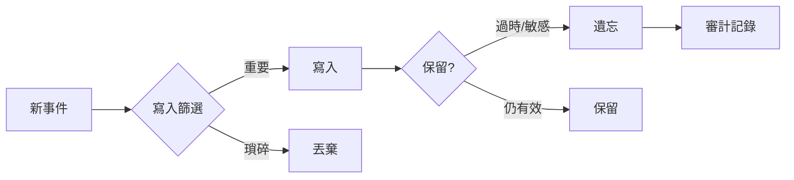
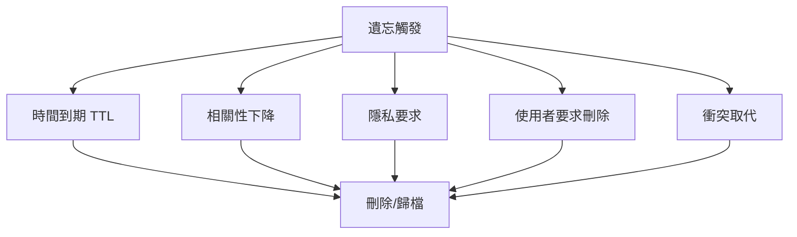
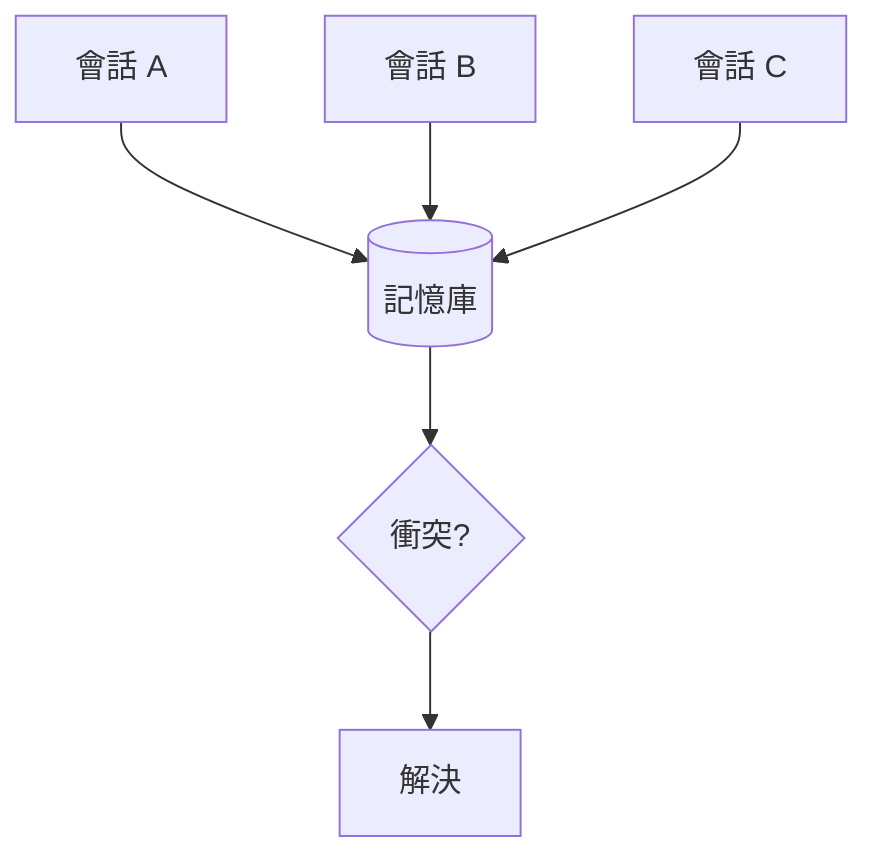
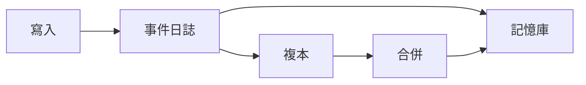

# 8.3 記憶寫入篩選、遺忘機制與跨工作階段一致性

## 記憶不是「什麼都存」

一個常見錯誤：把所有對話、所有事件都寫入長期記憶。結果是：
- **儲存爆炸**：成本與延遲上升。
- **檢索雜訊**：重要記憶被淹沒。
- **隱私風險**：敏感資料被永久保存。
- **衝突累積**：過時資訊誤導。

**記憶治理的核心問題**：什麼該記、什麼該忘、如何保持一致。



## 寫入篩選：什麼值得記

### 篩選維度

| 維度 | 問題 | 例子 |
|---|---|---|
| **重要性** | 對未來有用嗎？ | 偏好 vs. 寒暄 |
| **新穎性** | 是否已知？ | 新事實 vs. 重複 |
| **持久性** | 會持續有效嗎？ | 長期偏好 vs. 一次性 |
| **可靠性** | 來源可信嗎？ | 使用者明說 vs. 模型推測 |
| **敏感性** | 可否保存？ | 一般資料 vs. PII/密鑰 |

### 重要性評分

可以用模型或規則打分：

$$
\text{keep} \iff \; w_1 \cdot \text{importance} + w_2 \cdot \text{novelty} + w_3 \cdot \text{persistence} > \tau
$$

```python
async def should_write(event):
    score = await llm.evaluate(
        event,
        criteria=["future_usefulness", "novelty", "persistence"],
    )
    return score.total > 0.7
```

### 明確的寫入觸發

除了模型判斷，也可用規則：

| 觸發 | 寫入內容 |
|---|---|
| 使用者陳述偏好 | 語意記憶（偏好） |
| 任務完成 | 情節記憶（結果） |
| 重複成功的流程 | 程序記憶（技能） |
| 使用者糾正 | 更新語意記憶 |
| 明確要求「記住」 | 直接寫入 |

```text
使用者：記住我以後都要靠窗座位。
→ 觸發語意記憶寫入：user.prefers = window_seat
```

### 不要寫入的內容

- 寒暄、無意義的確認（「好的」「謝謝」）。
- 模型的猜測（除非驗證）。
- 敏感憑證（密碼、API key）。
- 短期狀態（當前購物車）——這些放中期記憶。

## 記憶的結構化寫入

寫入時就結構化，比事後解析好：

```json
{
  "type": "semantic",
  "subject": "user:u456",
  "predicate": "dietary_restriction",
  "object": "vegetarian",
  "confidence": 0.95,
  "source": "explicit_statement",
  "timestamp": "2026-02-20T14:30:00Z"
}
```

**來源（source）** 很重要：明確陳述 > 推測。推測的記憶信心低，容易被覆蓋。

## 去重與合併

相同事實重複寫入會浪費空間且造成衝突。寫入前查重：

```python
existing = await memory.search(subject=subj, predicate=pred)
if existing:
    if existing.object == new.object:
        existing.confidence = max(existing.confidence, new.confidence)
        existing.last_seen = now
    else:
        await resolve_conflict(existing, new)
```

### 衝突解決策略

| 策略 | 說明 |
|---|---|
| 時間優先 | 新者勝（適合偏好變化） |
| 信心優先 | 高信心勝（適合推測 vs. 明確） |
| 來源優先 | 明確陳述 > 推測 |
| 保留多重 | 記錄版本歷史（適合需追溯） |

```json
{
  "predicate": "city",
  "history": [
    {"object": "台北", "until": "2026-01"},
    {"object": "東京", "since": "2026-02", "source": "explicit"}
  ],
  "current": "東京"
}
```

## 遺忘機制：什麼該忘

遺忘不是失敗，而是**記憶健康的必要功能**。人類會遺忘，Agent 也該。



### 1. 時間衰減（TTL / Decay）

記憶的相關性隨時間下降：

$$
\text{weight}(m, t) = \text{weight}_0 \cdot e^{-\lambda (t - t_0)}
$$

低於閾值則歸檔或刪除。

```python
if memory.weight * exp(-decay * age_days) < 0.1:
    await archive(memory)
```

不同類型有不同半衰期：
- 一次性事件：短（天）。
- 偏好：長（月/年）。
- 核心事實：永久。

### 2. 相關性淘汰

記憶庫滿時，淘汰最少使用的（LRU）或最不相關的：

$$
\text{evict} = \arg\min_m \; \text{score}(m)
$$

score 可綜合：最近使用、使用頻率、重要性。

### 3. 隱私與法規（Right to be Forgotten）

- 使用者要求刪除：必須真刪（含備份）。
- 敏感資料：不寫入或加密。
- 資料保留期限：依政策自動清除。

```python
async def forget(user_id, predicate=None):
    # 硬刪除，並記錄審計
    await db.delete(type="semantic", subject=f"user:{user_id}", predicate=predicate)
    await audit.log("forget", user_id, predicate)
```

### 4. 衝突取代

新事實取代舊事實時，舊的標記為 `superseded` 而非直接刪（保留審計）：

```json
{"object": "台北", "status": "superseded", "superseded_by": "m_002"}
```

## 跨工作階段一致性

Agent 在多個會話、多個實例間運作，記憶必須一致。

### 挑戰



- **併發寫入**：兩個會話同時更新同一記憶。
- **快取不一致**：不同實例讀到不同版本。
- **延遲傳播**：寫入後其他實例未即時看到。

### 解法

1. **單一真相來源（Single Source of Truth）**：所有讀寫經同一服務。
2. **版本號 / 樂觀鎖**：

```python
async def update(memory_id, new_value, expected_version):
    current = await db.get(memory_id)
    if current.version != expected_version:
        raise Conflict()
    await db.update(memory_id, new_value, version=expected_version + 1)
```

3. **事件溯源（Event Sourcing）**：記錄所有變更事件，可重建狀態。
4. **最終一致 + 衝突解決**：允許暫時不一致，用 CRDT 或時間戳合併。



## 記憶治理的監控

| 指標 | 說明 |
|---|---|
| 寫入率 | 每會話寫入多少記憶 |
| 命中率 | 檢索到的記憶有多少被使用 |
| 衝突率 | 衝突發生頻率 |
| 遺忘量 | 刪除/歸檔數量 |
| 平均年齡 | 記憶的新鮮度 |

用這些指標調整篩選閾值與衰減率。

## 與後續章節的關聯

- **8.2 記憶類型**：本節治理三類記憶的生命週期。
- **9.3 上下文工程**：記憶如何被選入 context。
- **12.3 合規**：隱私與稽核。
- **11.2 評估**：記憶是否真的提升表現。

## 小結

1. 記憶不是什麼都存，需篩選：重要性、新穎性、持久性、可靠性、敏感性。
2. 結構化寫入 + 去重 + 衝突解決是品質基礎。
3. 遺忘是健康功能：TTL 衰減、相關性淘汰、隱私刪除、衝突取代。
4. 跨會話一致性靠單一真相源、版本鎖、事件溯源、最終一致。
5. 用監控指標調整治理策略。
