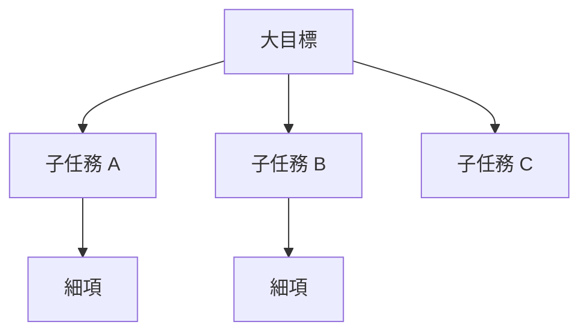
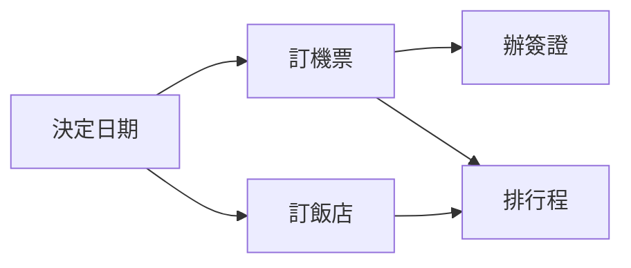
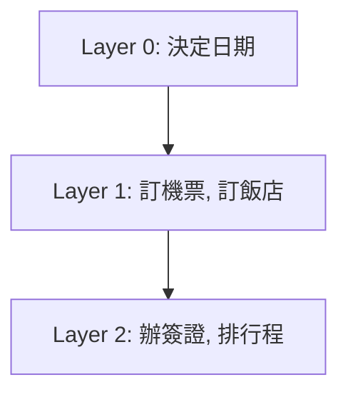
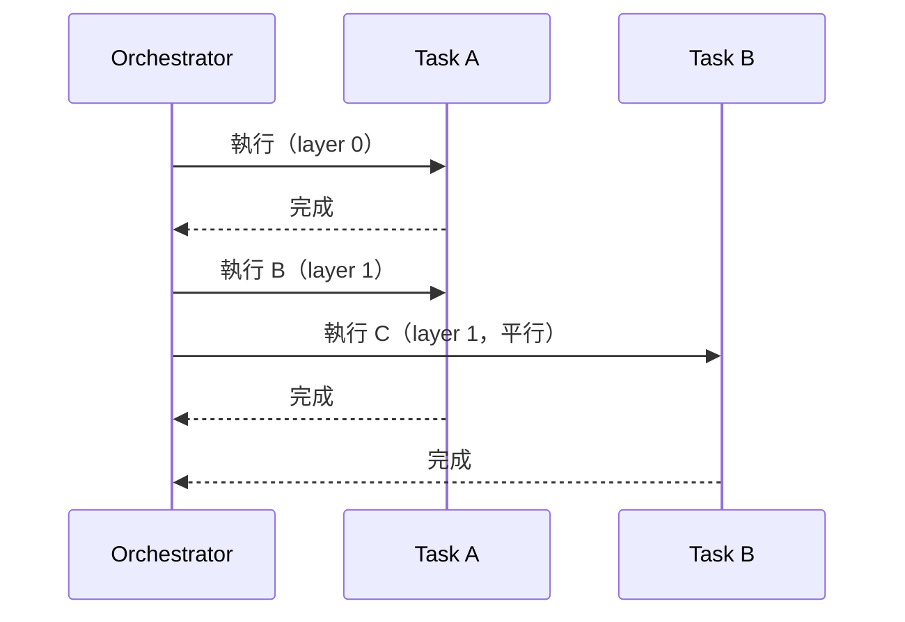
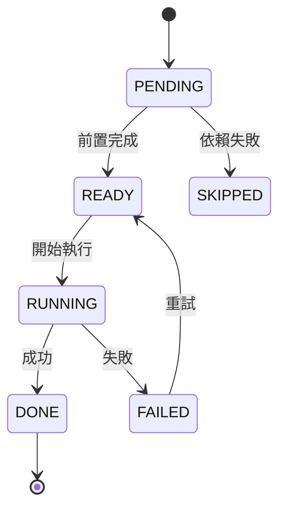
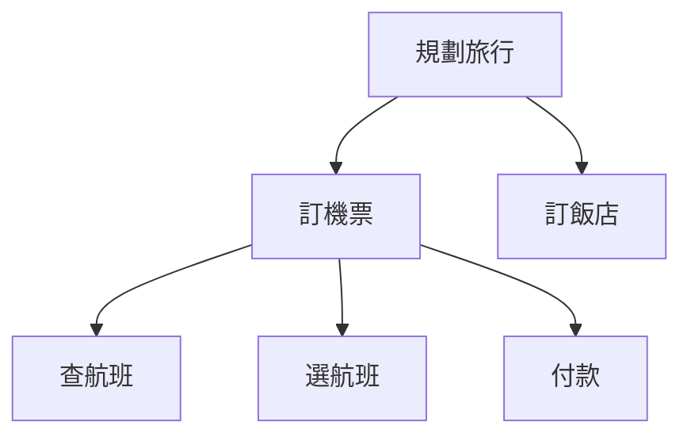

# 9.1 複雜目標拆解：DAG（有向無環圖）與子任務狀態追蹤

## 為什麼要拆解

單一 LLM 呼叫難以完成複雜任務（如「規劃一趟東京五日遊並訂好機票飯店」）。原因：

- **context 有限**：塞不下所有細節。
- **推理深度有限**：一次生成難以兼顧所有子問題。
- **錯誤累積**：單步錯誤拖垮全局。

**任務拆解（Task Decomposition）** 把大目標切成可管理的小任務，再組合成計畫。

$$
\text{goal} \;\Rightarrow\; \{t_1, t_2, \dots, t_n\} \;\Rightarrow\; \text{plan}
$$



## 為什麼用 DAG 而非線性清單

線性清單假設任務是**序列**的（做完 A 才做 B）。但多數任務有**依賴關係**，且部分可**平行**：

```
規劃東京行：
- 訂機票（無依賴）
- 訂飯店（需要日期，日期來自機票決策）
- 辦簽證（需要機票證明）
- 排行程（需要飯店位置）
```

用 **DAG（Directed Acyclic Graph，有向無環圖）** 表達：



- **節點**：子任務。
- **邊**：依賴（A → B 表示 B 需要 A 的結果）。
- **無環**：不能有循環依賴（否則永遠無法開始）。

### 為什麼必須無環

若存在循環 $`A \to B \to A`$，則兩個任務互為前提，永遠無法執行。無環保證存在拓撲排序（執行順序）。

$$
\text{DAG} \Rightarrow \exists \text{ topological order } \sigma: (u \to v) \Rightarrow \sigma(u) < \sigma(v)
$$

## DAG 的形式化

$$
G = (V, E), \quad V = \{t_1, \dots, t_n\}, \quad E \subseteq V \times V
$$

- **前置條件**：$`\text{pred}(t) = \{u : (u,t) \in E\}`$
- **可執行**：所有前置都完成 $`\text{pred}(t) \subseteq \text{done}`$
- **平行層級**：同一層的可執行任務可並行



## 拓撲排序與執行

用 Kahn 演算法求執行順序：

```python
from collections import deque

def topo_sort(graph):
    indeg = {v: 0 for v in graph}
    for u in graph:
        for v in graph[u]:
            indeg[v] += 1
    q = deque([v for v in graph if indeg[v] == 0])
    order = []
    while q:
        u = q.popleft()
        order.append(u)
        for v in graph[u]:
            indeg[v] -= 1
            if indeg[v] == 0:
                q.append(v)
    if len(order) != len(graph):
        raise CycleError()
    return order
```

### 平行執行

找出「所有前置都完成」的節點，並行執行：

```python
async def execute_dag(graph, executor):
    done = set()
    results = {}
    while len(done) < len(graph):
        ready = [
            t for t in graph
            if t not in done and all(p in done for p in pred(graph, t))
        ]
        if not ready:
            return results  # 卡住（可能有環或缺資源）
        batch = await asyncio.gather(*[executor(t, results) for t in ready])
        for t, r in zip(ready, batch):
            results[t] = r
            done.add(t)
    return results
```



## 子任務狀態追蹤

每個節點需要狀態：

```python
from enum import Enum

class Status(Enum):
    PENDING = "pending"
    READY = "ready"
    RUNNING = "running"
    DONE = "done"
    FAILED = "failed"
    SKIPPED = "skipped"
```

```json
{
  "id": "book_flight",
  "status": "running",
  "depends_on": ["decide_dates"],
  "attempts": 1,
  "result": null,
  "error": null,
  "started_at": "...",
  "outputs": {}
}
```

### 狀態機



### 依賴失敗的傳播

若某節點失敗，其下游全部無法執行，標記為 `skipped`：

$$
\text{failed}(u) \Rightarrow \forall v \text{ reachable from } u: \text{skipped}(v)
$$

```python
def propagate_failure(graph, failed_node):
    for v in descendants(graph, failed_node):
        if status[v] == Status.PENDING:
            status[v] = Status.SKIPPED
```

## 動態 DAG：執行中調整

計畫趕不上變化。執行中可能需要：
- **新增節點**：發現新子任務。
- **修改依賴**：發現順序錯。
- **刪除節點**：不再需要。

這叫**動態 DAG**：圖在執行中可變。要確保變更後仍無環。

```python
def add_edge(graph, u, v):
    graph[u].add(v)
    if has_cycle(graph):
        graph[u].remove(v)
        raise CycleError("would create cycle")
```

## 拆解的方法

### 1. 由 LLM 直接生成

```json
{
  "tasks": [
    {"id": "t1", "desc": "確認旅遊日期", "deps": []},
    {"id": "t2", "desc": "搜尋並預訂機票", "deps": ["t1"]},
    {"id": "t3", "desc": "依機票日期訂飯店", "deps": ["t2"]},
    {"id": "t4", "desc": "安排每日行程", "deps": ["t2", "t3"]}
  ]
}
```

### 2. 遞迴拆解

大任務拆成子任務，子任務再拆，直到可執行：



### 3. 模板 + 參數化

常見任務用預定義 DAG 模板，填空即可：

```yaml
template: trip_planning
params: [origin, destination, dates, budget]
```

## DAG 的視覺化與除錯

把 DAG 畫出來（Mermaid / Graphviz），能快速看出：
- 哪些平行。
- 哪個是關鍵路徑（最長路徑，決定總時間）。
- 哪裡卡住。

$$
\text{critical path} = \max_{\text{paths}} \sum_{t \in \text{path}} \text{duration}(t)
$$

## 與後續章節的關聯

- **7.2 Plan-and-Execute**：DAG 是 Plan 的具體形式。
- **9.2 失敗診斷**：節點失敗後的修正。
- **9.3 上下文工程**：每個子任務的最小 context。
- **10.2 多 Agent**：DAG 節點可分配給不同 Agent。

## 小結

1. 複雜目標需拆解，否則 context、推理、錯誤都失控。
2. DAG 表達依賴與平行，必須無環以保證可執行。
3. 拓撲排序決定順序，同層可平行。
4. 子任務用狀態機追蹤，失敗向下游傳播 skipped。
5. 動態 DAG 允許執行中調整，但要維持無環。
6. 關鍵路徑決定總時間，視覺化助於除錯。
