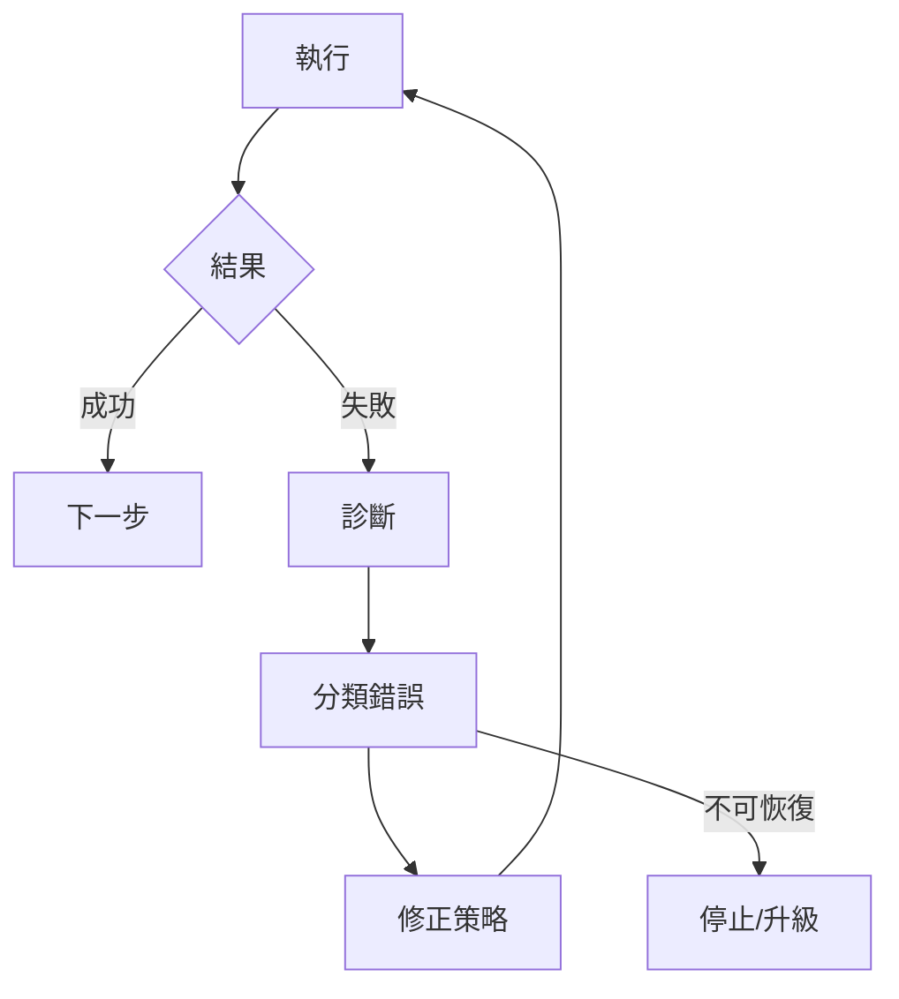
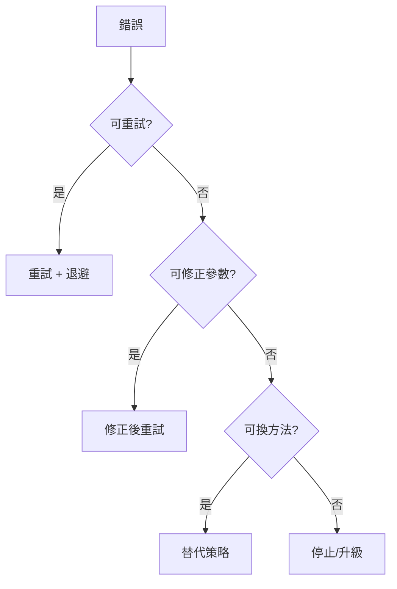
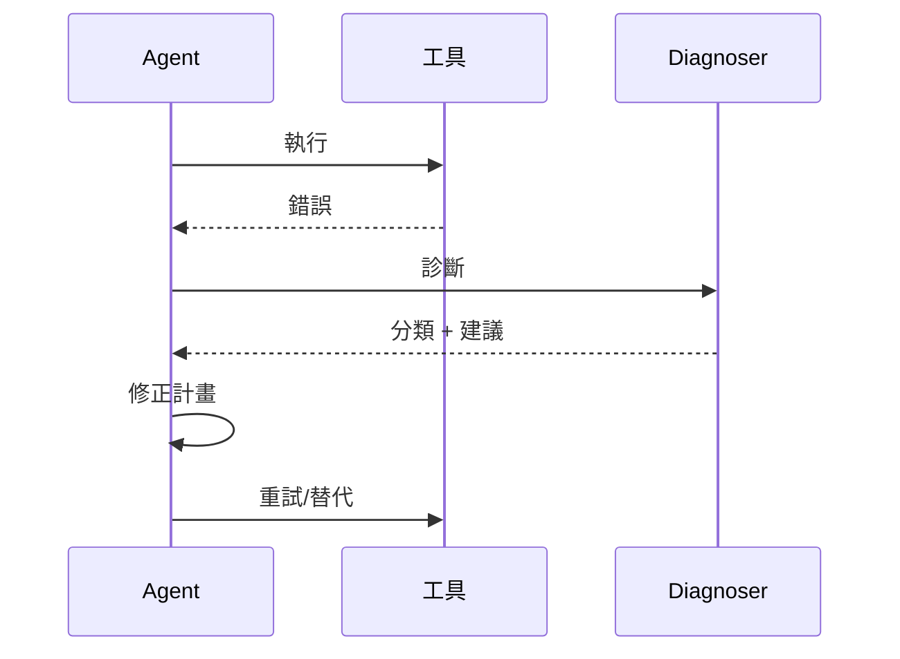

# 9.2 執行失敗診斷：從錯誤堆疊與工具輸出中動態修正計畫

## 失敗是常態，不是例外

在真實環境，Agent 的每一步都可能失敗：工具逾時、參數錯誤、權限拒絕、結果不符預期。**能跑的 Agent 不是不出錯，而是能從錯誤中恢復**。本節談如何診斷失敗並動態修正計畫。



## 錯誤的來源分類

| 層次 | 來源 | 例子 |
|---|---|---|
| **模型層** | 推理錯誤 | 選錯工具、參數錯、幻覺 |
| **工具層** | 執行錯誤 | 逾時、500、參數驗證失敗 |
| **環境層** | 外部狀態 | 網路斷、API 變更、資源耗盡 |
| **計畫層** | 拆解錯誤 | 依賴錯、任務不可行 |
| **規格層** | 需求不明 | 使用者意圖模糊 |

診斷的第一步是**定位層次**，因為不同層次要用不同方法修。

## 從錯誤訊息中提取訊號

工具回傳的錯誤要結構化，讓模型能理解：

```json
{
  "ok": false,
  "error": {
    "code": "INVALID_ARGUMENT",
    "field": "date",
    "message": "日期格式錯誤：'2026/3/1'，應為 YYYY-MM-DD",
    "retryable": false,
    "suggestion": "將 '2026/3/1' 改為 '2026-03-01'"
  }
}
```

反例（對模型無用的錯誤）：

```text
Traceback (most recent call last):
  File "...", line 42, in ...
ValueError: invalid literal for int() ...
```

**關鍵原則**：錯誤訊息是給「模型」讀的，不是給「開發者」讀的。要包含：
- 什麼錯了（code）。
- 在哪裡錯（field/step）。
- 可不可以重試（retryable）。
- 怎麼修（suggestion）。

## 診斷的三個問題

面對失敗，Agent 應自問：

### 1. 是暫時的還是永久的？



### 2. 是局部還是全局？

- **局部錯誤**：單一工具參數錯，修參數即可。
- **全局錯誤**：計畫本身錯（如目的地搞錯），需重規劃。

### 3. 還剩多少資源？

若剩餘步數/預算不多，應傾向「停止並回報」而非「繼續嘗試」。

$$
\text{retry} \iff \text{retryable} \;\wedge\; \text{budget\_left} > \text{cost}(\text{retry})
$$

## 動態修正計畫

### 修正層級


從最輕量的修正開始，逐步升級：

1. **參數修正**：同工具，改參數。
2. **步驟替換**：換一個能達成同目標的工具/方法。
3. **子計畫重排**：調整 DAG 的依賴或順序。
4. **全局重規劃**：放棄原計畫，重新拆解。

```python
async def recover(error, plan, context):
    if error.retryable:
        return Retry(same_action)
    if error.fixable:
        return Retry(fix_args(error.suggestion))
    alt = await find_alternative(error, plan)
    if alt:
        return Replace(alt)
    return Replan(plan, error)
```

## 從工具輸出中學習

工具輸出不只是「成功/失敗」，還可能包含**修正線索**：

### 1. 模糊匹配建議

```json
{"error": "NOT_FOUND", "query": "台北市", "did_you_mean": ["Taipei", "台北"]}
```

### 2. 部分成功

```json
{"ok": true, "processed": 8, "failed": [{"id": 9, "reason": "invalid"}]}
```

Agent 應處理部分失敗，而非當成全成功。

### 3. 狀態變化

工具可能改變環境，後續步驟需重新感知：

```text
工具回傳：訂單狀態已變更為 "shipped"
→ Agent 應更新狀態，後續不能執行 "cancel"
```

## 失敗診斷的 prompt 設計

給模型一個診斷框架：

```text
當工具或步驟失敗時，依序分析：
1. 錯誤類型（暫時/永久/參數/權限/依賴）
2. 是否能重試（看 retryable 與剩餘預算）
3. 是否有替代方法（其他工具/參數/來源）
4. 是否需要重規劃
5. 若都不行，向使用者說明並請求協助

不要盲目重試相同動作超過 2 次。
```

## 自我除錯的迴圈



## 失敗的可觀測性

每次失敗都應記錄（見 11.1）：

```json
{
  "span_id": "step_3",
  "action": "book_flight",
  "error": {"code": "TIMEOUT", "retryable": true},
  "diagnosis": "transient",
  "recovery": "retry_with_backoff",
  "attempt": 2,
  "latency_ms": 5000
}
```

這些記錄是改進 prompt、工具、計畫的原料。

## 常見失敗與修正對照

| 症狀 | 診斷 | 修正 |
|---|---|---|
| 工具一直逾時 | 暫時性 | 重試 + 退避 + 備援 |
| 參數格式錯 | 規格不明 | 改進 schema/描述 |
| 選錯工具 | 描述混淆 | 改進工具描述 |
| 結果不符預期 | 計畫錯 | 重規劃 |
| 權限拒絕 | 權限不足 | 升級/審批 |
| 重複同一動作 | 未察覺失敗 | 去重 + 反思 |
| 依賴未滿足 | DAG 錯 | 重排依賴 |

## 與後續章節的關聯

- **4.3 重試與回退**：暫時性錯誤的處理。
- **7.2 Reflexion**：跨嘗試的反思學習。
- **7.3 終止條件**：避免無窮重試。
- **11.3 失敗模式**：系統化分析。

## 小結

1. 失敗是常態，Agent 的價值在於恢復能力。
2. 錯誤分模型/工具/環境/計畫/規格層，需先定位。
3. 錯誤訊息要為模型設計：code、field、retryable、suggestion。
4. 診斷三問：暫時或永久、局部或全局、資源夠不夠。
5. 修正由輕到重：參數 → 替代 → 重排 → 重規劃。
6. 失敗記錄是可觀測性與改進的原料。
