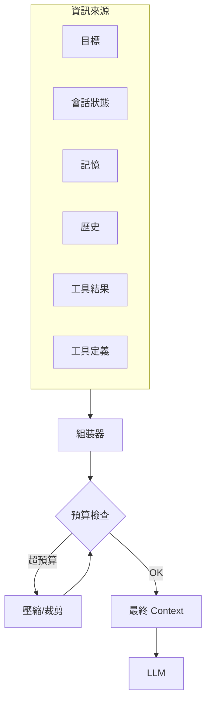
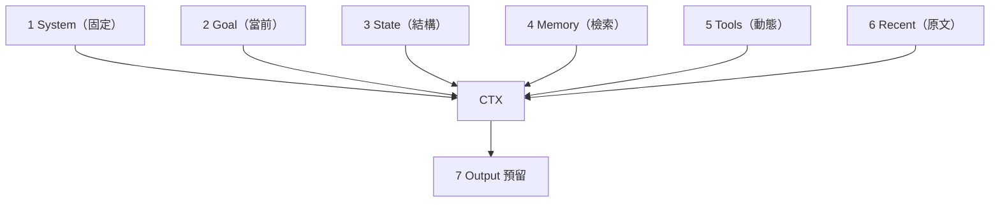
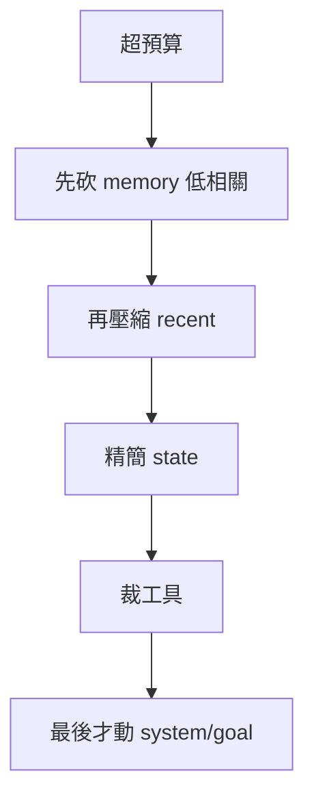
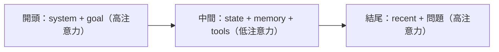

# 9.3 上下文工程（Context Engineering）：動態組裝每一輪的最小且足夠資訊

## 從「提示工程」到「上下文工程」

2.1 談的提示工程是「寫好一段 prompt」。但 Agent 每一輪的 context 是動態變化的：新的工具結果、更新的狀態、相關的記憶、變化的目標。**上下文工程（Context Engineering）** 是更高層的學問：**在每一輪，動態組裝出「最小且足夠」的 context**。

$$
\text{context}_t = \text{assemble}\big(\text{goal}, \text{state}_t, \text{memory}_{t}, \text{tools}_t, \text{history}_t\big)
$$

目標不是「塞越多越好」，而是「剛好夠用」——這同時優化正確性、成本與延遲。



## 為什麼「越多越糟」

更多 context 看似提供更多資訊，但實際上有害：

1. **Lost in the Middle**：模型對長 context 中間的資訊注意力下降（U 形注意力）。
2. **雜訊干擾**：無關資訊稀釋關鍵訊號。
3. **成本與延遲**：prefill 隨長度增長。
4. **衝突**：過時或矛盾資訊造成混淆。

$$
\text{quality}(c) \not\propto |c|, \quad \text{quality} \text{ peaks at } |c| \approx \text{sufficient}
$$

「Lost in the Middle」是關鍵發現：模型對 context 開頭與結尾的資訊利用最好，中間最差。因此**排序**和**精簡**同樣重要。

## 組裝的六個區塊

一個結構良好的 Agent context：

```text
[1] System: 角色、規則、輸出契約
[2] Goal: 當前任務與子目標
[3] State: 結構化會話狀態
[4] Memory: 相關的長期記憶（檢索）
[5] Tools: 工具定義（可能動態）
[6] Recent: 最近幾輪對話/工具結果
---
[7] Output 預留空間
```



## 區塊一：System（穩定前綴）

- 角色、硬規則、輸出格式。
- **放最前面且穩定**，以利 prompt caching（3.3）。
- 不要放動態資料（時間、使用者名）。

## 區塊二：Goal（當前目標）

不只總目標，還有**當前子目標**：

```text
總目標：規劃東京五日遊
當前子目標：確認回程日期（已完成：訂機票）
```

這讓模型聚焦，避免「全局漂移」。

## 區塊三：State（結構化狀態）

來自 8.1 的會話狀態。只放**與當前子目標相關**的欄位：

```json
{
  "destination": "東京",
  "depart": "2026-03-01",
  "return": null,
  "budget": 15000
}
```

## 區塊四：Memory（檢索的長期記憶）

用當前情境檢索相關記憶（8.2），只注入 top-k 且相關的：

```text
<memory>
- 使用者偏好靠窗座位
- 上次東京行住新宿，滿意
</memory>
```

**不要注入全部記憶**，只注入相關的。

## 區塊五：Tools（動態工具）

工具定義佔大量 context（4.1）。動態載入策略：
- **階段性**：只暴露當前階段需要的工具。
- **相關性**：依意圖檢索工具。
- **子集**：工具多時，先用分類器選子集。

```python
def select_tools(intent, all_tools, max_tools=10):
    if len(all_tools) <= max_tools:
        return all_tools
    scored = [(t, relevance(intent, t)) for t in all_tools]
    return [t for t, s in sorted(scored, key=lambda x: -x[1])[:max_tools]]
```

## 區塊六：Recent（最近原文）

最近 $`k`$ 輪的原文，提供語氣、細節、連貫性。這是 3.1 滑動視窗的應用。

## 區塊七：Output（預留）

必須為輸出留空間，否則會被截斷（1.3）。

$$
\sum_i |\text{block}_i| + n_{\max} \le C_{\max}
$$

## 動態組裝的演算法

```python
def assemble_context(session, budget):
    ctx = []
    ctx.append(("system", session.system_prompt))        # 固定
    ctx.append(("goal", session.current_subgoal))        # 當前

    state = filter_relevant(session.state, session.subgoal)
    ctx.append(("state", state))

    mem = retrieve_memory(session.query, top_k=5)
    ctx.append(("memory", mem))

    tools = select_tools(session.intent, session.all_tools)
    ctx.append(("tools", tools))

    recent = session.history[-session.recent_k:]
    ctx.append(("recent", recent))

    # 預算裁剪
    return fit_budget(ctx, budget)
```

## 預算裁剪策略

當超預算，按優先級裁剪：



**永不裁剪**：system 規則、當前 goal、輸出空間。

```python
def fit_budget(blocks, budget):
    priority = {"system": 100, "goal": 90, "state": 70, "tools": 60, "recent": 50, "memory": 40}
    # 按優先級保留，直到預算用完
    kept = []
    used = 0
    for name, content in sorted(blocks, key=lambda b: -priority[b[0]]):
        size = count_tokens(content)
        if used + size <= budget:
            kept.append((name, content))
            used += size
        else:
            kept.append((name, truncate(content, budget - used)))
    return kept
```

## 排序的重要性

由於「Lost in the Middle」，關鍵資訊應放**開頭或結尾**：



把當前問題或最重要的指令放最後（緊鄰生成位置），效果最好。

## 上下文工程的評估

怎麼知道組裝得好不好？

| 指標 | 說明 |
|---|---|
| 任務成功率 | 端到端正確率 |
| token 效率 | 每 token 帶來的正確率 |
| 延遲 | prefill 時間 |
| 資訊利用率 | 注入的資訊有多少被使用 |

A/B 測試不同組裝策略（見 11.2）。

## 常見反模式

| 反模式 | 問題 |
|---|---|
| 塞入全部歷史 | 雜訊、成本、lost in middle |
| 全部工具常駐 | context 爆炸 |
| 注入全部記憶 | 不相關資訊干擾 |
| 動態內容放 system 前綴 | 破壞快取 |
| 無輸出預留 | 截斷 |
| 關鍵資訊放中間 | 被忽略 |

## 與後續章節的關聯

- **3.1 壓縮**：recent 區塊的管理。
- **3.3 快取**：穩定前綴。
- **8.x 記憶**：memory 區塊的來源。
- **11.2 評估**：組裝策略的效果。
- **16.x 形式化**：約束作為 context 的硬邊界。

## 小結

1. 上下文工程是每輪動態組裝「最小且足夠」的 context。
2. 更多不等於更好：lost in middle、雜訊、成本、衝突。
3. 七區塊：system、goal、state、memory、tools、recent、output。
4. 預算裁剪按優先級，永不裁剪規則、目標、輸出空間。
5. 關鍵資訊放開頭或結尾，避開中間。
6. 用任務成功率與 token 效率評估組裝策略。
