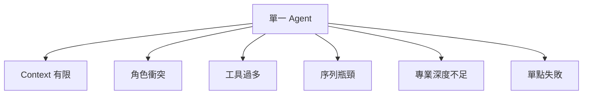
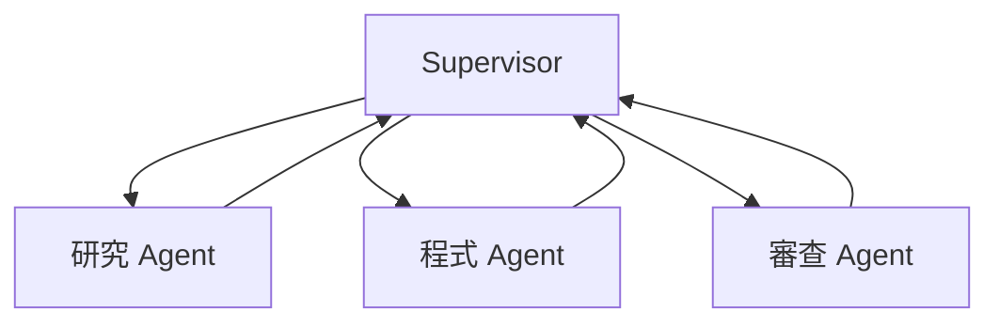
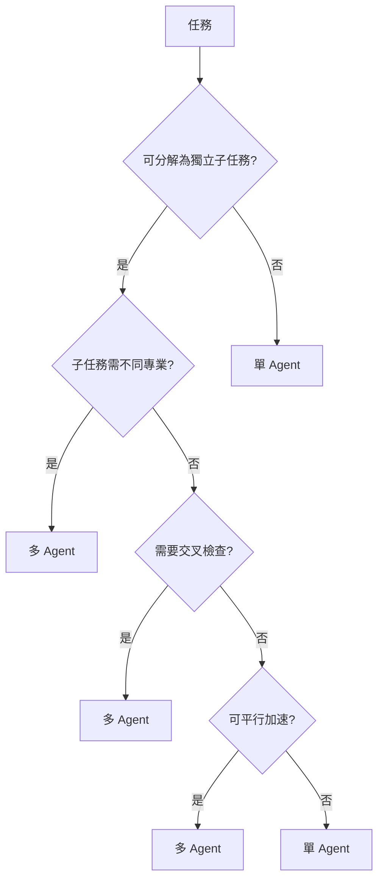

# 10.1 單一 Agent 的極限與多 Agent 的適用場景

## 單一 Agent 的限制

單一 Agent（第 7 章）能處理很多任務，但有其天花板：

### 1. Context 有限

一個 Agent 要同時裝下所有任務的歷史、狀態、工具。任務越複雜，context 越擠（1.2、9.3）。

### 2. 角色與目標衝突

一個 Agent 同時扮演「創意發想者」與「嚴格審查者」時，兩種目標會拉扯，導致兩邊都做不好。這就像要求一個人同時當作者與編輯，難以客觀。

### 3. 工具過多

工具越多，選擇越難、context 越貴（4.1）。不同任務需要不同工具集，混在一起造成干擾。

### 4. 序列瓶頸

單一 Agent 一次只能做一件事。可平行的子任務被迫串行，延遲高。

### 5. 專業深度不足

通用 Agent 的 prompt 難以同時精通程式、法律、醫療。專業任務需要深度特化的指令與知識。

### 6. 單點失敗

一個 Agent 的錯誤會污染整個軌跡，沒有獨立視角檢查。

## 多 Agent 的價值

多 Agent 把任務分給多個特化 Agent，各自專注、可平行、可互相檢查。

好處：

| 好處 | 說明 |
|---|---|
| 專業化 | 每個 Agent 專注一域，prompt 更深 |
| 隔離 | 各自的 context 不互相污染 |
| 平行 | 獨立任務同時執行 |
| 交叉檢查 | 審查 Agent 抓出執行 Agent 的錯 |
| 容錯 | 一個失敗不拖垮全部 |
| 可維護 | 模組化，易替換 |

## 多 Agent 的代價

多 Agent 不是免費的。它引入：

$$
\text{cost}_{\text{multi}} = \sum_i \text{cost}_i + \text{coordination overhead}
$$

### 1. 協調開銷（Coordination Overhead）

Agent 之間要通訊、同步、解決衝突。這本身就是成本，且隨 Agent 數量增長：

$$
\text{overhead} \sim O(n^2) \quad \text{（若兩兩通訊）}
$$

### 2. 錯誤放大

一個 Agent 的錯誤可能被其他 Agent 當成事實，層層放大。

### 3. 除錯困難

多個 Agent 的互動軌跡複雜，難以定位問題（見 11.1）。

### 4. 一致性

多個 Agent 可能做出矛盾決策，需要機制解決。

### 5. 延遲

通訊往返增加延遲，尤其串行依賴時。

## 何時該用多 Agent：判斷準則

### 適合多 Agent 的場景

1. **研究 + 撰寫 + 審查**：不同階段不同能力。
2. **軟體開發**：規劃、編碼、測試、審查分工。
3. **多來源資料整合**：不同 Agent 負責不同來源。
4. **對抗性任務**：辯論、紅隊測試。
5. **高可靠性需求**：多個 Agent 投票/交叉驗證。

### 不適合多 Agent 的場景

1. **簡單線性任務**：協調開銷 > 收益。
2. **強一致性需求**：多 Agent 難同步。
3. **即時低延遲**：通訊往返太慢。
4. **預算緊**：多 Agent 成本高。
5. **任務不可分解**：本質是單一推理。

## 「多 Agent」不等於「多模型」

多 Agent 可以是：
- 同一模型，不同 system prompt（最常見）。
- 不同模型（大模型規劃、小模型執行）。
- 不同工具集。

$$
\text{Agent}_i = (\text{model}_i, \text{prompt}_i, \text{tools}_i, \text{memory}_i)
$$

即使同一模型，不同 prompt 也能形成「角色分工」。

## 單 Agent 的強化：先榨乾再擴展

在引入多 Agent 前，先確認單 Agent 已優化：

- Context 工程（9.3）。
- 工具瘦身（4.1）。
- 記憶系統（第 8 章）。
- 更好的 prompt（2.1）。

很多「需要多 Agent」的問題，其實是「單 Agent 的 context 沒管好」。

## 成本效益分析

$$
\text{use multi} \iff \text{quality gain} \cdot \text{value} > \text{extra cost} + \text{complexity cost}
$$

實務經驗：多 Agent 在「任務可分解 + 需要專業化 + 品質敏感」時值得；在「簡單、延遲敏感、預算緊」時不值得。

## 與後續章節的關聯

- **10.2 拓撲結構**：多 Agent 如何組織。
- **10.3 通訊協定**：Agent 之間如何溝通。
- **11.1 追蹤**：多 Agent 的除錯。
- **12.2 成本**：多 Agent 的預算控制。

## 小結

1. 單 Agent 受限於 context、角色衝突、工具過多、序列瓶頸、專業深度、單點失敗。
2. 多 Agent 帶來專業化、隔離、平行、交叉檢查、容錯、可維護。
3. 代價是協調開銷、錯誤放大、除錯困難、一致性、延遲。
4. 適合可分解、需專業化、需交叉檢查、可平行的任務。
5. 先榨乾單 Agent 的優化，再考慮多 Agent。
6. 多 Agent 不等於多模型，prompt 分工即可。
