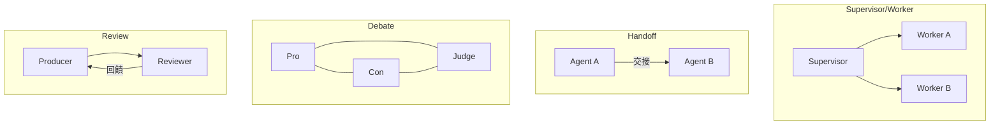
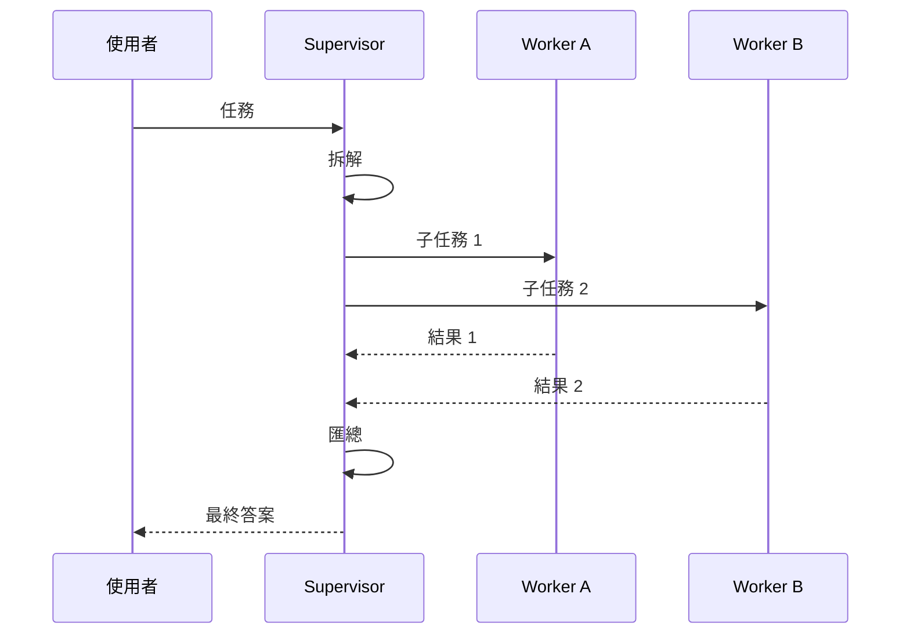
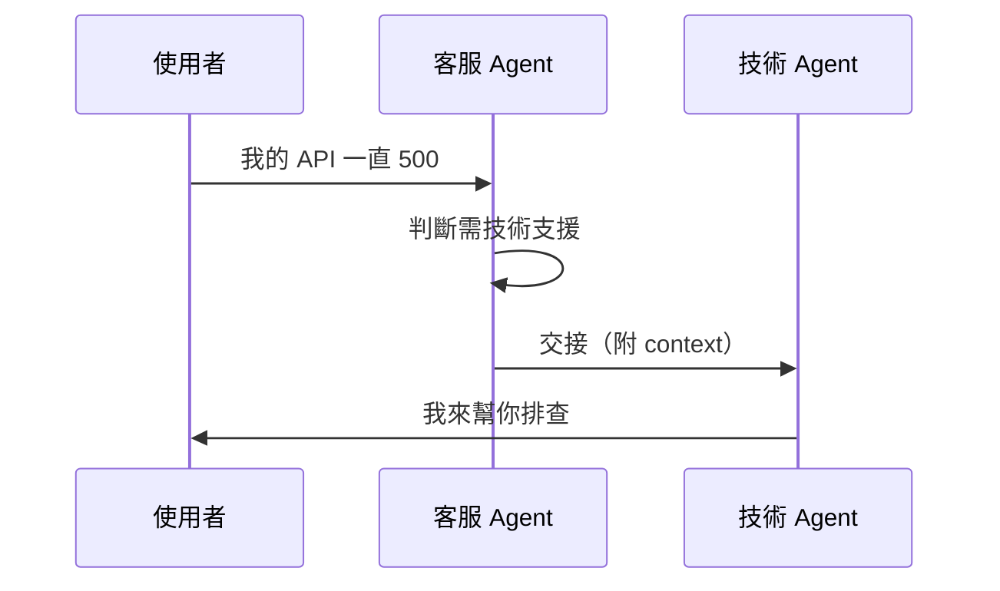
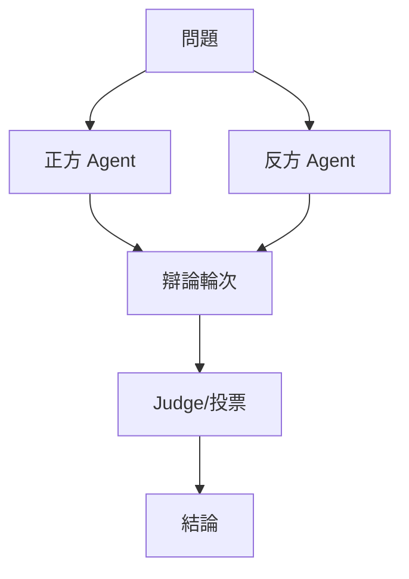
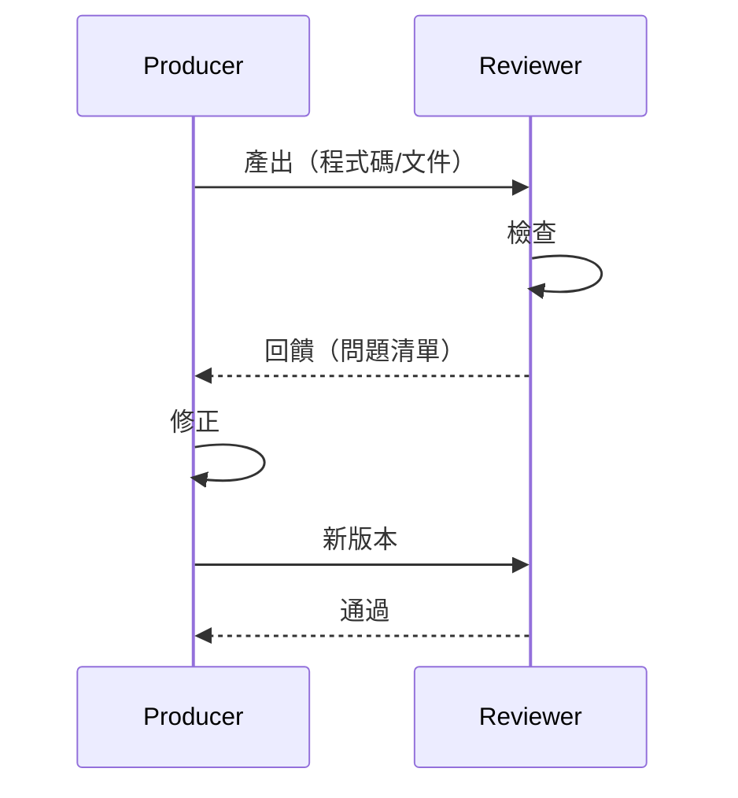
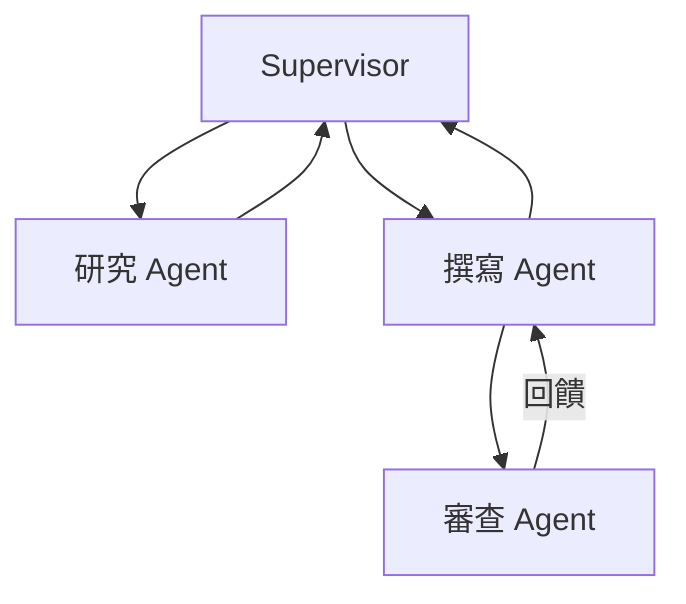

# 10.2 常見拓撲結構：主管-工作者（Supervisor/Worker）、交接（Handoff）、辯論與審查

## 拓撲決定協作方式

多 Agent 不是把一堆 Agent 丟在一起就會合作。需要一個**結構（拓撲）** 定義誰指揮誰、誰跟誰通訊、結果如何匯總。



## 拓撲一：Supervisor / Worker（主管—工作者）

### 結構

一個主管 Agent 負責拆解、分派、匯總；多個工作者 Agent 負責執行。



### 程式骨架

```python
class Supervisor:
    def __init__(self, workers):
        self.workers = workers

    async def run(self, task):
        subtasks = await self.plan(task)
        results = await asyncio.gather(*[
            self.dispatch(st, assignee=st.assignee) for st in subtasks
        ])
        return await self.synthesize(task, subtasks, results)
```

### 優點

- **集中控制**：主管掌握全局，易協調。
- **可平行**：工作者可同時執行。
- **模組化**：工作者可替換。

### 缺點

- **主管瓶頸**：所有決策經主管，主管能力上限即系統上限。
- **單點失敗**：主管錯則全錯。
- **context 壓力**：主管要匯總所有結果。

### 適用

- 任務可清楚拆解。
- 工作者同質或異質皆可。
- 需要集中決策。

## 拓撲二：Handoff（交接）

### 結構

一個 Agent 把對話/任務**移交**給另一個 Agent，後者接手。



### Handoff 的關鍵

1. **交接 context**：不是丟掉歷史，而是傳遞摘要 + 關鍵狀態。
2. **明確的觸發**：什麼情況下該交接（如超出能力、需要特定權限）。
3. **避免踢皮球**：交接要有次數上限，否則 A→B→A 循環。

```python
async def handle(msg, current_agent, max_handoffs=3):
    for _ in range(max_handoffs):
        result = await current_agent.process(msg)
        if result.type == "handoff":
            msg = result.context
            current_agent = result.target
            continue
        return result
    return escalation("too_many_handoffs")
```

### 優點

- **專業分工**：每個 Agent 處理擅長的。
- **自然對話流**：像真人轉接。
- **低耦合**：Agent 之間不需共享全部狀態。

### 缺點

- **context 遺失**：交接時可能漏資訊。
- **循環風險**：互相推諉。
- **使用者體驗**：頻繁轉接會困惑。

### 適用

- 客服路由。
- 多領域助手（技術/帳務/一般）。
- 需要不同權限的場景。

## 拓撲三：Debate（辯論）

### 結構

多個 Agent 從不同立場論證，由裁判（或投票）決定結論。



### 為什麼有效

不同視角能暴露盲點。辯論迫使每個 Agent 為自己的主張找證據，降低單一視角的偏誤。

$$
\text{answer} = \arg\max_{a} \sum_{i} \mathbb{1}[\text{agent}_i \text{ supports } a]
$$

### 程式骨架

```python
async def debate(question, rounds=3):
    pro = Agent("pro", "為以下主張辯護並找證據")
    con = Agent("con", "反駁以下主張並找反例")
    history = []
    for _ in range(rounds):
        p = await pro.argue(question, history)
        c = await con.argue(question, history + [p])
        history += [p, c]
    return await judge(question, history)
```

### 優點

- **減少偏誤**：多視角。
- **提升推理**：互相挑戰。
- **可解釋**：保留論證過程。

### 缺點

- **成本高**：多輪多 Agent。
- **可能收斂到錯誤共識**：若裁判有偏。
- **不適合事實查詢**：辯論不產生新事實。

### 適用

- 有爭議的判斷。
- 需要高可靠性的決策。
- 紅隊/安全審查。

## 拓撲四：Review（審查）

### 結構

生產者 Agent 產出，審查者 Agent 檢查並回饋，迭代直到通過。



### 關鍵

- **明確的審查標準**：否則審查者隨意挑毛病。
- **回饋要可執行**：指出具體問題與建議。
- **迭代上限**：避免無限修改。

```python
async def review_loop(producer, reviewer, max_rounds=3):
    artifact = await producer.create()
    for _ in range(max_rounds):
        critique = await reviewer.review(artifact)
        if critique.approved:
            return artifact
        artifact = await producer.revise(artifact, critique)
    return artifact  # 帶未解決問題
```

### 優點

- **品質提升**：獨立視角抓錯。
- **符合標準**：可強制特定規範。
- **可審計**：保留審查記錄。

### 缺點

- **延遲**：多輪往返。
- **成本**：雙倍 Agent。
- **審查者偏誤**：審查者也可能錯。

### 適用

- 程式碼生成（生成 + 測試/審查）。
- 文件撰寫（寫 + 編）。
- 合規檢查。

## 拓撲比較

| 拓撲 | 控制 | 平行 | 成本 | 適用 |
|---|---|---|---|---|
| Supervisor/Worker | 集中 | 高 | 中 | 可拆解任務 |
| Handoff | 分散 | 低 | 低 | 專業路由 |
| Debate | 分散 | 高 | 高 | 爭議判斷 |
| Review | 序列 | 低 | 中 | 品質敏感 |

## 混合拓撲

實務常混合：



主管分派，撰寫與審查形成 review 迴圈。

## 與後續章節的關聯

- **10.3 通訊協定**：拓撲中的訊息格式。
- **11.1 追蹤**：跨 Agent 的軌跡。
- **12.3 治理**：多 Agent 的稽核。

## 小結

1. 拓撲定義協作結構，決定控制、平行、成本。
2. Supervisor/Worker 集中控制、可平行，但主管是瓶頸。
3. Handoff 專業路由、低耦合，但怕 context 遺失與循環。
4. Debate 多視角降偏誤，但成本高、不產新事實。
5. Review 提升品質，需明確標準與迭代上限。
6. 實務常混合多種拓撲。
