# 10.3 Agent 間通訊協定、共用狀態與避免協調開銷爆炸

## Agent 之間如何「說話」

多 Agent 系統的核心挑戰：Agent 之間如何傳遞資訊、如何共享狀態、如何避免混亂。這需要**通訊協定（Protocol）** 與**共用狀態（Shared State）** 的設計。

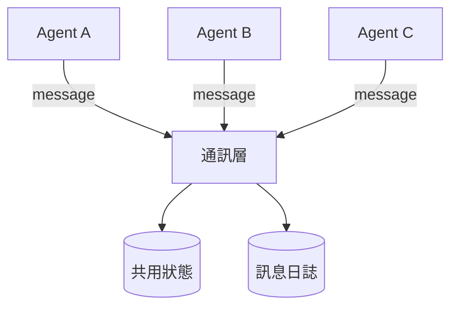

## 訊息格式：結構化勝於自然語言

Agent 間訊息應結構化，避免自然語言的歧義：

```json
{
  "id": "msg_001",
  "from": "supervisor",
  "to": "research_agent",
  "type": "task",
  "correlation_id": "task_42",
  "payload": {
    "instruction": "查詢 2025 年台灣 AI 市場規模",
    "constraints": {"source": "official", "max_age_days": 365}
  },
  "timestamp": "2026-03-01T10:00:00Z"
}
```

### 訊息類型

| 類型 | 用途 |
|---|---|
| `task` | 分派任務 |
| `result` | 回傳結果 |
| `query` | 請求資訊 |
| `handoff` | 交接 |
| `error` | 錯誤通知 |
| `control` | 中止/暫停/恢復 |

### 為什麼要 correlation_id

一個任務可能產生多輪訊息。`correlation_id` 把相關訊息串起來，便於追蹤與除錯（11.1）。

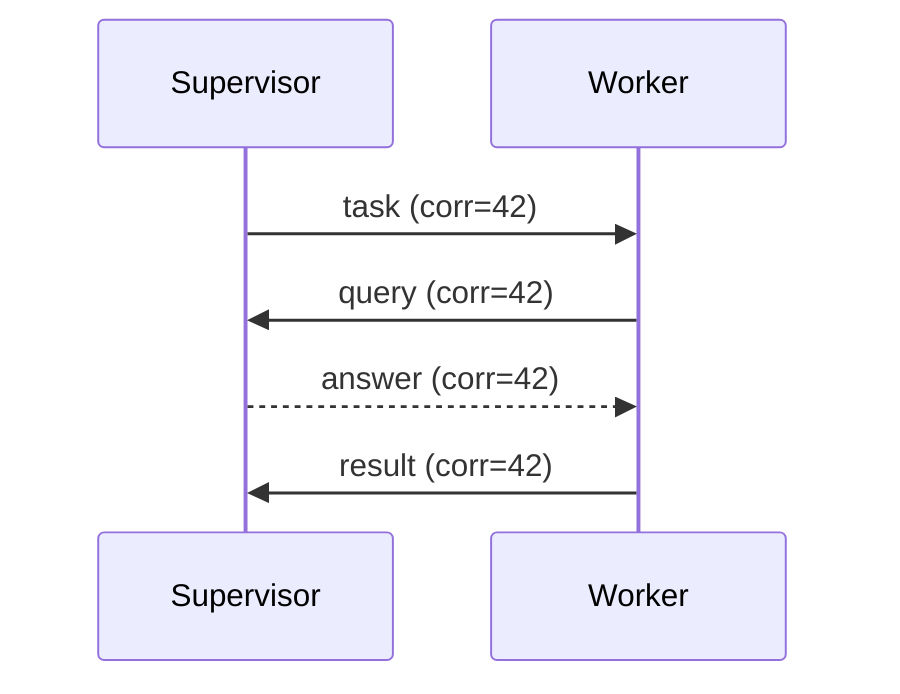

## 通訊模式

### 1. 請求—回應（Request-Response）

同步：發送者等待回應。

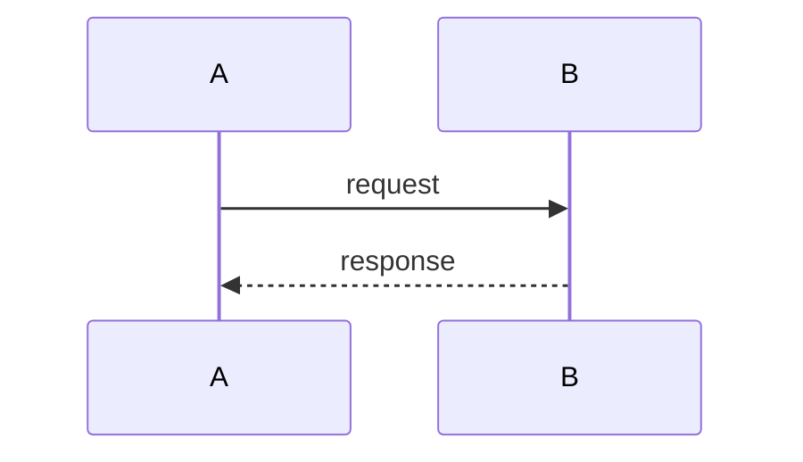

適合簡單依賴。缺點：阻塞。

### 2. 發布—訂閱（Pub/Sub）

Agent 發布事件，感興趣的訂閱。

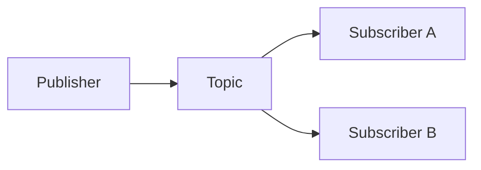

適合廣播、鬆耦合。缺點：難以保證順序。

### 3. 訊息佇列（Queue）

任務放入佇列，工作者取出執行。

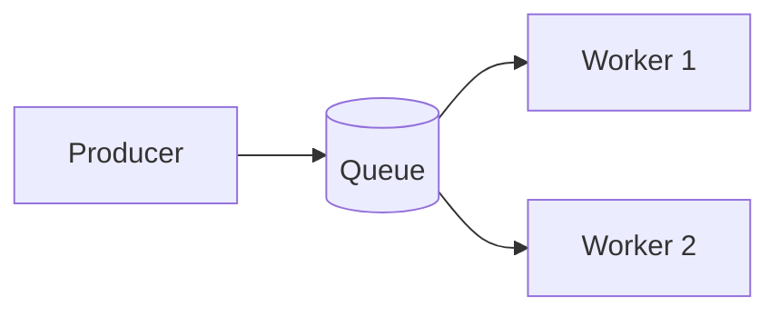

適合任務分配、負載平衡（12.1）。

### 4. 黑板（Blackboard）

所有 Agent 讀寫同一個共用空間。

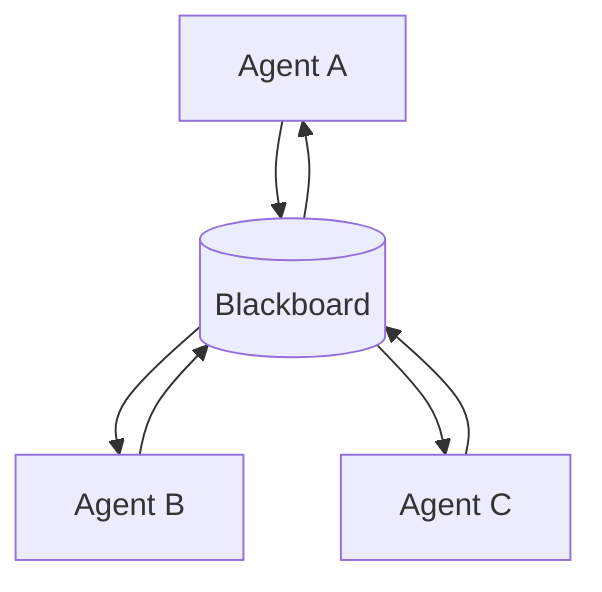

適合協作解決問題。

## 共用狀態設計

### 1. 集中式狀態

所有 Agent 讀寫同一個狀態存儲：

```json
{
  "task_id": "42",
  "status": "in_progress",
  "artifacts": {
    "research": {"done": true, "content": "..."},
    "draft": {"done": false}
  },
  "messages": [...]
}
```

**優點**：單一真相、易追蹤。
**缺點**：併發衝突、鎖競爭。

### 2. 分散式狀態 + 同步

每個 Agent 有本地狀態，定期同步。

**優點**：低延遲、可擴展。
**缺點**：一致性難。

### 3. 事件溯源

記錄所有狀態變更事件，狀態由事件重建：

```json
{"event": "artifact_created", "task": "42", "name": "research", "by": "agent_a"}
{"event": "artifact_updated", "task": "42", "name": "research", "by": "agent_a"}
```

**優點**：可審計、可重放、易除錯。
**缺點**：儲存量大、重建慢。

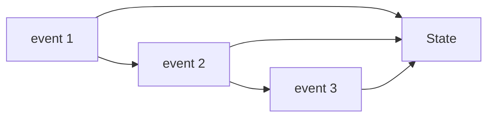

## 併發控制

多 Agent 同時寫共用狀態會衝突。解法：

### 1. 樂觀鎖（Optimistic Locking）

讀取時記版本，寫入時檢查版本：

```python
async def update(key, value, version):
    current = await store.get(key)
    if current.version != version:
        raise Conflict()
    await store.put(key, value, version + 1)
```

### 2. 悲觀鎖（Pessimistic Locking）

寫入前先取得鎖：

```python
async with store.lock(key):
    value = await store.get(key)
    await store.put(key, modify(value))
```

### 3. 分區（Partitioning）

不同 Agent 寫不同區域，避免衝突：

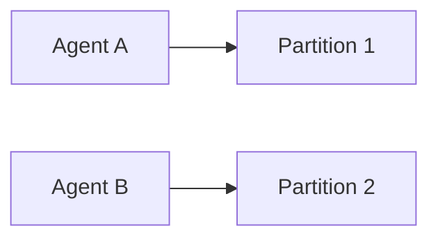

## 避免協調開銷爆炸

協調開銷隨 Agent 數量增長。若不控制，系統會癱瘓。

### 1. 減少通訊

- **批次**：合併多個訊息。
- **摘要**：傳摘要而非全文。
- **按需**：只在必要時通訊。

### 2. 階層化

用 Supervisor 分層，避免全連接：

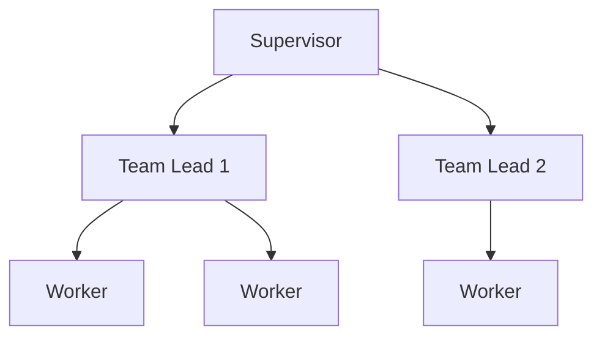

全連接是 $`O(n^2)`$，階層是 $`O(n \log n)`$ 或 $`O(n)`$：

$$
\text{links}_{\text{flat}} = \frac{n(n-1)}{2}, \qquad \text{links}_{\text{hier}} \approx n
$$

### 3. 非同步

不要讓 Agent 互相等待。用訊息佇列解耦：

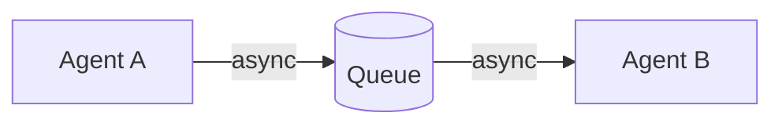

### 4. 共享記憶取代訊息

與其讓 Agent 互相問答，不如把資訊放共用記憶，各自讀取：

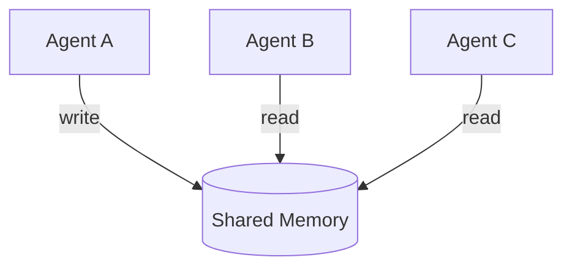

這把 $`O(n^2)`$ 的訊息變成 $`O(n)`$ 的讀寫。

### 5. 限制 Agent 數量

不是越多越好。每個 Agent 都有協調成本。用「最小可行 Agent 數」原則。

## 通訊的可靠性

| 問題 | 對策 |
|---|---|
| 訊息遺失 | ACK + 重送 |
| 重複訊息 | 冪等處理（msg_id 去重） |
| 順序錯亂 | 序列號 |
| 逾時 | 超時 + 重試 |
| 死鎖 | 避免循環等待 |

```python
async def send_with_ack(msg, max_retries=3):
    for _ in range(max_retries):
        await bus.send(msg)
        if await wait_ack(msg.id, timeout=5):
            return True
    raise DeliveryFailed(msg.id)
```

## 與 MCP 的關係

5.3 的 MCP 也可用於 Agent 間共享「能力」：一個 Agent 可作為 MCP server 把工具暴露給其他 Agent。但 MCP 主要針對「Agent-to-Tool」，Agent-to-Agent 通常需要更豐富的語意（任務、狀態、協商）。

## 與後續章節的關聯

- **10.1/10.2 拓撲**：協定服務於拓撲。
- **11.1 追蹤**：correlation_id 串起軌跡。
- **12.1 佇列**：非同步通訊的基礎設施。
- **12.3 稽核**：訊息日誌。

## 小結

1. Agent 間訊息應結構化，含 type、correlation_id、payload。
2. 通訊模式：請求回應、pub/sub、佇列、黑板。
3. 共用狀態有集中、分散、事件溯源三種，各有取捨。
4. 併發用樂觀鎖、悲觀鎖、分區解決。
5. 避免協調爆炸：減少通訊、階層化、非同步、共享記憶、限制數量。
6. 通訊可靠性靠 ACK、冪等、序列號、逾時、防死鎖。
