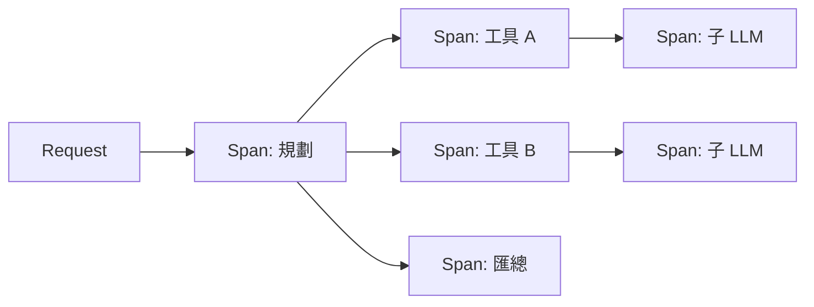
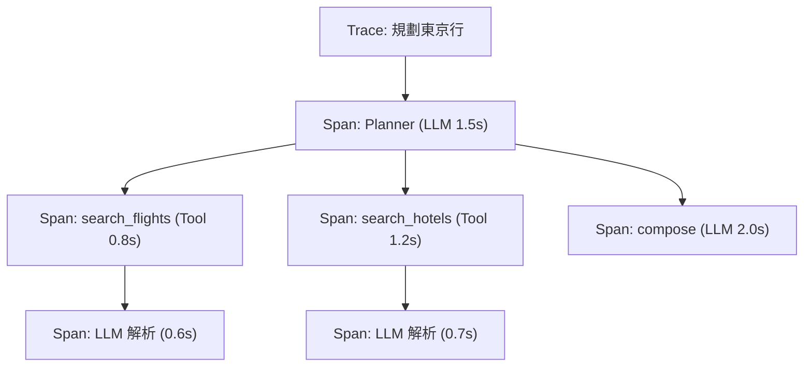
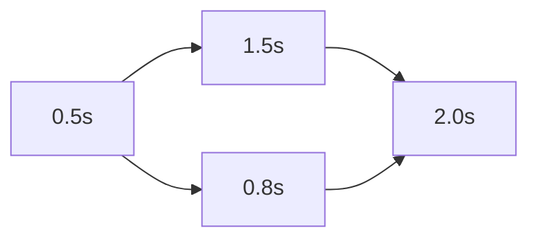
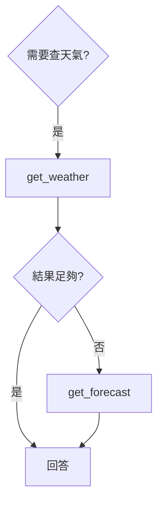
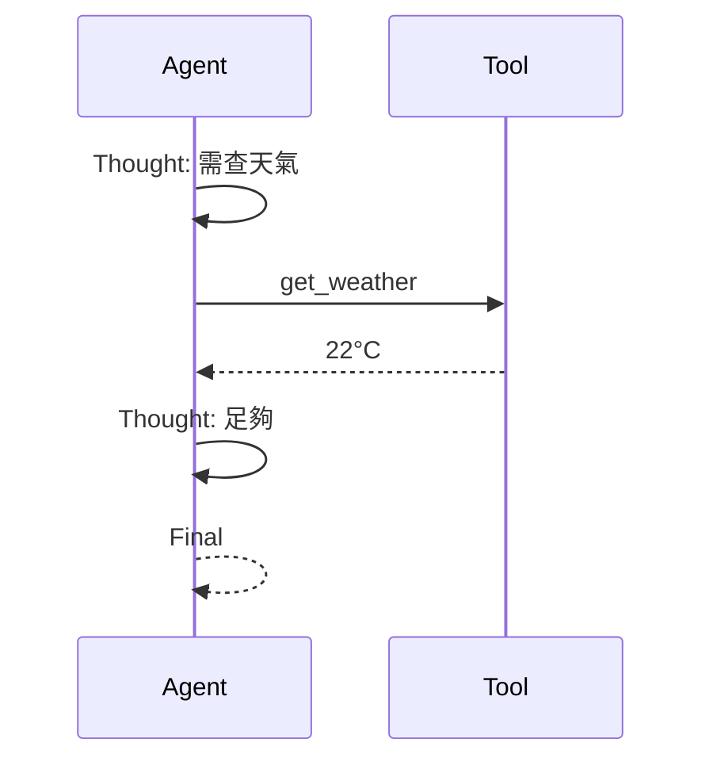

# 11.1 追蹤完整執行軌跡（Trace）：Span、延遲瓶頸、Token 消耗與決策路徑視覺化

## 為什麼 Agent 比傳統系統更難除錯

傳統程式的執行是確定的：同樣輸入 → 同樣路徑。Agent 則：

- **非確定**：同一輸入可能走不同路徑（1.1）。
- **多層呼叫**：LLM → 工具 → 子 Agent，層層嵌套。
- **狀態複雜**：context 動態組裝（9.3）。
- **失敗隱蔽**：錯誤可能藏在「看似合理」的輸出中。

因此，Agent 需要**完整的執行軌跡（Trace）**，才能回答：「它到底做了什麼？為什麼？」



## 什麼是 Trace 與 Span

借鏡分散式追蹤（如 OpenTelemetry）的概念：

- **Trace**：一次完整任務的軌跡，由多個 Span 組成。
- **Span**：一個操作單元（一次 LLM 呼叫、一次工具執行、一個子 Agent）。

$$
\text{Trace} = \{\text{Span}_1, \text{Span}_2, \dots, \text{Span}_n\}, \quad \text{Span} = (\text{id}, \text{parent}, t_{\text{start}}, t_{\text{end}}, \text{attrs})
$$

### Span 的結構

```json
{
  "span_id": "span_003",
  "parent_id": "span_001",
  "trace_id": "trace_42",
  "name": "llm_call",
  "type": "llm",
  "start": "2026-03-01T10:00:01.200Z",
  "end": "2026-03-01T10:00:02.800Z",
  "attributes": {
    "model": "gpt-4o",
    "input_tokens": 1200,
    "output_tokens": 150,
    "temperature": 0.2,
    "tool_calls": ["get_weather"]
  },
  "status": "ok"
}
```

## 一棵 Trace 樹



這棵樹讓你一眼看出：
- 哪些是平行（A、B）。
- 哪個最慢（C 2.0s）。
- 總延遲的組成。

## 追蹤什麼

### 1. LLM 呼叫

| 屬性 | 用途 |
|---|---|
| model | 模型版本 |
| input/output tokens | 成本 |
| latency | 延遲 |
| temperature 等參數 | 重現 |
| prompt hash | 版本追蹤 |
| finish_reason | 是否截斷 |

### 2. 工具執行

| 屬性 | 用途 |
|---|---|
| tool name | 哪個工具 |
| args | 參數 |
| result (摘要) | 結果 |
| error | 錯誤 |
| latency | 延遲 |
| retries | 重試次數 |

### 3. 決策

| 屬性 | 用途 |
|---|---|
| reasoning | 思考內容 |
| chosen action | 選了什麼 |
| alternatives | 考慮過什麼 |

### 4. 狀態變化

| 屬性 | 用途 |
|---|---|
| context size | context 用量 |
| memory writes | 記憶寫入 |
| state updates | 狀態更新 |

## 延遲分析

用 Span 時間計算：

$$
\text{latency}_{\text{span}} = t_{\text{end}} - t_{\text{start}}
$$

找出**關鍵路徑**（最長路徑）：



關鍵路徑 = A → B → D = 4.0s。優化應針對關鍵路徑，而非所有 Span。

### 瀑布圖（Waterfall）

```text
Planner      |████████████████| 1.5s
search_flight  |████| 0.8s
search_hotel     |██████| 1.2s
compose                  |████████| 2.0s
```

一眼看出並行與序列、瓶頸所在。

## Token 與成本追蹤

每個 LLM Span 記錄 token，彙總到 Trace：

$$
\text{cost}_{\text{trace}} = \sum_{s \in \text{LLM spans}} \big( n_{\text{in},s} p_{\text{in}} + n_{\text{out},s} p_{\text{out}} \big)
$$

```python
def trace_cost(trace):
    return sum(
        s.attributes["input_tokens"] * PRICE_IN
        + s.attributes["output_tokens"] * PRICE_OUT
        for s in trace.spans if s.type == "llm"
    )
```

分析：
- 哪個 Span 最貴？
- context 是否在迴圈中膨脹？
- 工具結果是否過大？

## 決策路徑視覺化

Agent 的價值在決策。把決策畫出來：



或時序圖：



工具如 LangSmith、Langfuse、Phoenix、OpenTelemetry 可自動生成這類視圖。

## 追蹤的資料模型

```python
@dataclass
class Span:
    span_id: str
    parent_id: str | None
    trace_id: str
    name: str
    type: str  # llm | tool | agent | decision
    start: datetime
    end: datetime
    attributes: dict
    status: str  # ok | error
    children: list["Span"]
```

用 context manager 自動記錄：

```python
with tracer.span("tool_call", type="tool") as span:
    span.set("tool", "get_weather")
    result = await get_weather(city)
    span.set("result_size", len(result))
```

## 取樣與隱私

追蹤全部會產生大量資料與隱私風險：

- **取樣**：正常請求取樣 1–10%，錯誤全記。
- **遮罩**：PII、密鑰不入 trace。
- **保留期**：依政策刪除。

```python
if should_sample(trace_id) or is_error:
    store.save(trace)
```

## 從 Trace 到改進

Trace 不只是除錯，更是改進的原料：

| 觀察 | 行動 |
|---|---|
| 某工具常逾時 | 加快取/換供應商 |
| context 膨脹 | 壓縮策略（3.1） |
| 重複工具呼叫 | 改 prompt/去重（7.3） |
| 決策繞路 | 改計畫策略（9.1） |
| 特定輸入常失敗 | 加測試案例（2.3） |

## 與後續章節的關聯

- **11.2 評估**：Trace 是離線評估的資料。
- **11.3 失敗模式**：從 Trace 歸納失敗。
- **12.3 稽核**：生產環境的追蹤。
- **7.3 死迴圈**：Trace 顯示循環。

## 小結

1. Agent 非確定、多層、狀態複雜，需完整 Trace 才能除錯。
2. Trace 由 Span 樹組成，每個 Span 記錄時間、屬性、狀態。
3. 追蹤 LLM 呼叫、工具執行、決策、狀態變化。
4. 用關鍵路徑與瀑布圖找延遲瓶頸。
5. 彙總 token 找成本熱點。
6. 決策路徑可視化讓「為什麼」可見。
7. 取樣、遮罩、保留期兼顧隱私與成本。
