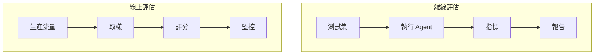
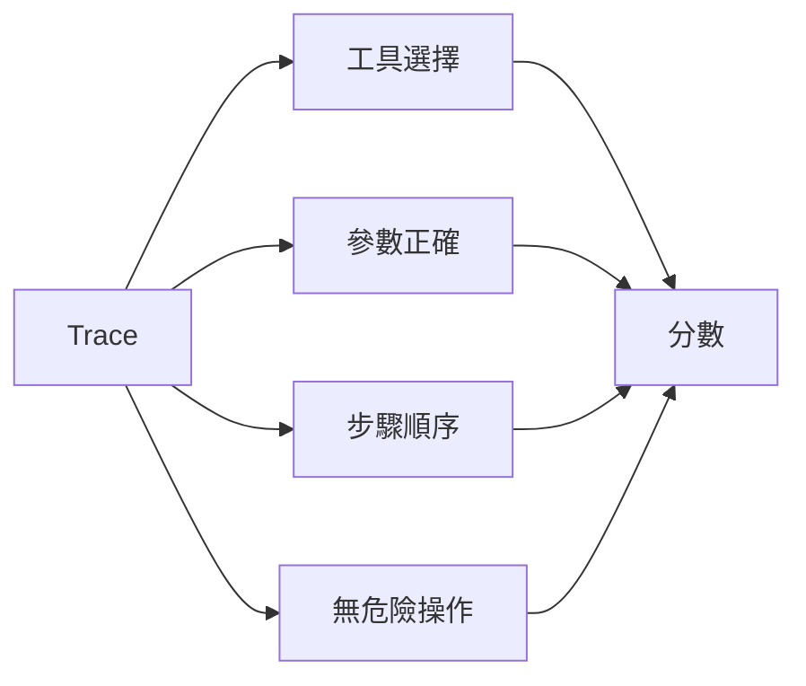
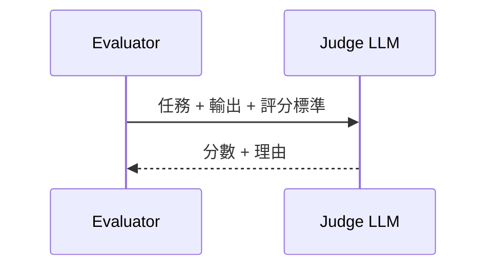
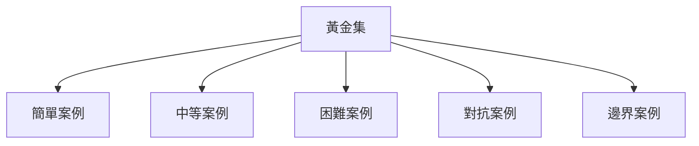
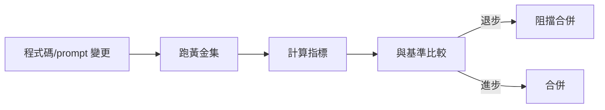
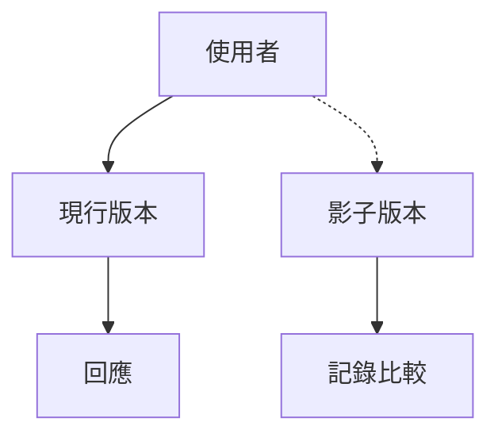

# 11.2 離線與線上評估：任務成功率、軌跡正確性、LLM-as-a-Judge 與黃金測試集

## 沒有評估，就沒有工程

2.3 談了 prompt 層級的評估。但 Agent 的評估更複雜：它不只是「答案對不對」，還包括「過程對不對」「軌跡合理嗎」「成本可接受嗎」。**評估是 Agent 工程的眼睛**：沒有它，你無法知道改動是變好還是變壞。



## 評估的維度

Agent 的評估是多維的：

| 維度 | 問題 | 指標 |
|---|---|---|
| **結果正確性** | 答案對嗎？ | 準確率、F1 |
| **任務成功率** | 端到端完成了嗎？ | success rate |
| **軌跡正確性** | 過程合理嗎？ | path correctness |
| **效率** | 花了多少步/token？ | steps、tokens、cost |
| **延遲** | 多快？ | p50/p95 latency |
| **安全性** | 有沒有違規？ | policy violations |
| **穩健性** | 換輸入還行嗎？ | robustness |

只看得分數會誤導：一個「對但繞了 20 步」的 Agent 可能比「錯但快」的更糟，視情境而定。

## 任務成功率（Task Success Rate）

最直觀的指標：完成任務的比例。

$$
\text{SR} = \frac{\#\{\text{成功任務}\}}{\#\{\text{總任務}\}}
$$

但「成功」需要定義。常見判定：
- **精確匹配**：輸出等於標準答案。
- **規則檢查**：符合預設規則（如 JSON 合法、數值範圍）。
- **狀態檢查**：環境達到目標狀態（如訂單真的建立了）。

```python
def is_success(trace, expected):
    if expected.type == "exact":
        return trace.final == expected.value
    if expected.type == "state":
        return check_env_state(expected.goal)
    if expected.type == "rubric":
        return score(trace.final, expected.rubric) >= 0.8
```

## 軌跡正確性（Trajectory Correctness）

結果對不代表過程對。例如「算出答案」可能是猜的。軌跡評估檢查：

- 是否用了正確的工具？
- 步驟順序合理嗎？
- 有沒有多餘/危險的操作？
- 推理是否支持結論？



### 軌跡比對

若有「黃金軌跡」（標準步驟），可計算相似度：

$$
\text{sim}(\tau, \tau^*) = \frac{|\text{common steps}|}{|\tau \cup \tau^*|}
$$

但真實任務常有多條正確路徑，硬比對會誤判。因此更常用「關鍵步驟檢查」而非「逐字比對」。

## LLM-as-a-Judge

用另一個 LLM 當評審，評估輸出品質。適合開放式任務（無標準答案）。

### 基本流程



```python
async def llm_judge(task, output, rubric):
    prompt = f"""
    評分標準：{rubric}
    任務：{task}
    輸出：{output}
    請依標準給 1-5 分，並說明理由。輸出 JSON：
    {{"score": int, "reason": str}}
    """
    return await llm(prompt, response_format=json_schema)
```

### 偏誤與對策

LLM-as-a-Judge 有已知偏誤：

| 偏誤 | 說明 | 對策 |
|---|---|---|
| 位置偏誤 | 偏好第一個/最後一個 | 隨機順序、雙向評估 |
| 長度偏誤 | 偏好長答案 | 明確要求簡潔 |
| 自我偏好 | 偏好自己模型的輸出 | 用不同模型當裁判 |
| 寬容偏誤 | 給分偏高 | 用 rubric + 對照範例 |
| 格式偏誤 | 偏好特定格式 | 忽略格式只評內容 |

**關鍵**：給 judge 明確的 rubric 與範例，並校準（人類標註一小批，比較 judge 與人類的一致性）。

$$
\text{agreement} = \frac{\#\{\text{judge} = \text{human}\}}{\#\{\text{all}\}}
$$

一致率低於閾值（如 0.7）就要調整 judge。

### Pairwise 比較

與其給絕對分數，不如比較兩個版本哪個好：

```json
{"winner": "A", "reason": "A 的答案更完整且有引用"}
```

Pairwise 通常比絕對評分穩定。

## 黃金測試集（Golden Dataset）

評估的基石是一組高品質、有標準答案的測試案例。

### 組成

```json
{
  "id": "case_001",
  "input": "幫我查台北明天天氣",
  "expected": {
    "tools": ["get_weather"],
    "answer_contains": ["台北", "溫度"],
    "state": null
  },
  "tags": ["weather", "simple"]
}
```

### 品質要求

| 要求 | 說明 |
|---|---|
| 涵蓋性 | 各類型、邊界、對抗 |
| 正確性 | 標準答案經人工確認 |
| 多樣性 | 不同難度、長度、語言 |
| 穩定性 | 不依賴易變的外部狀態 |
| 可維護 | 易新增、易更新 |

### 分層設計



### 避免污染

測試集不能出現在 prompt 的 few-shot 中，否則評估失真（2.3）。

## 離線評估流程



```python
async def evaluate(agent, dataset):
    results = []
    for case in dataset:
        trace = await agent.run(case.input)
        results.append({
            "id": case.id,
            "success": is_success(trace, case.expected),
            "trajectory_ok": check_trajectory(trace, case.expected),
            "steps": trace.step_count,
            "cost": trace.cost,
            "latency": trace.latency,
        })
    return aggregate(results)
```

### 回歸測試

每次變更都跑，確保沒有退步：

$$
\text{regression} = \frac{\#\{\text{之前成功，現在失敗}\}}{\#\{\text{之前成功}\}}
$$

## 線上評估

離線評估無法涵蓋真實分布。線上評估：

### 1. 取樣人工標註

隨機抽樣生產流量，人工評分。

### 2. 自動 judge

對所有（或取樣）流量跑 LLM judge。

### 3. 使用者回饋

👍/👎、重新提問率、任務完成率。

### 4. 影子模式

新版本只記錄不影響使用者，比較表現。



## 評估的統計顯著性

小樣本的差異可能是雜訊。用信賴區間判斷：

$$
\hat{p} \pm z \sqrt{\frac{\hat{p}(1-\hat{p})}{n}}
$$

例如 100 題中 80 題成功，$`\hat{p}=0.8`$，95% CI 約 $`0.8 \pm 0.078`$。若新版本 82%，在誤差內，不能宣稱進步。

## 與後續章節的關聯

- **2.3 Prompt 評估**：本節是其 Agent 版。
- **11.1 Trace**：評估的資料來源。
- **11.3 失敗模式**：從評估找失敗。
- **12.3 飛輪**：持續迭代。

## 小結

1. Agent 評估多維：正確性、成功率、軌跡、效率、延遲、安全、穩健。
2. 結果對不代表過程對，軌跡評估不可或缺。
3. LLM-as-a-Judge 適合開放式任務，但需處理偏誤與校準。
4. 黃金測試集要涵蓋、正確、多樣、穩定，並防污染。
5. 離線做回歸，線上做取樣/judge/回饋/影子。
6. 用統計顯著性避免被雜訊誤導。
