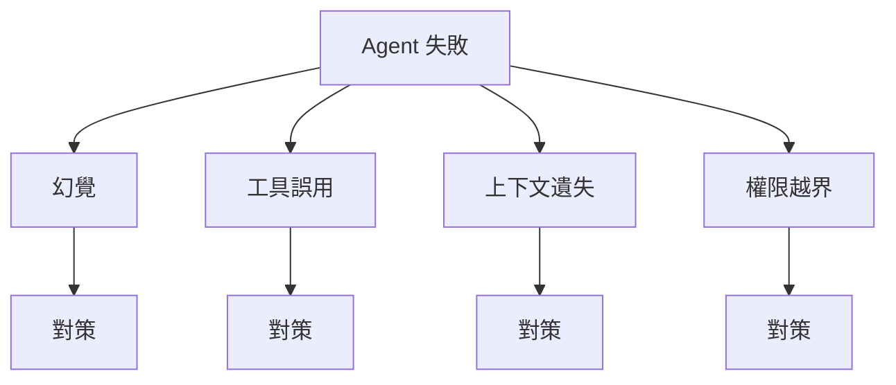
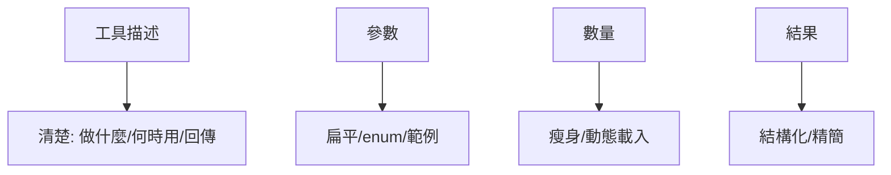
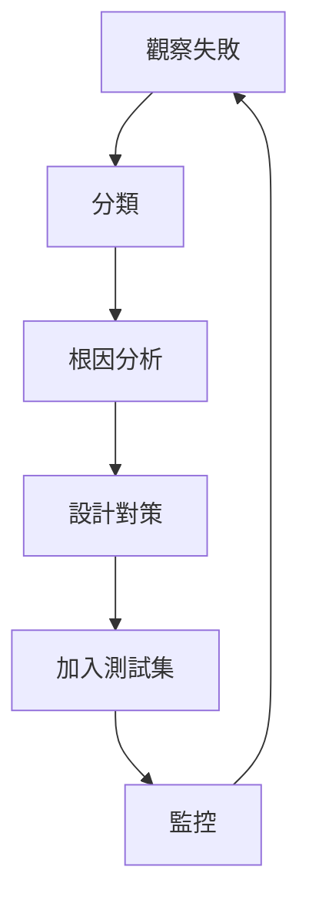

# 11.3 失敗模式分析：幻覺、工具誤用、上下文遺失與權限越界

## 失敗模式是設計的輸入

Agent 的失敗不是隨機的，而是有**可辨識的模式**。把失敗分類，才能系統性地防範。本節整理四類最常見的失敗，並連結到前後章節的對策。



## 失敗模式一：幻覺（Hallucination）

### 表現

模型生成看似合理但虛假的内容：
- 捏造事實、引用、數字。
- 虛構工具參數或結果。
- 聲稱執行過的動作其實沒做。

### 成因

- **訓練目標**：模型被訓練成「預測合理下一個 token」，不是「說真話」。
- **知識缺口**：不知道就編。
- **context 缺失**：沒有依據時，模型傾向補全。
- **過度自信**：缺乏不確定性表達。

$$
P(\text{hallucination}) \uparrow \text{ when } P(\text{correct} \mid \text{context}) \text{ is low}
$$

### 在 Agent 中的放大

Agent 迴圈會**放大幻覺**：模型虛構一個工具結果，後續步驟把它當事實，層層累積。


### 對策

| 對策 | 說明 | 章節 |
|---|---|---|
| 強制工具驗證 | 事實必須來自工具 | 4.2 |
| 要求引用 | 答案附來源 | 5.1 |
| 校準不確定性 | 允許說「不知道」 | 2.1 |
| 檢索增強 | 提供依據 | 5.x |
| 輸出驗證 | 檢查一致性 | 2.2 |
| 自我檢查 | 反問「有依據嗎」 | 9.2 |

## 失敗模式二：工具誤用（Tool Misuse）

### 表現

- 選錯工具（該查天氣卻查航班）。
- 參數錯誤（格式、範圍、缺漏）。
- 呼叫時機錯（不需工具卻呼叫，或該用卻不用）。
- 誤解工具結果（把錯誤當成功）。

### 成因

- **描述不清**：工具描述模糊（4.1）。
- **工具過多**：選擇困難。
- **參數複雜**：巢狀、缺範例。
- **結果格式混亂**：模型誤讀。

### 對策



具體：
- 改進描述（4.1）。
- schema 收斂（2.2）。
- 工具瘦身與動態載入（9.3）。
- 結果結構化（4.2）。
- 執行前驗證參數（2.2）。

## 失敗模式三：上下文遺失（Context Loss）

### 表現

- 忘記使用者早先的約束（預算、偏好）。
- 重複問已回答的問題。
- 忽略工具結果。
- 偏離原始目標。

### 成因

- **滑動視窗丟棄**（3.1）。
- **摘要漂移**（3.1）。
- **Lost in the Middle**（9.3）。
- **context 超載**：關鍵資訊被淹沒。
- **狀態未更新**（8.1）。

### 對策

| 對策 | 說明 | 章節 |
|---|---|---|
| 結構化狀態 | 把關鍵事實釘選 | 8.1 |
| 關鍵資訊置頂 | 放開頭/結尾 | 9.3 |
| 釘選事實 | 永不壓縮 | 3.1 |
| 定期重申目標 | 每輪提醒 | 9.3 |
| 顯式記憶 | 寫入長期記憶 | 8.2 |

```python
PINNED = ["budget", "deadline", "hard_constraints"]
def compress(history):
    return [m for m in history if m.is_pinned] + summarize(history)
```

## 失敗模式四：權限越界（Permission Violation）

### 表現

- 執行了不該執行的操作（刪除、轉帳）。
- 存取無權限的資料。
- 超過授權範圍（批次、他人資料）。
- 被注入操控（2.3）。

### 成因

- **權限過大**（6.3）。
- **缺乏分級**（6.2）。
- **注入攻擊**（2.3、13.4）。
- **審批缺失**。

### 對策


- 最小權限（6.3）。
- 讀寫分級（6.2）。
- HITL 審批（6.3）。
- 注入防禦（2.3）。
- 稽核監控（12.3）。

## 其他常見失敗

### 1. 死迴圈

重複、震盪、無窮重試（7.3）。對策：步數上限、去重、震盪偵測。

### 2. 錯誤傳播

早期錯誤沿軌跡放大（7.1）。對策：每步驗證、反思（9.2）。

### 3. 過度自信

不表達不確定性。對策：要求信心分數、不確定時澄清。

### 4. 目標漂移

執行中偏離原目標。對策：定期重申目標、進度檢查。

### 5. 格式錯誤

結構化輸出不合規。對策：guided decoding、驗證重試（2.2）。

### 6. 協調失敗

多 Agent 衝突、循環（10.3）。對策：拓撲設計、通訊協定、上限。

## 失敗模式的分類矩陣

| 失敗 | 主要成因章節 | 主要對策章節 |
|---|---|---|
| 幻覺 | 1.1, 5.1 | 4.2, 5.x, 9.2 |
| 工具誤用 | 4.1 | 2.2, 4.1, 9.3 |
| 上下文遺失 | 3.1, 9.3 | 8.1, 9.3 |
| 權限越界 | 6.2 | 2.3, 6.3 |
| 死迴圈 | 7.3 | 7.3 |
| 錯誤傳播 | 7.1 | 9.2 |
| 目標漂移 | 7.1 | 9.3 |

## 從失敗中建立防禦



這個循環就是 12.3 的「維運飛輪」。每次失敗都應：
1. 分類（哪種模式）。
2. 根因（哪一層、哪個章節）。
3. 對策（改 prompt/工具/架構）。
4. 測試（加入黃金集）。
5. 監控（持續觀察）。

## 失敗分析的實務

- **Trace 是原料**（11.1）：每個失敗都有完整軌跡。
- **自動分類**：用規則或模型標記失敗類型。
- **優先級**：依頻率 × 影響排序。
- **修復驗證**：修完跑回歸（11.2）。

```python
def classify_failure(trace):
    if has_hallucinated_fact(trace): return "hallucination"
    if wrong_tool(trace): return "tool_misuse"
    if lost_constraint(trace): return "context_loss"
    if unauthorized_action(trace): return "permission"
    if loop_detected(trace): return "loop"
    return "other"
```

## 與後續章節的關聯

- **12.3 飛輪**：失敗驅動迭代。
- **13.4 跨模態**：GUI/多模態的新失敗模式。
- **15.3 實體**：物理世界的失敗更嚴重。
- **16.x 形式化**：用不變量防範部分失敗。

## 小結

1. 失敗有模式，分類才能系統防範。
2. 四大模式：幻覺、工具誤用、上下文遺失、權限越界。
3. 幻覺被迴圈放大，需工具驗證與引用。
4. 工具誤用靠描述、schema、瘦身。
5. 上下文遺失靠結構化狀態、釘選、排序。
6. 權限越界靠最小權限、分級、審批、注入防禦。
7. 失敗分析循環：觀察→分類→根因→對策→測試→監控。
