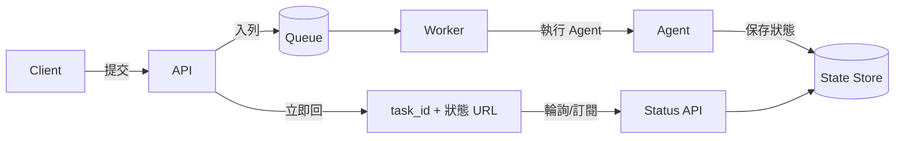
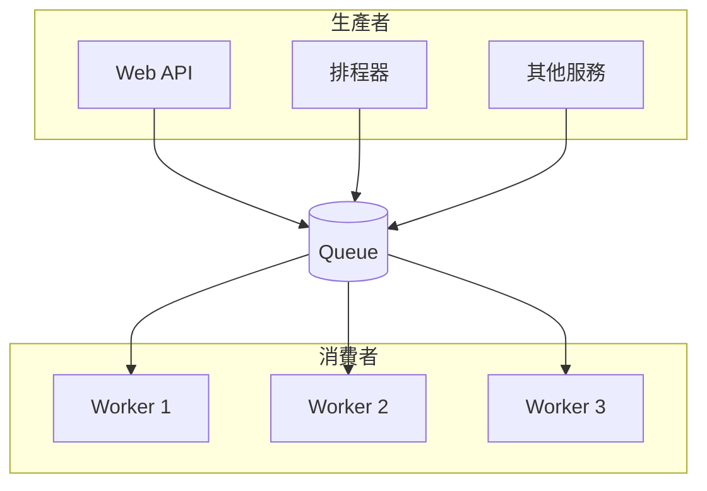
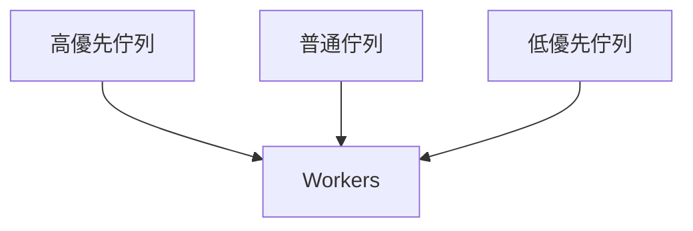
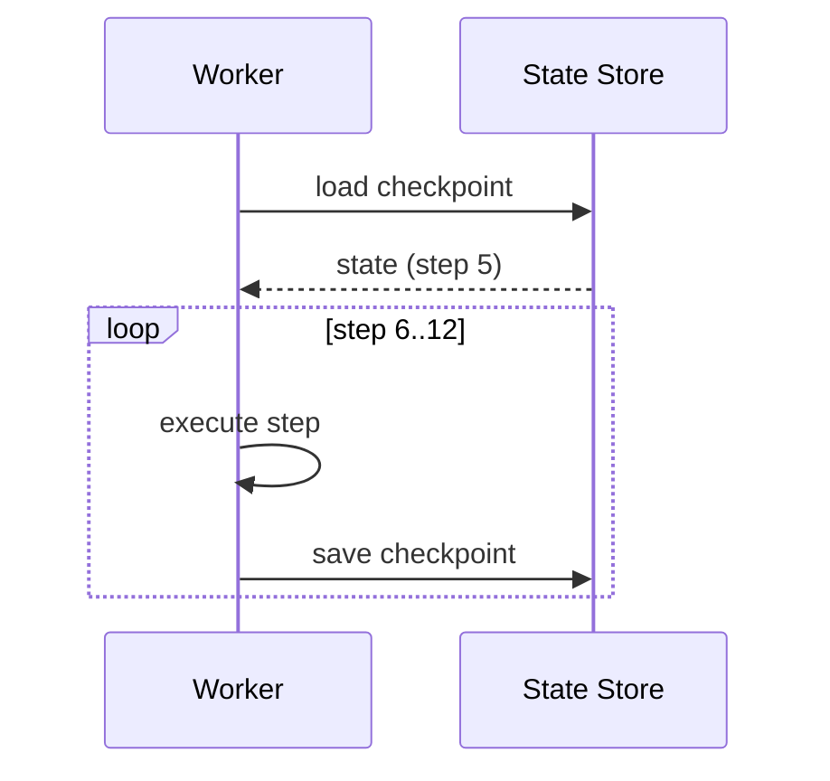
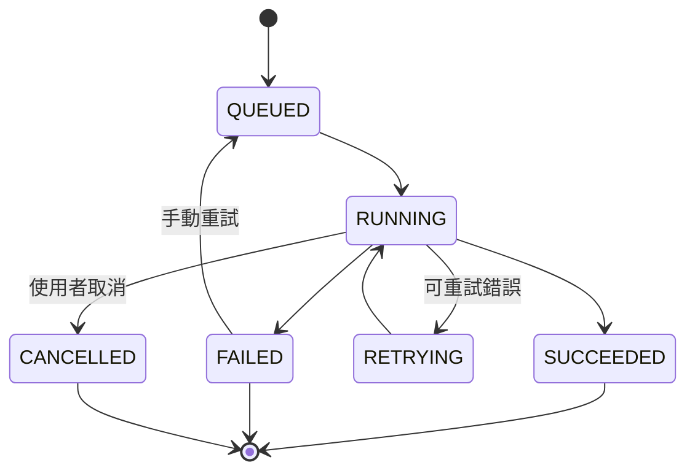

# 12.1 非同步任務佇列、背景執行、斷點續跑與狀態持久化

## Agent 任務是「長跑」

一個聊天回覆可能幾秒，但 Agent 任務（研究報告、批次處理、多步規劃）可能跑幾分鐘到幾小時。若用同步 HTTP 請求，會遇到：

- **連線逾時**：瀏覽器/閘道斷線。
- **無法恢復**：中途失敗要從頭來。
- **資源佔用**：長連線佔用伺服器。
- **無法重試**：失敗即遺失。

解法：**非同步任務佇列 + 背景執行 + 狀態持久化**。



## 任務佇列

### 基本架構



常用工具：Redis + Celery、RabbitMQ、SQS、Kafka、Temporal、BullMQ。

### 任務訊息

```json
{
  "task_id": "t_42",
  "type": "agent_run",
  "payload": {
    "goal": "產生 2025 台灣 AI 市場報告",
    "user_id": "u_456",
    "budget_usd": 2.0
  },
  "created_at": "2026-03-01T10:00:00Z",
  "attempt": 1,
  "max_attempts": 3
}
```

## 背景執行

Worker 從佇列取出任務，在背景執行 Agent：

```python
async def worker():
    while True:
        task = await queue.dequeue()
        try:
            await run_task(task)
            await queue.ack(task)
        except RetryableError:
            await queue.retry(task)
        except Exception as e:
            await queue.fail(task, e)
```

### 併發控制

Worker 可同時處理多個任務，但需限制：

```python
semaphore = asyncio.Semaphore(10)  # 最多 10 個並行

async def run_task(task):
    async with semaphore:
        await agent.run(task)
```

### 優先級佇列

不同任務不同優先級：



Worker 先取高優先，避免低優先餓死高優先。

## 狀態持久化

任務執行中，狀態需持久化，才能：

- **斷點續跑**：失敗後從中斷處繼續。
- **查詢進度**：使用者可看進度。
- **審計**：記錄發生了什麼。

### 保存什麼

```json
{
  "task_id": "t_42",
  "status": "running",
  "current_step": 5,
  "total_steps": 12,
  "state": {
    "goal": "...",
    "facts": {...},
    "completed_steps": ["s1", "s2", "s3", "s4"],
    "pending_steps": ["s6", "s7", ...]
  },
  "messages": [...],
  "artifacts": {...},
  "cost_so_far": 0.35,
  "updated_at": "..."
}
```

### Checkpoint（檢查點）

定期保存快照：

```python
async def run_with_checkpoint(task):
    state = await load_state(task.id) or init_state(task)
    for step in remaining_steps(state):
        result = await execute(step)
        state = update(state, step, result)
        await save_checkpoint(task.id, state)   # 每步保存
```



## 斷點續跑

Worker 掛了，任務被重新分配。新 Worker 從最後 checkpoint 恢復：

```python
async def resume(task_id):
    state = await load_checkpoint(task_id)
    if state is None:
        return await start_fresh(task_id)
    return await continue_from(state)
```

### 冪等性是前提

續跑可能重複執行某些步驟，因此步驟必須**冪等**（4.3）：

- 有副作用的操作帶冪等鍵。
- 查詢類操作天然冪等。
- 寫入前檢查是否已完成。

```python
async def execute_step(step, state):
    if step.id in state.completed_steps:
        return state.results[step.id]   # 跳過已完成
    result = await run(step)
    state.completed_steps.append(step.id)
    return result
```

## 任務狀態機



## 使用者體驗

非同步任務的使用者體驗設計：

- **立即回應**：提交後立刻回 `task_id`。
- **進度查詢**：`GET /tasks/{id}` 回傳狀態與進度。
- **推送**：WebSocket/SSE 推送進度（3.2）。
- **取消**：允許使用者中途取消。
- **通知**：完成後通知（email/webhook）。

```json
{
  "task_id": "t_42",
  "status": "running",
  "progress": {"current": 5, "total": 12, "percent": 42},
  "eta_seconds": 90
}
```

## 分散式執行的挑戰

| 挑戰 | 說明 | 對策 |
|---|---|---|
| 任務重複 | Worker 掛了任務重送 | 冪等 + 去重 |
| 狀態一致 | 多 Worker 寫同一狀態 | 樂觀鎖（10.3） |
| 時鐘 | 分散式時間不一致 | 邏輯時鐘/版本 |
| 部分失敗 | 子任務失敗 | 補償/重試 |
| 資源隔離 | 任務互相影響 | 沙盒（6.1） |

## 與後續章節的關聯

- **3.2 串流**：進度推送。
- **8.1 狀態管理**：保存的狀態。
- **12.2 限流**：Worker 的資源控制。
- **12.3 維運**：任務監控。

## 小結

1. Agent 長任務需非同步佇列 + 背景執行，避免同步逾時。
2. 任務訊息含 task_id、payload、重試資訊。
3. 狀態持久化支援斷點續跑、進度查詢、審計。
4. Checkpoint 定期保存，續跑從最後檢查點恢復。
5. 冪等性是續跑與重試的前提。
6. 使用者體驗靠立即回應、進度查詢、推送、取消、通知。
7. 分散式挑戰靠冪等、鎖、版本、補償、沙盒。
