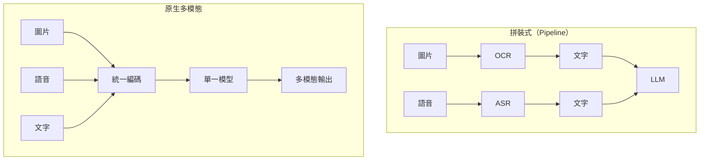
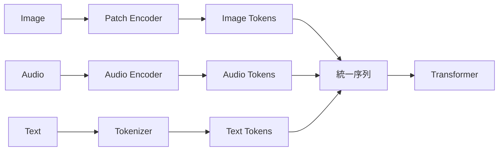
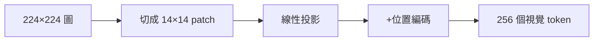
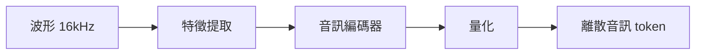
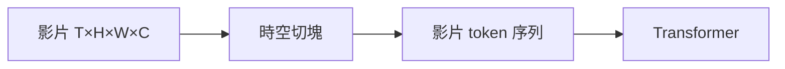
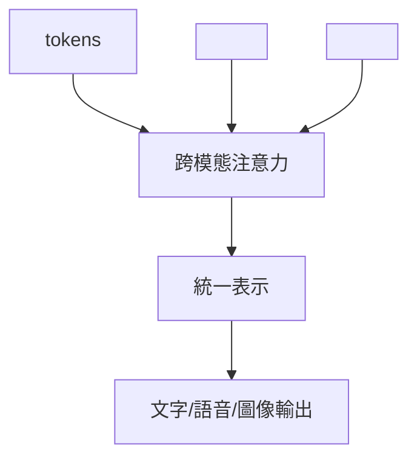

# 13.1 從純文字到原生多模態：統一 Token 空間下的視覺、語音與影片理解

## 為什麼「多模態」不是「多個模型拼起來」

早期做法是「拼裝」：ASR 把語音轉文字、OCR 把圖片轉文字，再丟給 LLM。這有根本缺陷——**轉換過程丟失資訊**（語氣、版面、動作），且誤差層層累積。

**原生多模態（Native Multimodality）** 的目標：讓不同模態的資訊在同一模型中、以統一的表示方式被理解與推理。



## 統一 Token 空間的想法

LLM 的核心是「token 序列 → 下一 token 分布」（1.1）。多模態的關鍵問題：**如何把圖像、音訊、影片也變成 token？**

$$
\text{text} \to \text{tokens}, \quad \text{image} \to \text{tokens}, \quad \text{audio} \to \text{tokens}
$$

一旦所有模態都能表示為 token 序列，就能用同一個 Transformer 處理：

$$
P(x_{1:n} \mid \text{any modalities}) = \prod_t P(x_t \mid x_{<t})
$$



## 視覺：從 Patch 到 Token（ViT）

圖像被切成固定大小的 patch（如 16×16），每個 patch 線性投影成向量，加上位置編碼，成為 token 序列：

$$
\text{image} \in \mathbb{R}^{H \times W \times C} \;\to\; \{p_1, \dots, p_N\}, \quad N = \frac{HW}{P^2}
$$

這就是 **Vision Transformer（ViT）** 的核心。關鍵洞察：**圖像 = 一堆 patch token 的序列**，與文字序列同構。



### 解析度與 token 數的權衡

$$
N = \left(\frac{H}{P}\right)\left(\frac{W}{P}\right)
$$

- patch 越小 → token 越多 → 細節越多，但成本越高。
- 高解析度圖片可能產生數千 token，擠壓 context（1.2、3.3）。

## 語音：從波形到 Token

音訊是連續波形。兩種主流路徑：

### 1. 離散化（Discrete Tokens）

用神經音訊編碼器（如 SoundStream、EnCodec）把波形量化為離散 token：

$$
\text{waveform} \to \text{codec tokens} \in \{1, \dots, K\}^T
$$

這些 token 可直接接入 LLM 的詞表。

### 2. 連續嵌入（Continuous Embeddings）

把音訊幀編碼為連續向量，投影到模型嵌入空間。



**語音的獨特挑戰**：不只是內容，還有**韻律、情緒、語速**。原生多模態能保留這些，拼裝式會丟失。

## 影片：時空的雙重序列

影片 = 一系列影格（時間維度）+ 每格的空間結構。挑戰：

- **token 爆炸**：$`T`$ 格 × 每格 $`N`$ 個 patch。
- **時序一致性**：跨格動作的連貫。

策略：
- **時空 patch**：把連續幾格壓成一個 token。
- **稀疏取樣**：不處理每一格。
- **時序壓縮**：用 3D 卷積或時序注意力。

$$
\text{video tokens} \approx \frac{T \cdot H \cdot W}{P_t \cdot P_s^2}
$$



## 統一序列的拼接

把不同模態的 token 放進同一序列，用特殊標記分隔：

```text
<image> [patch tokens...] </image>
<audio> [audio tokens...] </audio>
使用者問：這段影片裡的人在說什麼？
```

模型透過注意力在模態間建立關聯。**關鍵能力**：跨模態推理（看圖回答、聽聲辨位、影片問答）。



## 多模態的輸出

輸入多模態之外，輸出也可多模態：
- **文字**：最常見。
- **語音**：TTS（13.2）。
- **圖像**：生成（13.2）。
- **動作**：GUI/機器人（13.3、15.2）。

這讓 Agent 能「看、聽、說、做」。

## 為什麼原生多模態對 Agent 重要

| 能力 | 拼裝式 | 原生 |
|---|---|---|
| 看圖理解版面 | 依賴 OCR，丟失結構 | 直接理解 |
| 聽語氣情緒 | 丟失 | 保留 |
| 影片動作理解 | 難 | 可 |
| 跨模態對齊 | 弱 | 強 |
| 延遲 | 多模型串接 | 單模型 |

對 Agent 而言，原生多模態意味著**更少的資訊損失、更低的延遲、更強的跨模態推理**，這是 13.3 GUI Agent 的基礎。

## 成本與延遲的現實

多模態 token 很貴：
- 一張高解析圖片可能數千 token。
- 一段影片可能數萬 token。

優化：
- **解析度自適應**：依任務調整。
- **關鍵幀取樣**：影片只取關鍵格。
- **模態路由**：不需要視覺時不送圖。
- **快取**：重複的圖像/文件前綴（3.3）。

## 與後續章節的關聯

- **13.2**：即時語音/影片串流與生成。
- **13.3**：GUI Agent 用視覺理解螢幕。
- **13.4**：跨模態的安全邊界。
- **14.x**：影片生成即世界模型的一部分。

## 小結

1. 原生多模態不是拼裝，而是統一 token 空間下的單一模型推理。
2. 圖像 = patch token 序列（ViT），音訊 = 量化/嵌入 token，影片 = 時空 token。
3. 統一序列用標記分隔模態，靠注意力跨模態對齊。
4. 輸出也可多模態：文字、語音、圖像、動作。
5. 原生多模態減少資訊損失、降低延遲，是 GUI/具身的基礎。
6. 多模態 token 貴，需解析度自適應、取樣、路由、快取。
