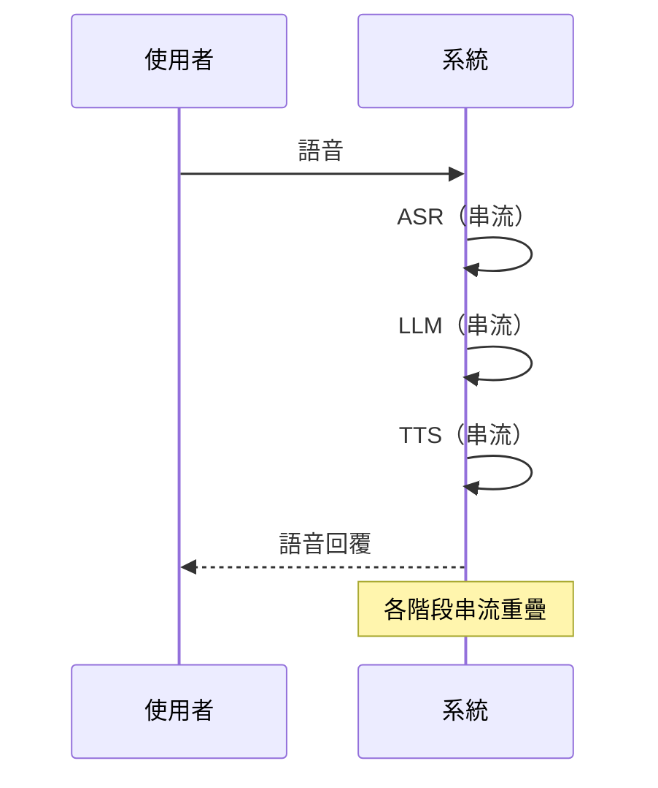
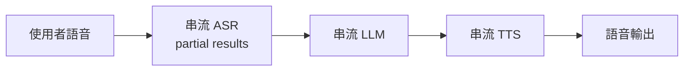
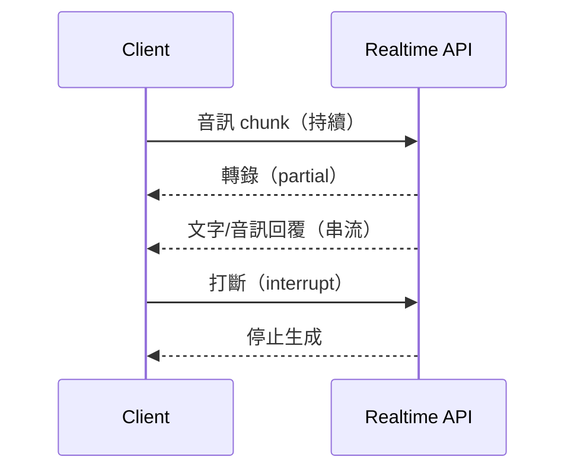
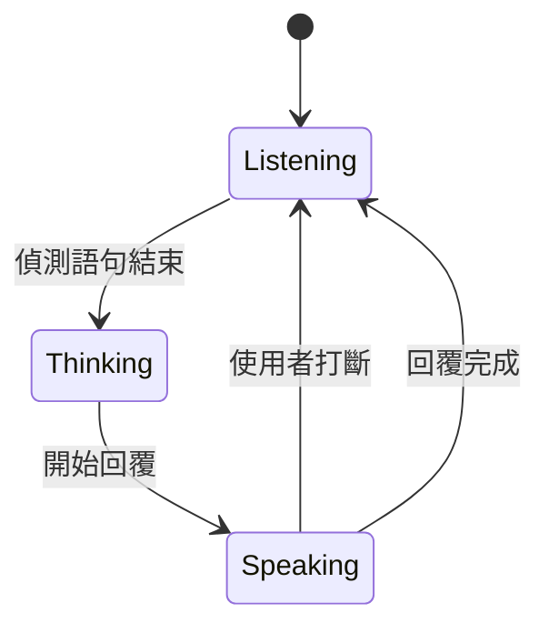
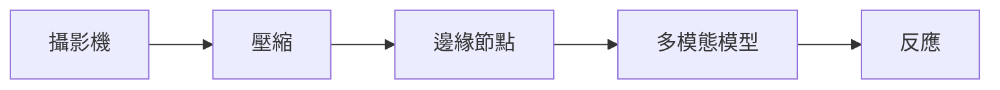
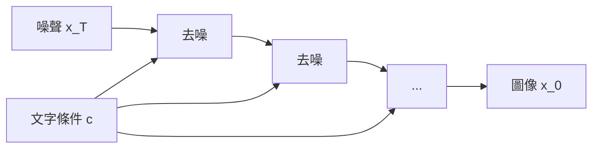
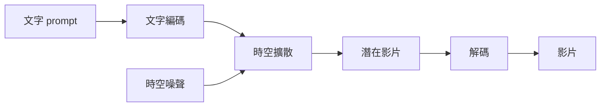
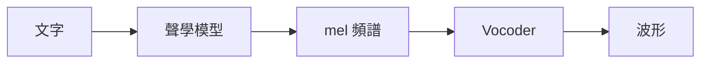
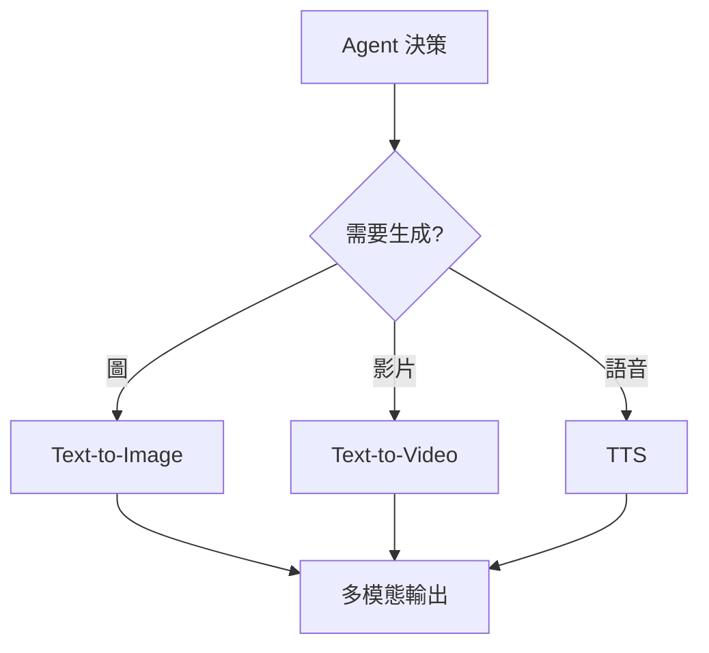

# 13.2 低延遲即時語音與視訊串流（Realtime Audio/Video）及生成式影音工作流（Text-to-Image / Text-to-Video / 語音合成）

## 即時互動的延遲門檻

文字聊天可以等幾秒，但**語音對話**不行。人類對話的輪替間隔約 200ms，超過 1 秒就覺得卡。這對系統架構提出嚴苛要求。

$$
\text{perceived latency} = \text{ASR} + \text{LLM TTFT} + \text{TTS first chunk}
$$

## 串流式語音管線

關鍵是**不要等整段完成**，而是邊收邊處理：

### 三段串流的重疊

1. **ASR 串流**：邊說邊轉錄，偵測語句結束（VAD）。
2. **LLM 串流**：收到完整語句即開始生成（3.2）。
3. **TTS 串流**：收到第一批文字即開始合成。

$$
T_{\text{response}} \approx T_{\text{VAD}} + T_{\text{TTFT}} + T_{\text{TTS-first}}
$$

若能重疊（如邊生成邊合成），總延遲大幅下降。

## Realtime API 的模式

新一代 API（如 OpenAI Realtime）用 WebSocket/WebRTC 雙向串流：

關鍵特性：
- **雙向**：同時送收。
- **低延遲**：端到端優化。
- **可打斷（barge-in）**：使用者插話時中止。
- **原生語音**：不必先轉文字（部分實作）。

## 語音活動偵測（VAD）

判斷使用者何時說完，是即時語音的關鍵：

$$
\text{speech}(t) = \begin{cases} 1 & \text{有語音} \\ 0 & \text{靜音} \end{cases}
$$

- 太早判定 → 截斷使用者。
- 太晚判定 → 延遲回應。

用能量、零交越率、或神經 VAD。加上「端點偵測」（endpointing）的靜音閾值。

## 打斷（Barge-in）處理

使用者插話時，系統必須：
1. 停止 TTS 播放。
2. 中止 LLM 生成。
3. 清空待播放佇列。
4. 開始接收新輸入。

這是即時語音體驗的關鍵細節，也是與文字聊天最大的差異。

## 視訊串流

即時視訊更難：頻寬大、延遲敏感、需理解時序。

- **取樣**：不處理每一格，取關鍵格或低帧率。
- **壓縮**：H.264/H.265 傳輸。
- **邊緣運算**：就近處理降低延遲。
- **事件驅動**：只在畫面變化時處理。

## 生成式影音工作流

### Text-to-Image（T2I）

從文字生成圖像。核心是**擴散模型（Diffusion）**：

$$
x_{t-1} = \frac{1}{\sqrt{\alpha_t}}\left(x_t - \frac{1-\alpha_t}{\sqrt{1-\bar\alpha_t}}\epsilon_\theta(x_t, t, c)\right) + \sigma_t z
$$

其中 $`c`$ 是文字條件。從純噪聲逐步去噪，生成圖像。

**Agent 的用法**：
- 生成插圖、圖表、UI 草稿。
- 視覺化資料。
- 作為世界模型的一部分（14.3）。

### Text-to-Video（T2V）

在時間維度上擴展擴散：

$$
\text{video} = \{x^{(1)}, x^{(2)}, \dots, x^{(T)}\}
$$

挑戰：
- **時序一致性**：格與格之間不能閃爍、跳變。
- **動作連貫**：動作要合理。
- **計算成本**：影片是圖像的 $`T`$ 倍。

技術：
- **時空注意力**：跨格建模。
- **潛在擴散（Latent Diffusion）**：在壓縮的潛在空間去噪，省算力。
- **動作條件化**：用動作序列引導（14.3）。

### 語音合成（TTS）

從文字生成語音。現代 TTS：

1. **文字 → 聲學特徵**（mel spectrogram）。
2. **聲學特徵 → 波形**（vocoder）。

或用端到端神經 TTS（如 diffusion-based、autoregressive）。

**Agent 的用法**：
- 語音助理回覆。
- 有聲內容生成。
- 個人化語音（voice cloning，需倫理與安全考量）。

## 生成式影音在 Agent 中的整合

Agent 可根據任務自動選擇生成模態：報告配圖、教學配影片、助理配語音。

## 延遲與品質的權衡

| 模式 | 延遲 | 品質 | 適用 |
|---|---|---|---|
| 串流 TTS | 低 | 中 | 即時對話 |
| 完整 TTS | 中 | 高 | 預錄內容 |
| 快速 T2I（少步） | 低 | 中 | 草稿 |
| 高品質 T2I（多步） | 高 | 高 | 成品 |
| T2V | 很高 | 視情況 | 短片 |

**擴散步數**是關鍵旋鈕：步數少 → 快但粗糙；步數多 → 慢但精細。

## 安全與倫理

生成式影音帶來風險（13.4 詳談）：
- **深偽（Deepfake）**：偽造人物。
- **版權**：訓練資料與生成內容。
- **不當內容**：暴力、色情。
- **誤導**：假新聞影片。

需內容過濾、浮水印、政策限制。

## 與後續章節的關聯

- **3.2 串流**：文字串流的延伸。
- **13.3 GUI Agent**：視覺理解。
- **14.3 T2V 與世界模型**：動作條件化的影片生成。
- **13.4 安全**：生成內容的風險。

## 小結

1. 即時語音的門檻是 200ms–1s，需串流、重疊、低延遲優化。
2. ASR、LLM、TTS 三段串流重疊，VAD 與打斷是關鍵。
3. 視訊串流靠取樣、壓縮、邊緣運算、事件驅動。
4. 生成式影音：T2I（擴散）、T2V（時空擴散 + 一致性）、TTS（聲學 + vocoder）。
5. Agent 可依任務自動選擇生成模態。
6. 延遲與品質靠擴散步數等旋鈕權衡，並需內容安全治理。
