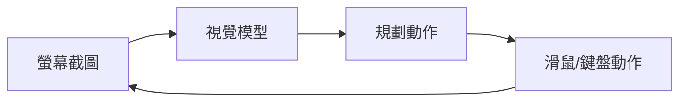
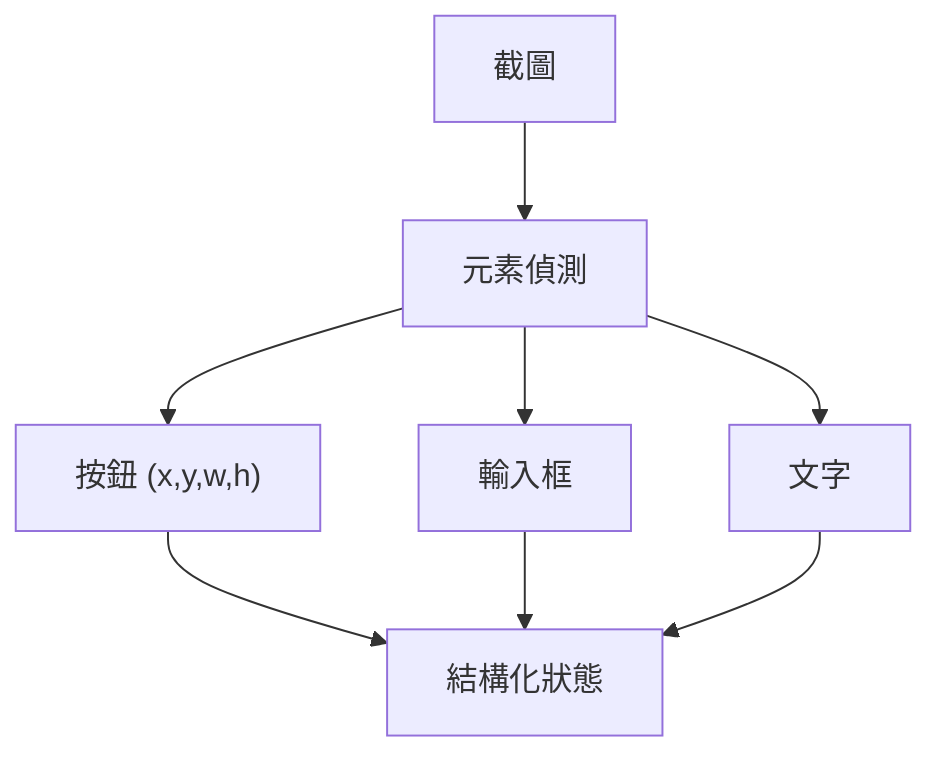
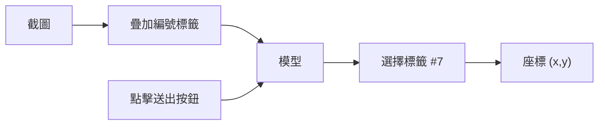
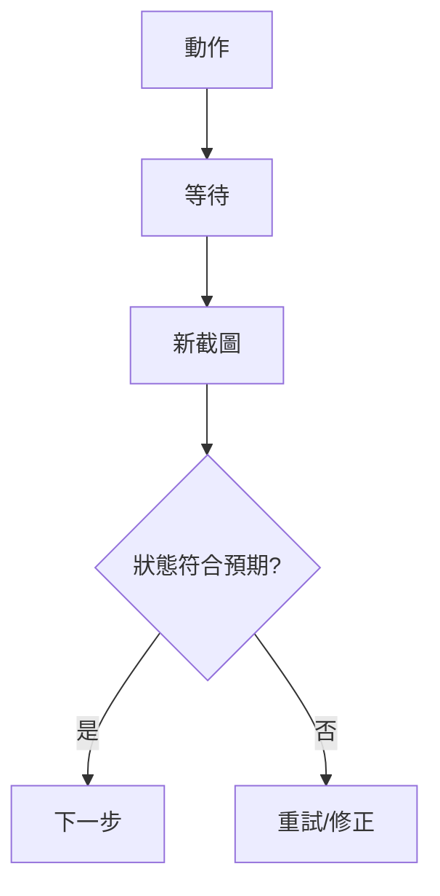
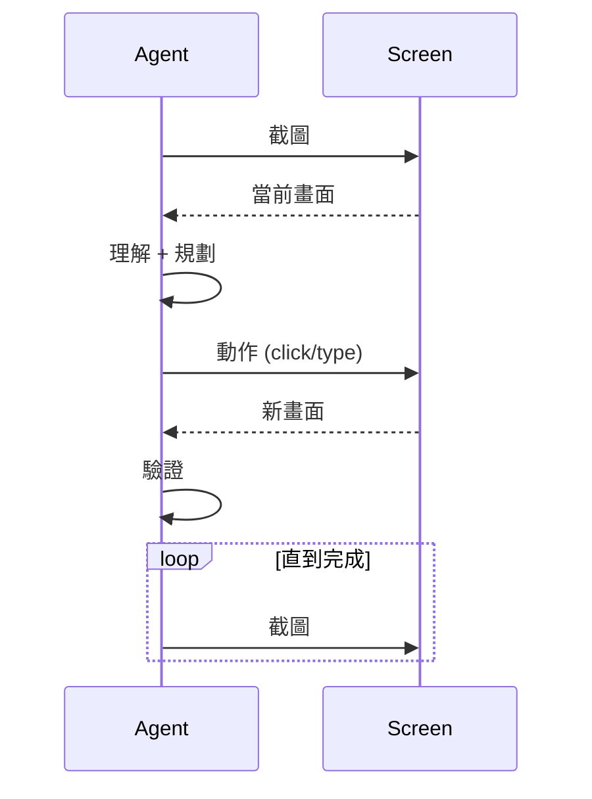
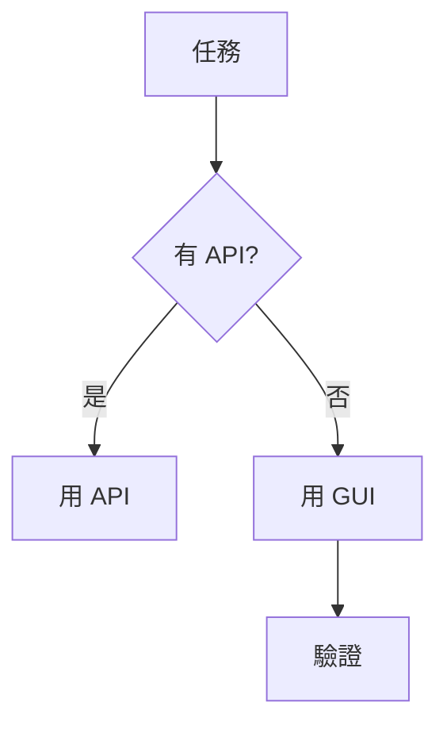

# 13.3 脫離純 API 依賴：透過視覺辨識與滑鼠鍵盤操作任意軟體與網頁（Computer Use / GUI Agents）、座標定位與軌跡驗證

## 為什麼要「操作 GUI」

多數軟體沒有 API，只有圖形介面。若 Agent 只能呼叫 API，就無法操作這些系統。**Computer Use / GUI Agent** 讓 Agent 像人一樣：看螢幕、移滑鼠、點擊、打字、捲動——**透過視覺與輸入裝置操作任意軟體**。



這是「脫離純 API 依賴」的關鍵能力，也是 Agent 邁向通用性的重要一步。

## 感知：把螢幕變成可理解的狀態

### 1. 截圖（Screenshot）

Agent 取得當前畫面：

```python
screenshot = capture_screen()   # 回傳 image
```

### 2. 元素偵測與理解

視覺模型辨識：
- 按鈕、輸入框、連結、選單。
- 文字內容（OCR 或原生多模態）。
- 版面結構（哪個區域是什麼）。



### 3. 無障礙樹（Accessibility Tree）

除了像素，還可用作業系統的無障礙 API 取得結構化 UI 樹：

```json
{
  "role": "button",
  "name": "送出",
  "bounds": [100, 200, 80, 30],
  "enabled": true
}
```

**像素 vs. 樹**：
- 像素：通用（任何畫面），但需視覺理解。
- 樹：精確、便宜，但依賴 OS/應用支援。

實務常**混合**：優先樹，缺失時用視覺。

## 行動：滑鼠與鍵盤

### 基本動作

| 動作 | 參數 | 例子 |
|---|---|---|
| click | (x, y) | 點擊按鈕 |
| double_click | (x, y) | 開啟檔案 |
| right_click | (x, y) | 上下文選單 |
| type | text | 輸入文字 |
| key | keys | 快捷鍵 Ctrl+C |
| scroll | (dx, dy) | 捲動 |
| drag | (x1,y1)->(x2,y2) | 拖放 |

```python
async def act(action):
    if action.type == "click":
        pyautogui.click(action.x, action.y)
    elif action.type == "type":
        pyautogui.write(action.text)
    elif action.type == "key":
        pyautogui.hotkey(*action.keys)
```

## 座標定位：GUI Agent 的核心難題

### 問題

模型要點擊「送出」按鈕，必須知道它在螢幕的哪個座標。這需要**視覺 grounding**：把語言描述映射到像素座標。

$$
\text{ground}: (\text{instruction}, \text{screenshot}) \to (x, y)
$$

### 方法

1. **邊界框預測**：模型輸出元素的外框。
2. **點擊點預測**：直接輸出點擊座標。
3. **網格化**：把螢幕切成網格，模型選格子。
4. **標記疊加**：在元素上疊加編號標籤，模型選編號（如 Set-of-Mark）。



**Set-of-Mark** 是常用技巧：先用分割/偵測找出候選元素，標上編號，模型只需回傳編號，降低座標回歸難度。

### 解析度與縮放

截圖解析度與模型輸入解析度不同，座標需換算：

$$
x_{\text{screen}} = x_{\text{model}} \cdot \frac{W_{\text{screen}}}{W_{\text{model}}}
$$

換算錯誤會導致點偏，是常見 bug。

## 軌跡驗證：動作真的生效了嗎

GUI 操作是**不可靠**的：點擊可能沒中、頁面可能延遲、彈窗可能攔截。Agent 必須**驗證每步**：



### 驗證方式

1. **畫面差異**：動作前後截圖比對。
2. **元素狀態**：按鈕是否變色、輸入框是否有文字。
3. **預期結果**：如「點送出後應出現成功訊息」。
4. **無障礙樹變化**：結構是否更新。

```python
async def click_and_verify(target, expectation):
    before = capture()
    click(target)
    await wait_for_change(before, timeout=3)
    after = capture()
    if not expectation.matches(after):
        raise ActionFailed(target)
```

## 動作迴圈



## 挑戰與失敗模式

| 挑戰 | 說明 | 對策 |
|---|---|---|
| 定位漂移 | 點偏 | Set-of-Mark、驗證、重試 |
| 動態畫面 | 元素移動/延遲 | 等待、條件輪詢 |
| 彈窗干擾 | 廣告、cookie | 偵測並關閉 |
| 滾動 | 元素在視窗外 | 先捲動再定位 |
| 多視窗 | 焦點錯 | 管理視窗焦點 |
| 縮放/解析度 | 座標換算錯 | 統一座標系 |
| 非文字 UI | 圖示按鈕 | 視覺 + tooltip |
| 長流程 | 步驟多易錯 | 檢查點、狀態追蹤 |

## 與傳統 RPA 的差異

| 面向 | RPA | GUI Agent |
|---|---|---|
| 定位 | 固定座標/選擇器 | 視覺理解 |
| 適應性 | 低（UI 變就壞） | 高（看得懂） |
| 開發 | 需錄製/腳本 | 自然語言任務 |
| 可靠性 | 高（確定） | 中（需驗證） |
| 適用 | 固定流程 | 開放任務 |

GUI Agent 的優勢是**泛化**，代價是**不確定性**，因此驗證與重試格外重要。

## 效率：何時不用 GUI

GUI 操作慢、脆、貴。若能呼叫 API，優先 API：

$$
\text{prefer API} \gg \text{prefer GUI}
$$

GUI 是最後手段，用於「無 API 可用」的場景。混合策略：能用 API 用 API，不能用才操作介面。



## 安全：GUI 是最危險的介面

GUI Agent 能點任何東西，包括「刪除帳號」「轉帳」。因此：
- 不可逆動作攔截（13.4）。
- 敏感畫面遮罩。
- 人工審批（6.3）。
- 沙盒化環境（6.1）。

## 與後續章節的關聯

- **13.1 視覺理解**：GUI 的感知基礎。
- **13.4 安全邊界**：GUI 操作的風險。
- **6.2 風險分級**：動作分類。
- **15.x 具身**：從螢幕到真實世界。

## 小結

1. GUI Agent 讓 Agent 透過視覺與滑鼠鍵盤操作任意軟體，脫離 API 依賴。
2. 感知靠截圖 + 元素偵測 + 無障礙樹（混合）。
3. 行動是滑鼠鍵盤動作，座標定位是核心難題（grounding、Set-of-Mark、座標換算）。
4. 每步都要驗證（畫面差異、元素狀態、預期結果）。
5. 失敗模式多：漂移、動態、彈窗、滾動、縮放。
6. GUI 慢脆貴，能用 API 就用 API，GUI 是最後手段。
7. GUI 是最危險的介面，需安全邊界。
