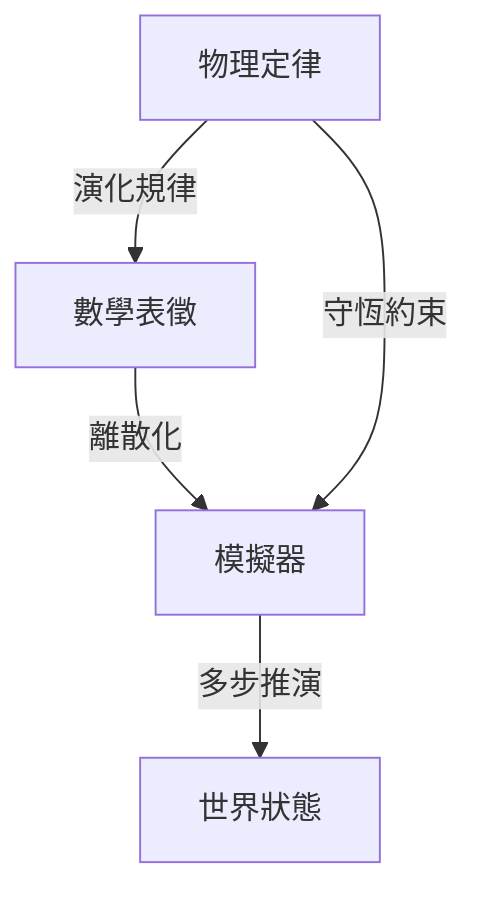
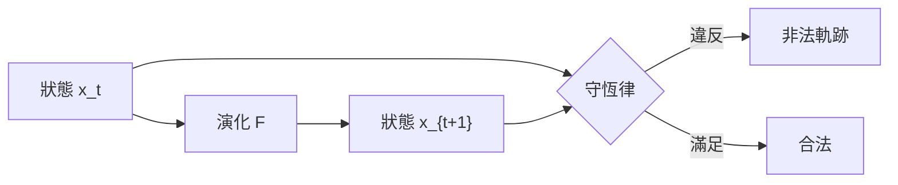
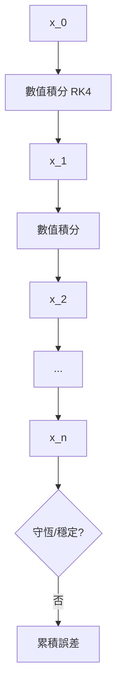
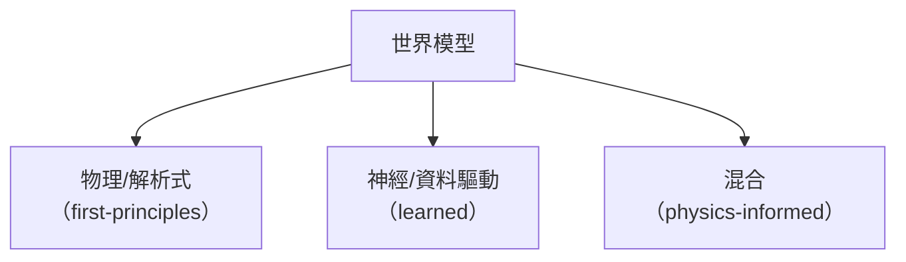

# 14.1 物理—數學—模擬三角關係：物理定律提供演化規律與守恆約束，數學提供嚴格表徵，模擬器負責多步狀態推演

## Agent 為什麼需要「物理」

前面各章的 Agent 活在符號世界：文字、API、GUI。但真實世界由**連續、動態、受物理定律約束的狀態**組成。要讓 Agent 在真實世界行動（機器人、自動駕駛、具身助理），它必須能**預測行動的後果**——這就需要世界模型（World Model），而世界模型的骨架是物理與數學。

## 三角關係的核心

三個角色各有職責：

| 角色 | 提供 | 回答的問題 |
|---|---|---|
| **物理** | 演化規律、守恆律、因果 | 世界如何變化？什麼不可能？ |
| **數學** | 嚴格表徵、可證明性質 | 如何精確描述？有何不變量？ |
| **模擬** | 數值推演、多步預測 | 下一步會怎樣？ |

$$
\text{物理} \xrightarrow{\text{建模}} \text{數學} \xrightarrow{\text{離散化}} \text{模擬} \xrightarrow{\text{觀測}} \text{物理}
$$

這是一個閉環：物理啟發數學模型，數值化為模擬，模擬結果再與物理觀測比對修正。

## 物理：演化規律與守恆約束

### 演化規律

物理定律描述狀態如何隨時間演化。連續系統常用**微分方程**：

$$
\frac{d\mathbf{x}}{dt} = f(\mathbf{x}, \mathbf{u}, t)
$$

- $`\mathbf{x}`$：狀態（位置、速度、溫度……）。
- $`\mathbf{u}`$：控制輸入。
- $`f`$：演化函數（由物理定律決定）。

離散時間則寫成：

$$
\mathbf{x}_{t+1} = F(\mathbf{x}_t, \mathbf{u}_t)
$$

### 守恆約束

物理的強大之處在於**某些量不隨時間改變**：

- 能量守恆：$`E(\mathbf{x}_{t+1}) = E(\mathbf{x}_t)`$（封閉系統）。
- 動量守恆：$`\mathbf{p}_{t+1} = \mathbf{p}_t`$。
- 質量守恆。

這些是**硬約束**：任何合法軌跡都必須滿足。世界模型若違反守恆律，就是「物理幻覺」（14.4）。

## 數學：嚴格表徵

數學把物理規律寫成可分析、可證明的形式。

### 1. 微分方程

牛頓力學：$`m\ddot{\mathbf{q}} = \mathbf{F}`$
拉格朗日：$`\frac{d}{dt}\frac{\partial L}{\partial \dot q} - \frac{\partial L}{\partial q} = 0`$
哈密頓：$`\dot q = \frac{\partial H}{\partial p}, \dot p = -\frac{\partial H}{\partial q}`$

這些形式等價，但各有優勢（拉格朗日適合約束系統，哈密頓揭示辛結構）。

### 2. 幾何與流形

位形空間常是**流形**（manifold），而非歐氏空間：
- 旋轉在 $`SO(3)`$（李群）。
- 位置在 $`\mathbb{R}^3`$，但姿態在彎曲空間。

這引出李群/李代數（14.2）。

### 3. 不變量

數學能證明系統的**不變量**（invariants）：無論怎麼演化，某些量不變。這對驗證模擬至關重要（第 16 章形式化）。

$$
I(\mathbf{x}_{t+1}) = I(\mathbf{x}_t) \quad \forall t
$$

## 模擬：多步狀態推演

模擬器把連續方程**離散化**，數值推演：

$$
\mathbf{x}_{t+1} = \mathbf{x}_t + \Delta t \cdot f(\mathbf{x}_t, \mathbf{u}_t)
$$

### 離散化方法

| 方法 | 說明 | 取捨 |
|---|---|---|
| 顯式歐拉 | $`x_{t+1} = x_t + \Delta t f(x_t)`$ | 簡單、可能不穩 |
| 隱式歐拉 | 解方程求 $`x_{t+1}`$ | 穩定、計算貴 |
| 龍格-庫塔（RK4） | 多點加權 | 精度高、成本中 |
| 辛積分 | 保持辛結構 | 長期能量守恆 |

### 穩定性的重要性

顯式方法在 $`\Delta t`$ 太大時會**數值爆炸**（不穩定）：

$$
\Delta t < \Delta t_{\text{critical}} \sim \frac{1}{\lambda_{\max}}
$$

這是模擬失真的來源之一（14.4）。

## 為什麼三者缺一不可

### 只有物理，沒有數學

物理直覺難以精確、難以證明、難以實現。

### 只有數學，沒有物理

漂亮的方程若脫離真實物理，模擬就無意義。

### 只有模擬，沒有物理/數學

純資料驅動的模擬（如神經網路）可能在訓練分布外產生「物理幻覺」，因為它沒學到守恆律與因果。

**三者結合**才能得到：正確的規律（物理）+ 嚴格的表徵（數學）+ 可執行的推演（模擬）。

## 與世界模型的關係

世界模型（World Model）本質是「可預測環境動態的內部模型」：

$$
\text{world model}: (\text{state}_t, \text{action}_t) \to \text{state}_{t+1}
$$

它有兩種實作路線：

- **解析式**：用物理方程，精確但需建模。
- **神經**：從資料學，靈活但可能幻覺。
- **混合**：神經 + 物理先驗，兼顧（14.3）。

三角關係提醒我們：**好的世界模型需要物理約束與數學結構**，否則只是統計擬合。

## 離散時間的馬可夫性

若狀態 $`\mathbf{x}_t`$ 完整描述系統，則未來只依賴當前：

$$
P(\mathbf{x}_{t+1} \mid \mathbf{x}_t, \mathbf{x}_{t-1}, \dots) = P(\mathbf{x}_{t+1} \mid \mathbf{x}_t)
$$

這就是**馬可夫性**。但真實系統常有**部分可觀測**（看不到全部狀態），需用 POMDP（14.2）。

## 與後續章節的關聯

- **14.2**：物理與數學的具體工具箱。
- **14.3**：神經模擬與影片生成的融合。
- **14.4**：模擬失真與治理。
- **15.x**：模擬到實體。
- **16.x**：形式化驗證。

## 小結

1. Agent 進入真實世界需世界模型，其骨架是物理—數學—模擬三角。
2. 物理提供演化規律（微分方程）與守恆約束（硬限制）。
3. 數學提供嚴格表徵（微分方程、流形、不變量）。
4. 模擬離散化數值推演，需注意穩定性與誤差累積。
5. 三者缺一不可：規律 + 表徵 + 推演。
6. 世界模型有解析、神經、混合三路線，物理約束是防幻覺關鍵。
