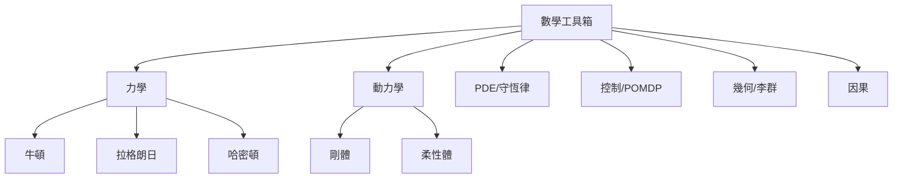
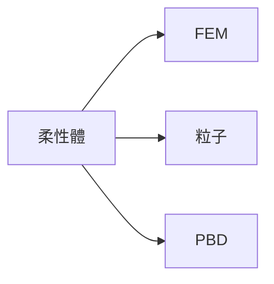
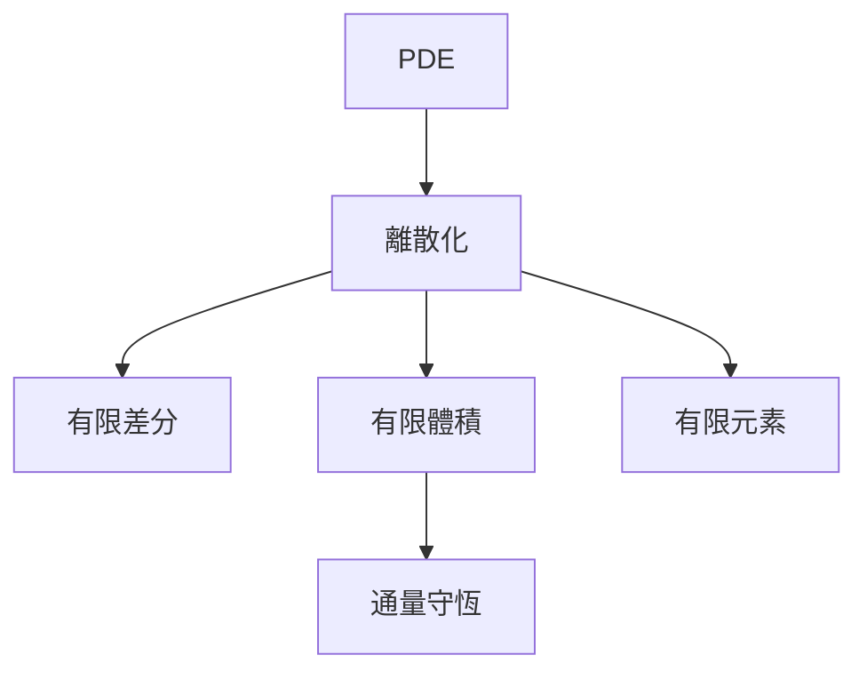
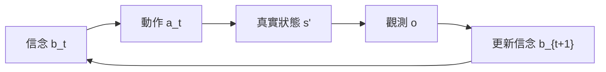
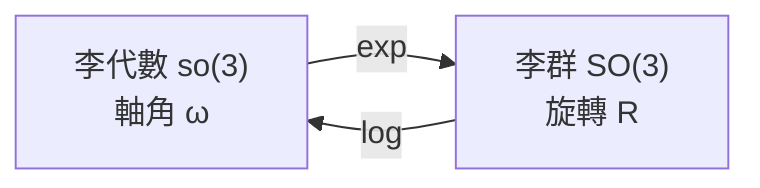
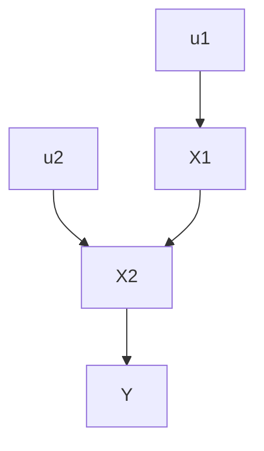
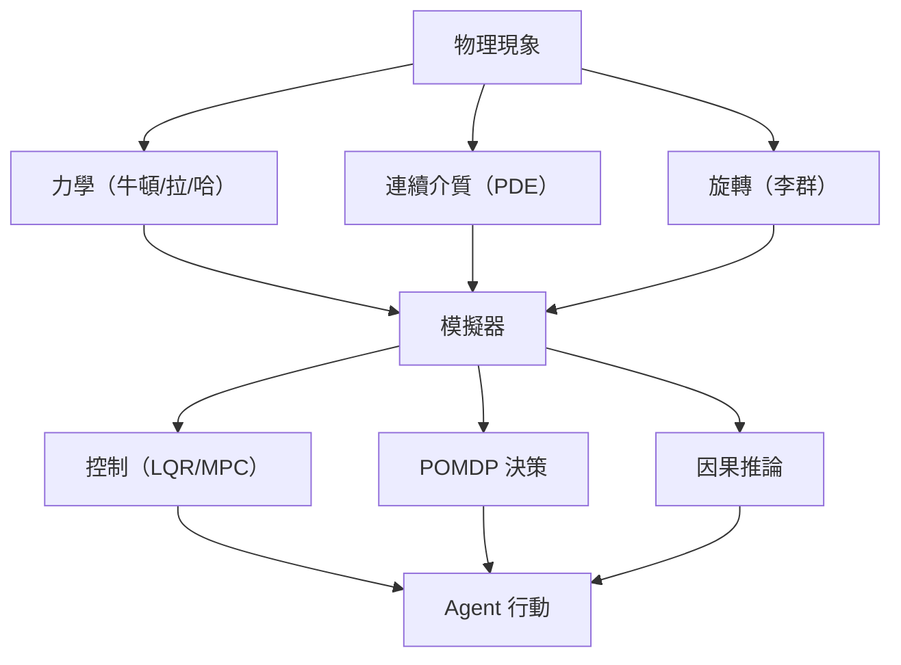

# 14.2 物理模型與數學工具箱：牛頓/拉格朗日/哈密頓力學、剛體與柔性體動力學、偏微分方程（PDE）與守恆律、控制與 POMDP、李群/流形幾何與因果推論

## 工具箱的意義

14.1 說明了物理—數學—模擬三角。本節把「數學工具箱」攤開：世界模型需要哪些具體工具，以及它們為何互相關聯。這是一份**給工程師的物理—數學地圖**。

## 一、三種力學表述

### 1. 牛頓力學（向量力）

$$
\mathbf{F} = m\mathbf{a} = m\ddot{\mathbf{q}}
$$

以力與加速度描述。直觀，適合簡單系統。

### 2. 拉格朗日力學（能量）

定義拉格朗日量 $`L = T - V`$（動能減位能）：

$$
\frac{d}{dt}\left(\frac{\partial L}{\partial \dot q_i}\right) - \frac{\partial L}{\partial q_i} = 0
$$

**優勢**：自動處理約束（如擺的繩長約束），用廣義座標 $`q`$ 而非笛卡兒座標。

### 3. 哈密頓力學（相空間）

定義哈密頓量 $`H(q,p) = T + V`$：

$$
\dot q_i = \frac{\partial H}{\partial p_i}, \qquad \dot p_i = -\frac{\partial H}{\partial q_i}
$$

**優勢**：揭示**辛結構（symplectic structure）**，長期積分能保持能量守恆（辛積分器）。

三者等價，但適用場景不同：牛頓直觀、拉格朗日約束、哈密頓保結構。

## 二、剛體與柔性體動力學

### 剛體（Rigid Body）

剛體有 6 自由度：位置 $`\mathbf{r} \in \mathbb{R}^3`$ + 姿態 $`R \in SO(3)`$。

牛頓—歐拉方程：

$$
m\dot{\mathbf{v}} = \mathbf{F}, \qquad I\dot{\boldsymbol{\omega}} + \boldsymbol{\omega} \times (I\boldsymbol{\omega}) = \boldsymbol{\tau}
$$

其中 $`I`$ 是慣性張量。

**難點**：旋轉在 $`SO(3)`$ 上，不是歐氏空間，需李群處理（見下）。

### 柔性體（Deformable Body）

可變形物體（布料、流體、軟體機器人）。用：
- **有限元素法（FEM）**：離散為元素。
- **粒子系統**：質點 + 彈簧。
- **位置基礎動力學（PBD）**：約束求解，穩定快速。

## 三、偏微分方程（PDE）與守恆律

連續介質（流體、熱、電磁）用 PDE 描述。

### 守恆律的一般形式

$$
\frac{\partial u}{\partial t} + \nabla \cdot \mathbf{F}(u) = S
$$

- $`u`$：守恆量（質量、動量、能量）。
- $`\mathbf{F}`$：通量。
- $`S`$：源項。

### 常見 PDE

| PDE | 描述 |
|---|---|
| 波動方程 | $`u_{tt} = c^2 \nabla^2 u`$ |
| 熱方程 | $`u_t = \alpha \nabla^2 u`$ |
| 納維—斯托克斯 | 流體：$`\rho(\mathbf{u}_t + \mathbf{u}\cdot\nabla\mathbf{u}) = -\nabla p + \mu\nabla^2\mathbf{u}`$ |
| 馬克士威 | 電磁場 |

### 數值解法

- **有限差分（FDM）**：網格上近似導數。
- **有限體積（FVM）**：守恆律的首選，保證通量守恆。
- **有限元素（FEM）**：複雜幾何。

**關鍵**：好的數值格式應**保持守恆性**（conservative scheme），否則模擬會憑空產生/消滅質量。

## 四、控制理論與 POMDP

### 控制系統

$$
\dot{\mathbf{x}} = A\mathbf{x} + B\mathbf{u}
$$

目標：設計 $`\mathbf{u}`$ 使系統達到期望狀態。

- **LQR**：線性二次調節器，最小化 $`\int (x^TQx + u^TRu)dt`$。
- **MPC（模型預測控制）**：每步求解有限時域最佳化。

### POMDP（部分可觀測馬可夫決策過程）

真實世界**看不到完整狀態**，只能從觀測推斷：

$$
\text{POMDP} = (\mathcal{S}, \mathcal{A}, \mathcal{O}, T, O, R, \gamma)
$$

- $`\mathcal{S}`$：狀態空間。
- $`\mathcal{A}`$：動作。
- $`\mathcal{O}`$：觀測。
- $`T(s'|s,a)`$：轉移。
- $`O(o|s)`$：觀測機率。
- $`R`$：獎勵。
- $`\gamma`$：折扣。

Agent 維護**信念狀態（belief）**：

$$
b_{t+1}(s') \propto O(o_{t+1} \mid s') \sum_s T(s' \mid s, a_t) b_t(s)
$$

POMDP 是世界模型的數學框架：Agent 在不確定下決策。第 15 章的具身 Agent 本質是 POMDP。

## 五、李群、流形與幾何

### 為什麼需要李群

3D 旋轉不滿足交換律，且在歐氏空間表示會退化（萬向鎖）。用**李群 $`SO(3)`$** 精確表示：

$$
SO(3) = \{ R \in \mathbb{R}^{3\times3} : R^TR = I, \det R = 1 \}
$$

李代數 $`\mathfrak{so}(3)`$ 是「切空間」，用軸角向量 $`\boldsymbol{\omega} \in \mathbb{R}^3`$ 參數化，透過指數映射回到群：

$$
R = \exp([\boldsymbol{\omega}]_\times)
$$

### 流形（Manifold）

位形空間常是彎曲流形。最佳化需在流形上做（流形最佳化），而非歐氏空間。

這對 SLAM、運動規劃（15.1）至關重要。

## 六、因果推論

### 相關不等於因果

世界模型若要「正確」預測**干預**的後果，需要因果，而非只是相關。

$$
P(y \mid do(x)) \neq P(y \mid x)
$$

- $`P(y|x)`$：觀察到 $`x`$ 時的 $`y`$。
- $`P(y|do(x))`$：**主動設定** $`x`$ 時的 $`y`$。

### 結構因果模型（SCM）

$$
x_i = f_i(\text{pa}(x_i), u_i)
$$

每個變數由其父節點與外生雜訊決定。這讓 Agent 能回答反事實：「如果當初選另一條路會怎樣？」

因果對**行動前推演**（14.4）與**安全干預**（15.3）不可或缺。

## 工具箱的整合

## 與後續章節的關聯

- **14.1 三角關係**：本節是「數學」與「物理」的展開。
- **14.3 神經模擬**：這些工具作為物理先驗注入神經網路。
- **14.4 失真治理**：不變量與守恆律是檢查工具。
- **15.1 空間理解**：李群與流形的應用。
- **16.x 形式化**：把這些不變量變成可證明的定理。

## 小結

1. 三種力學表述等價：牛頓（力）、拉格朗日（能量/約束）、哈密頓（相空間/辛結構）。
2. 剛體 6 自由度用 $`SO(3)`$ 表示旋轉；柔性體用 FEM/粒子/PBD。
3. PDE 描述連續介質，守恆律需守恆數值格式。
4. 控制（LQR/MPC）與 POMDP 提供不確定下的決策框架。
5. 李群/流形精確處理旋轉與彎曲空間；因果推論區分相關與干預。
6. 這些工具整合成世界模型的數學骨架，也是形式化驗證的對象。
