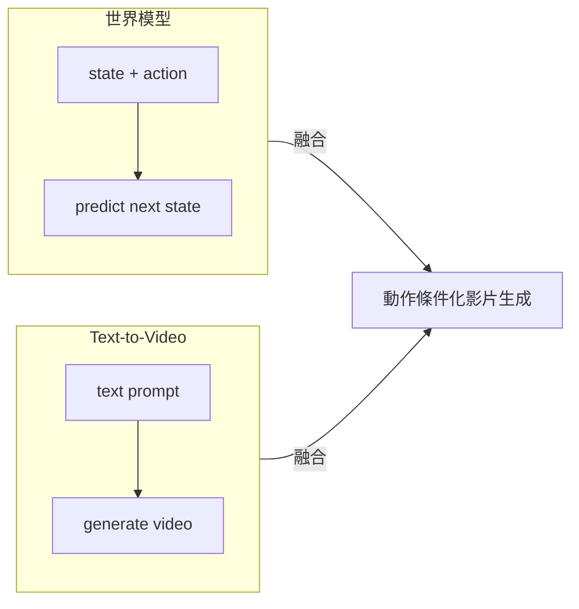
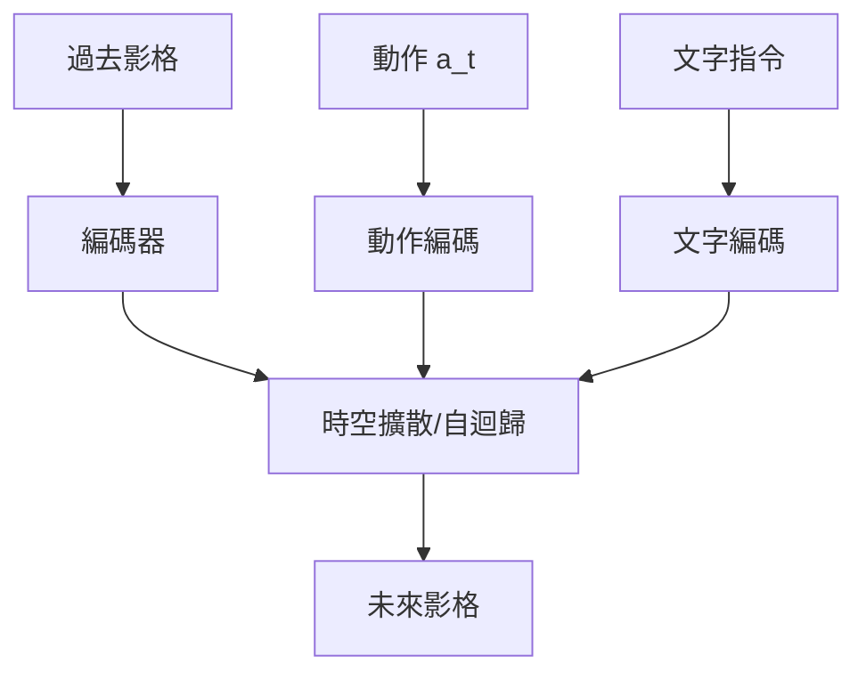
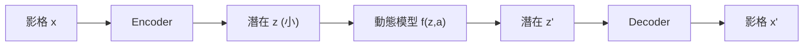
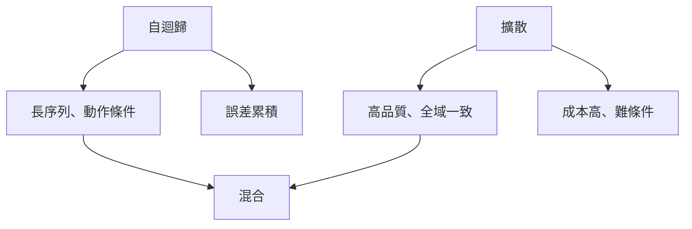
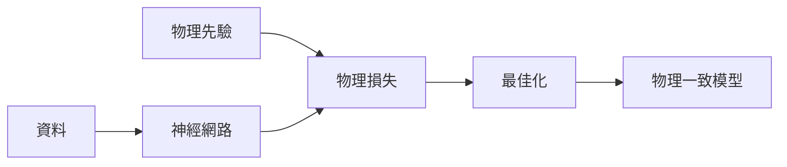
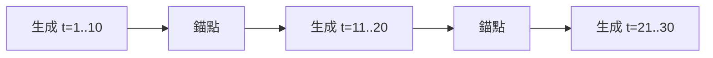
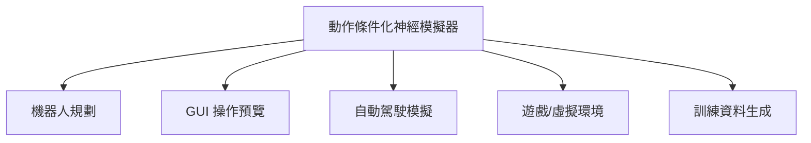

# 14.3 世界模型與 Text-to-Video 的端到端（E2E）融合：動作條件化（Action-Conditioned）神經模擬器、潛在空間（Latent Space）動態推演、物理先驗注入與長時序一致性

## 兩條技術路線的交會

一邊是**世界模型**：預測「給定動作，環境如何變化」。另一邊是**Text-to-Video（T2V）**：生成「符合描述的影片」。看似不同，實則高度重疊——**影片生成本質上就是一種世界模擬**。

若能讓影片生成器接受「動作」作為條件，就得到**動作條件化的神經模擬器**：

$$
\text{video}_{t+1} = \text{Model}(\text{video}_{\le t}, \text{action}_t, \text{text})
$$

這是世界模型與生成式影片的端到端融合。

## 動作條件化（Action-Conditioned）

### 核心想法

標準 T2V 只吃文字。動作條件化額外吃「動作」：

$$
p(\text{future frames} \mid \text{past frames}, \text{action}, \text{instruction})
$$

動作可以是：
- 機器人的關節指令。
- GUI 的點擊/輸入（13.3）。
- 遊戲的手把輸入。
- 抽象的「移動前進」「抓取」。

### 條件注入方式

1. **拼接（Concatenation）**：把動作嵌入與影格特徵拼接。
2. **交叉注意力（Cross-Attention）**：動作作為 query/key。
3. **FiLM/AdaLN**：用動作調變特徵。
4. **ControlNet 式**：額外控制分支。

## 潛在空間（Latent Space）動態推演

直接在像素空間生成影片太貴（$`H \times W \times T`$）。用**潛在空間**：

$$
\text{frame} \xrightarrow{\text{encoder}} z \xrightarrow{\text{dynamics}} z' \xrightarrow{\text{decoder}} \text{frame}'
$$

在壓縮的 $`z`$ 上做動態推演，大幅降低計算。

### 為什麼潛在空間更好

- **效率**：維度低，計算快。
- **抽象**：潛在空間捕捉語意而非像素細節。
- **穩定**：避免像素級雜訊累積。

但要注意：潛在空間可能**丟失物理關鍵資訊**（如精確位置），導致漂移。

## 自迴歸 vs. 擴散

兩種生成範式：

### 自迴歸（Autoregressive）

逐格/逐塊預測：

$$
p(\text{video}) = \prod_t p(\text{frame}_t \mid \text{frame}_{<t}, \text{action}_{<t})
$$

- 優點：自然支援長序列、動作條件。
- 缺點：**誤差累積**、慢（序列生成）。

### 擴散（Diffusion）

整體去噪：

$$
p(\text{video}) = \int p(\text{noise}) \prod_t p(x_{t-1} \mid x_t) \, dx
$$

- 優點：品質高、全域一致。
- 缺點：難做精確動作條件、長影片成本高。

實務常混合：擴散生成短片段，自迴歸串接長影片。

## 物理先驗注入

純神經模型不懂物理，容易產生幻覺（物體憑空消失、穿透）。注入物理先驗：

### 1. 損失函數約束

在訓練時加入物理損失：

$$
\mathcal{L} = \mathcal{L}_{\text{gen}} + \lambda_1 \mathcal{L}_{\text{conservation}} + \lambda_2 \mathcal{L}_{\text{smooth}}
$$

- $`\mathcal{L}_{\text{conservation}}`$：懲罰能量/動量不守恆。
- $`\mathcal{L}_{\text{smooth}}`$：懲罰不連續運動。

### 2. 架構約束

- **哈密頓神經網路（HNN）**：強制學哈密頓量，保證辛結構。
- **拉格朗日神經網路（LNN）**：學拉格朗日量。
- **圖神經網路（GNN）**：粒子互動。

### 3. 混合模型

$$
\text{state}_{t+1} = \underbrace{F_{\text{physics}}(\text{state}_t)}_{\text{已知物理}} + \underbrace{G_\theta(\text{state}_t)}_{\text{神經殘差}}
$$

物理主幹 + 神經修正，兼顧精度與泛化。

## 長時序一致性（Long-Horizon Consistency）

影片越長，越容易**漂移**：物體變形、顏色漂移、場景突變、物理崩壞。

### 成因

- **誤差累積**：每步小誤差疊加。
- **記憶有限**：模型忘記早期內容。
- **分布外**：越走越偏離訓練分布。

### 對策

1. **關鍵幀錨定**：定期回到已知狀態。
2. **全域注意力**：跨時序建模。
3. **物理約束**：守恆律防止崩壞。
4. **分層生成**：先低頻結構，再高頻細節。
5. **重錨定（Re-anchoring）**：用真實觀測校正。

## 評估世界模型

怎麼知道影片生成器是好的世界模型？

| 指標 | 說明 |
|---|---|
| 物理合理性 | 是否違反物理（穿透、消失） |
| 動作遵循 | 動作是否產生預期效果 |
| 時序一致性 | 物件是否穩定 |
| 長期漂移 | 長影片是否崩壞 |
| 與真實比對 | 預測 vs. 實際 |

$$
\text{world model quality} = f(\text{physical plausibility}, \text{action fidelity}, \text{consistency})
$$

## 應用場景

Agent 可在**行動前**用世界模型模擬後果，選擇最佳動作（14.4）。

## 與後續章節的關聯

- **14.1/14.2**：物理與數學先驗的來源。
- **14.4**：模擬失真的治理。
- **15.2**：Sim-to-Real 遷移。
- **16.x**：用形式化約束模擬。

## 小結

1. 世界模型與 T2V 本質重疊，融合成動作條件化神經模擬器。
2. 動作條件化讓模型接受動作輸入，預測後果。
3. 潛在空間推演高效，但可能丟失物理關鍵資訊。
4. 自迴歸適合長序列/動作條件，擴散適合高品質，常混合。
5. 物理先驗注入（損失、架構、混合）對抗幻覺。
6. 長時序一致性靠錨定、全域注意力、物理約束、分層、重錨定。
7. 評估需看物理合理性、動作遵循、一致性、漂移。
