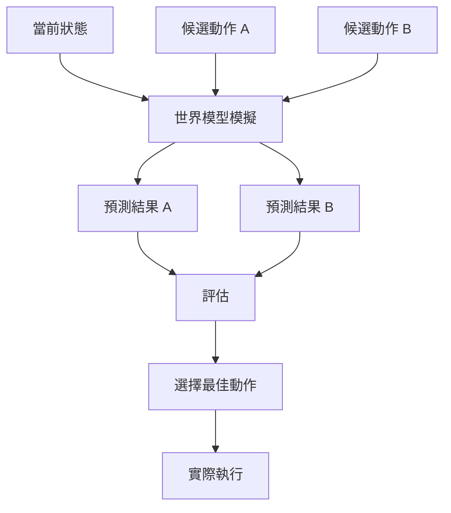
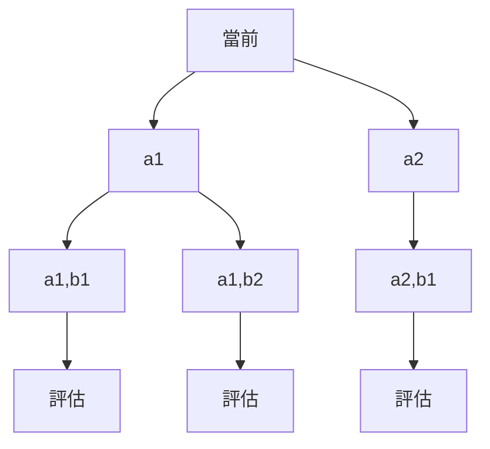
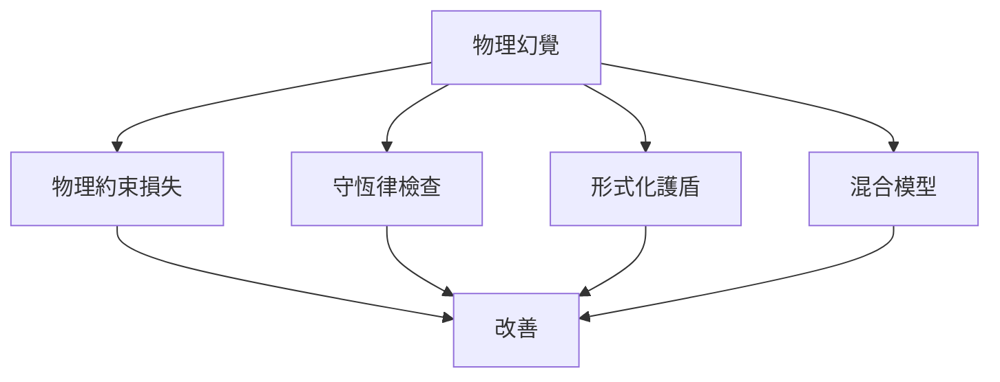
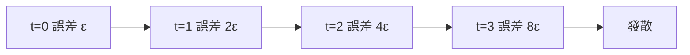
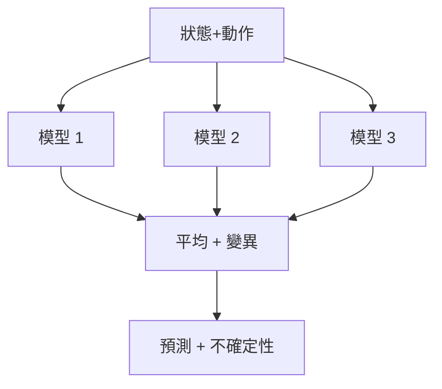
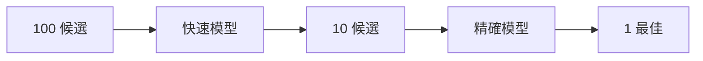
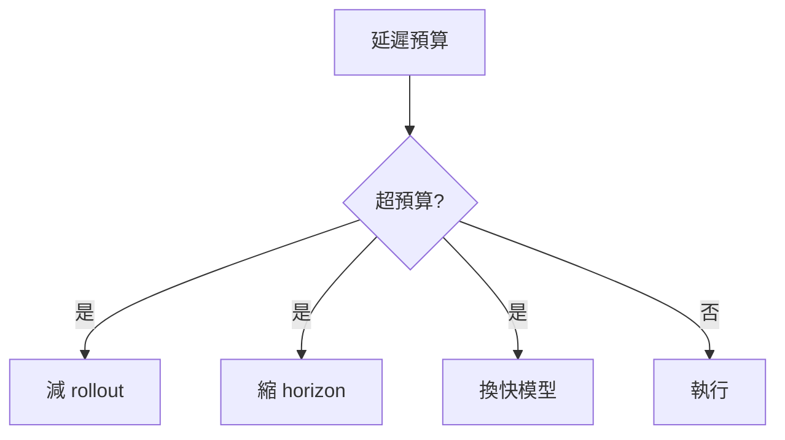

# 14.4 行動前推演與模擬失真治理：Mental Simulation、物理幻覺與累積漂移成因、算力與延遲優化

## 行動前推演（Mental Simulation）

人類在下棋、開車、組裝家具前，會在腦中「預演」：如果我這樣做，會發生什麼？Agent 也需要這個能力——**在真正行動前，用世界模型模擬後果**。

$$
a^* = \arg\max_{a \in \mathcal{A}} \; \mathbb{E}\big[ U(\text{simulate}(\text{state}, a)) \big]
$$



這把「試錯」從真實世界搬到模擬世界，避免昂貴/危險的實際嘗試。

## 為什麼推演很重要

| 場景 | 不推演的後果 | 推演的好處 |
|---|---|---|
| 機器人抓取 | 撞倒物品 | 先算路徑 |
| 自動駕駛 | 危險 | 預測軌跡 |
| GUI 操作 | 誤刪資料 | 先看後果 |
| 資源分配 | 超支 | 先估成本 |

推演是 Agent 從「反應式」邁向「規劃式」的關鍵（7.2 Plan-and-Execute 的深層基礎）。

## 推演的兩種範式

### 1. 樹搜尋（Tree Search）

在動作空間展開樹，評估葉節點：



- **MCTS（蒙地卡羅樹搜尋）**：取樣 + UCB 平衡探索/利用。
- **AlphaZero 式**：網路引導 + 搜尋。

$$
\text{UCB}(s,a) = Q(s,a) + c\sqrt{\frac{\ln N(s)}{N(s,a)}}
$$

### 2. 軌跡取樣（Trajectory Sampling）

從模型取樣多條未來軌跡，統計評估：

$$
\{(\text{future}^{(i)}, \text{reward}^{(i)})\}_{i=1}^N \to \hat{\mathbb{E}}[\text{reward}]
$$

適合連續動作空間（機器人）。

## 物理幻覺（Physical Hallucination）

### 表現

模擬器生成**違反物理**的結果：
- 物體穿透（穿牆、穿地）。
- 憑空消失/出現。
- 能量不守恆（越滾越快）。
- 違反因果（先果後因）。
- 不合理的碰撞反應。


### 成因

1. **資料驅動的極限**：神經模型只學到統計相關，不懂守恆律。
2. **分布外**：遇到訓練沒見過的情境就亂猜。
3. **離散化誤差**：數值方法本身的誤差。
4. **潛在空間丟失**：壓縮掉了物理關鍵變數。
5. **訓練目標錯**：只優化像素相似度，不管物理。

### 治理



- **物理約束損失**（14.3）。
- **守恆律檢查**：模擬後驗證能量/動量。
- **形式化護盾**：用定理證明排除非法軌跡（16.4）。
- **混合模型**：物理主幹 + 神經殘差。

## 累積漂移（Cumulative Drift）

### 問題

即使每步誤差很小，長時間累積也會偏離：

$$
\|\mathbf{x}_t^{\text{sim}} - \mathbf{x}_t^{\text{real}}\| \sim O(t \cdot \epsilon) \quad \text{或} \quad O(e^{\lambda t}\epsilon)
$$

線性累積是溫和的；**指數發散**（混沌系統）則會迅速失控。



### 混沌系統的挑戰

有些系統（如多體、流體）對初始條件極敏感（正 Lyapunov 指數）：

$$
\delta(t) \approx \delta_0 e^{\lambda t}, \quad \lambda > 0
$$

長期精確預測**本質上不可能**，只能做短期預測或統計預測。

### 治理

1. **重錨定（Re-anchoring）**：定期用真實觀測校正。
2. **短期推演**：只推幾步就重新感知（Receding Horizon）。
3. **不確定性量化**：預測時附信心區間。
4. **集合預測（Ensemble）**：多條軌跡，看分布。
5. **形式化不變量**：用守恆律限制漂移方向。


## 不確定性量化

好的推演不只給「會怎樣」，還給「多確定」：

$$
P(\mathbf{x}_{t+k} \mid \mathbf{x}_t, a_{t:t+k})
$$

方法：
- **機率模型**：輸出分布而非點估計。
- **Ensemble**：多模型平均 + 變異數。
- **貝氏方法**：後驗分布。
- **共形預測（Conformal）**：有保證的區間。



不確定性高時，Agent 應**保守行動**或**先探索**。

## 算力與延遲優化

推演很貴：每步都要跑模型。優化策略：

### 1. 模型規模分層

- **快速模型**：粗推演，篩選候選。
- **精確模型**：細推演，只對少數候選。



### 2. 早停（Early Termination）

若某動作明顯不好，提早停止推演：

```python
for step in range(horizon):
    state = model.step(state, action)
    if is_hopeless(state):
        return -inf
```

### 3. 平行推演

多條軌跡/多個動作並行（4.3）：

```python
results = await asyncio.gather(*[simulate(a) for a in actions])
```

### 4. 快取

相似狀態重用推演結果。

### 5. 潛在空間推演

在低維潛在空間模擬（14.3），比像素空間快。

### 6. 自適應精度

簡單情境用粗模擬，關鍵決策用精細模擬。

## 延遲預算

$$
T_{\text{decision}} = N_{\text{rollouts}} \times H_{\text{horizon}} \times T_{\text{step}} \le T_{\max}
$$

若超預算，減少 rollout 數、縮短 horizon、或用更快模型。



## 推演的可靠性邊界

**何時可以信任推演？**

- 短期、低不確定性、物理明確 → 可信任。
- 長期、高不確定性、混沌 → 不可信任，需重錨定。

$$
\text{trust} \propto \frac{1}{\text{horizon} \times \text{uncertainty}}
$$

Agent 應**知道何時不該相信自己的模擬**。

## 與後續章節的關聯

- **14.2 數學工具**：不變量與守恆律。
- **14.3 神經模擬**：推演的引擎。
- **15.2 Sim-to-Real**：模擬到現實的落差。
- **16.4 形式化護盾**：裁減非法推演。

## 小結

1. 行動前推演用世界模型預測後果，把試錯搬到模擬。
2. 兩種範式：樹搜尋（MCTS）與軌跡取樣。
3. 物理幻覺源於資料驅動極限、分布外、離散化、潛在空間丟失；靠物理約束、守恆檢查、形式化護盾治理。
4. 累積漂移可線性或指數（混沌），需重錨定、短期推演、不確定性量化、ensemble。
5. 算力優化：模型分層、早停、平行、快取、潛在空間、自適應精度。
6. 延遲預算決定 rollout 數與 horizon。
7. Agent 要知道何時不可信推演。
