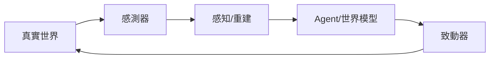
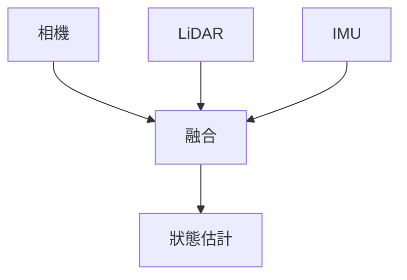
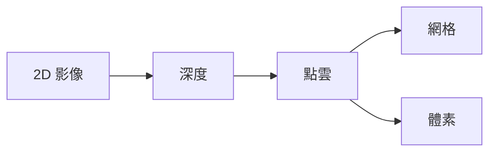
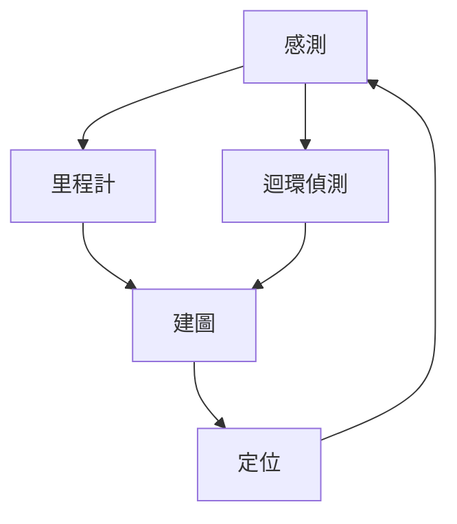
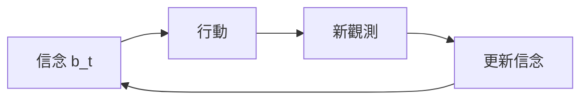
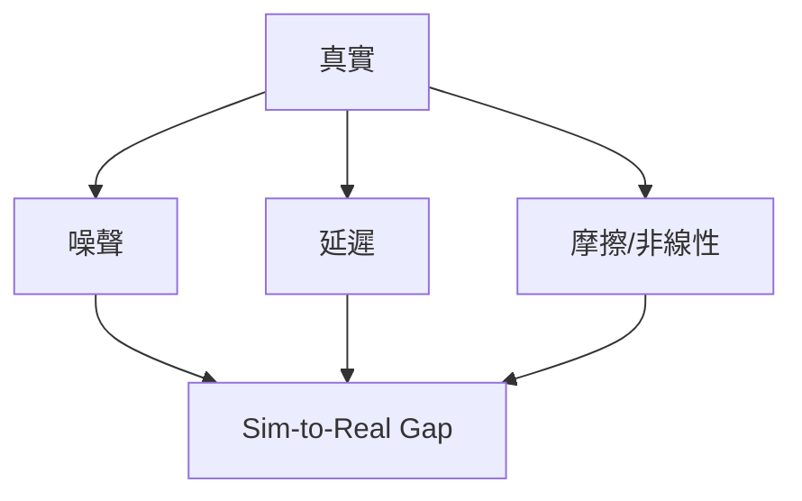

# 15.1 實體與模擬的介面：感測器物理模型、3D 空間重建、局部可觀測性與現實摩擦/噪聲/延遲挑戰

## 從數位到物理的跨越

第 14 章的世界模型活在模擬裡。第 15 章要把它接到**真實世界**。這一步的鴻溝遠比想像大：真實世界有噪聲、延遲、摩擦、不可預測性，且 Agent 只能「局部」看到它。

這是一個閉環：真實 → 感測 → 推理 → 行動 → 真實。每一環都有失真。

## 感測器物理模型

Agent 透過感測器認識世界，而感測器**不是完美的眼睛**。

### 常見感測器

| 感測器 | 提供 | 特性/限制 |
|---|---|---|
| RGB 相機 | 2D 影像 | 無深度、受光照影響 |
| 深度相機 | 深度圖 | 範圍限制、反光失效 |
| LiDAR | 3D 點雲 | 精確、貴、雨霧衰減 |
| IMU | 加速度/角速度 | 高頻、累積漂移 |
| 編碼器 | 關節角度 | 精確、需校準 |
| 力/力矩感測 | 接觸力 | 用於抓取控制 |
| 麥克風 | 聲音 | 噪聲、回音 |

每種感測器有自己的**物理模型**與**噪聲模型**：

$$
\mathbf{z} = h(\mathbf{x}) + \boldsymbol{\eta}, \quad \boldsymbol{\eta} \sim \mathcal{N}(0, \Sigma)
$$

- $`h`$：感測函數。
- $`\boldsymbol{\eta}`$：噪聲。

### 感測器融合

單一感測器不足，需融合多源：

卡爾曼濾波（KF）是經典方法：

$$
\begin{aligned}
\hat{\mathbf{x}}_{t|t-1} &= F\hat{\mathbf{x}}_{t-1} + Bu \\
P_{t|t-1} &= FP_{t-1}F^T + Q \\
K_t &= P_{t|t-1}H^T(HP_{t|t-1}H^T + R)^{-1} \\
\hat{\mathbf{x}}_{t|t} &= \hat{\mathbf{x}}_{t|t-1} + K_t(\mathbf{z}_t - H\hat{\mathbf{x}}_{t|t-1})
\end{aligned}
$$

- $`Q`$：過程噪聲。
- $`R`$：觀測噪聲。
- $`K`$：卡爾曼增益。

延伸：EKF（非線性）、UKF（無跡）、粒子濾波（多峰）。

## 3D 空間重建

Agent 需要「空間感」：物件在哪、多大、怎麼連。

### 1. 從 2D 到 3D

- **單目深度估計**：從一張圖推深度（不精確）。
- **雙目/多視角**：三角測量。
- **深度相機/LiDAR**：直接測距。

### 2. 點雲與體素

- **點雲（Point Cloud）**：$`\{(x,y,z)\}`$ 集合。
- **體素（Voxel）**：3D 網格。
- **網格（Mesh）**：頂點 + 面。

### 3. 建圖與定位（SLAM）

同時定位與建圖：

SLAM 的難點：累積漂移（14.4）、動態環境、尺度不確定。

### 4. 場景表示

- **佔據柵格（Occupancy Grid）**：哪裡有物體。
- **TSDF**：截斷符號距離場。
- **神經輻射場（NeRF）/ 3D Gaussian Splatting**：隱式/半顯式表示。

這些表示讓 Agent 能查詢「這個位置有東西嗎」「從 A 到 B 有障礙嗎」。

## 局部可觀測性（Partial Observability）

真實世界的關鍵挑戰：**Agent 看不到全部**。

- 視野有限（FOV）。
- 遮擋（occlusion）。
- 感測範圍限制。
- 隱藏狀態（如人的意圖）。

$$
\text{observation} = O(\text{full state}), \quad |\text{obs}| \ll |\text{state}|
$$

這正是 POMDP（14.2）的現實來源。

### 信念維護

Agent 需維護「我認為世界是什麼樣」的信念分布：

$$
b_t(\mathbf{s}) = P(\mathbf{s}_t = \mathbf{s} \mid \text{history})
$$

### 主動感知

既然看不全，就**主動去看**：

- 移動以獲得更好視角。
- 轉動相機。
- 觸碰以確認。

$$
a^* = \arg\max_a \; \underbrace{\mathbb{E}[\text{information gain}]}_{\text{探索}} + \underbrace{\mathbb{E}[\text{task reward}]}_{\text{利用}}
$$

這是探索—利用權衡（exploration-exploitation）。

## 現實的三大摩擦

### 1. 噪聲（Noise）

- 感測噪聲（$`\eta`$）。
- 致動噪聲（馬達不精確）。
- 環境噪聲（風、振動）。

### 2. 延遲（Latency）

- 感測延遲。
- 通訊延遲。
- 計算延遲。
- 致動延遲。

$$
T_{\text{loop}} = T_{\text{sense}} + T_{\text{compute}} + T_{\text{actuate}} + T_{\text{comm}}
$$

延遲造成**控制不穩**：你看到的是過去的世界，動作作用在未來。

### 3. 摩擦（Friction / Reality Gap）

- 物理參數不確定（摩擦係數、質量）。
- 模型與現實不符。
- 非剛性、非線性效應。

## 現實 vs. 模擬的對照

| 面向 | 模擬 | 現實 |
|---|---|---|
| 狀態 | 完整可讀 | 部分可觀測 |
| 噪聲 | 可控 | 複雜 |
| 延遲 | 可忽略 | 顯著 |
| 物理 | 精確已知 | 不確定 |
| 重置 | 容易 | 難/危險 |
| 成本 | 低 | 高 |

這個落差就是 15.2 的 Sim-to-Real 要解決的問題。

## 與後續章節的關聯

- **14.2 機率與 POMDP**：局部可觀測的數學框架。
- **15.2 Sim-to-Real**：跨越現實落差。
- **15.3 安全**：現實中的碰撞與緊急煞停。
- **13.1 多模態**：感測器是另一種模態。

## 小結

1. 從數位到物理是巨大跨越：噪聲、延遲、摩擦、局部可觀測。
2. 感測器有物理與噪聲模型，多源融合（KF/EKF/UKF/粒子濾波）估狀態。
3. 3D 重建靠深度、點雲、SLAM、場景表示（佔據/TSDF/NeRF）。
4. 局部可觀測是 POMDP 的現實，需信念維護與主動感知。
5. 現實三大摩擦：噪聲、延遲、摩擦，構成 Sim-to-Real Gap。
6. 模擬與現實的差異是具身挑戰的核心。
