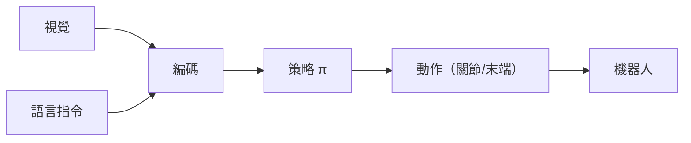
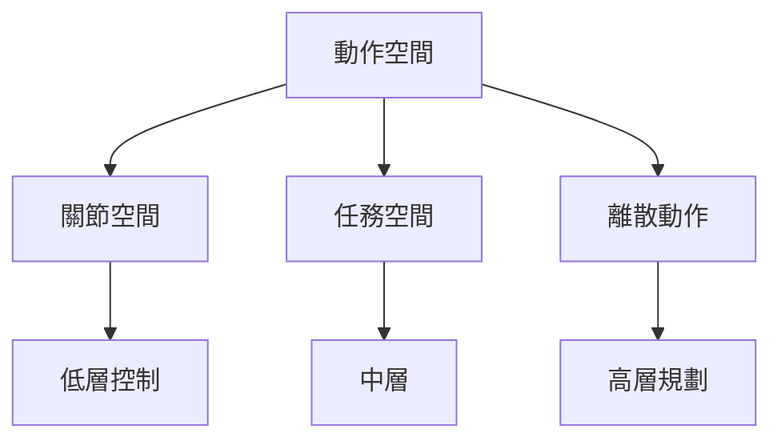
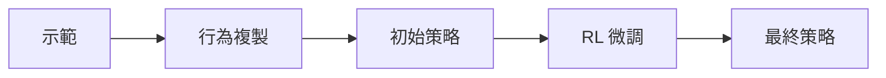
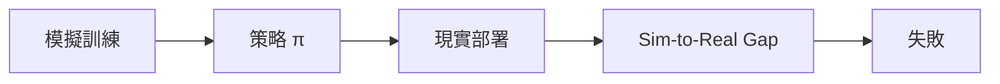
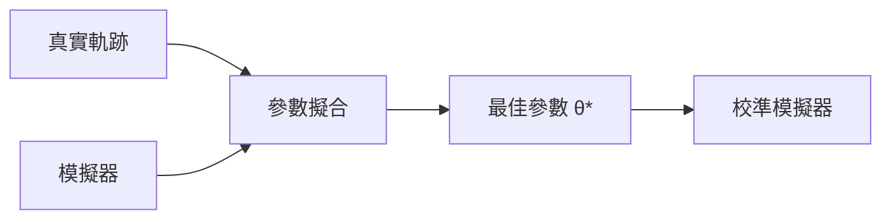
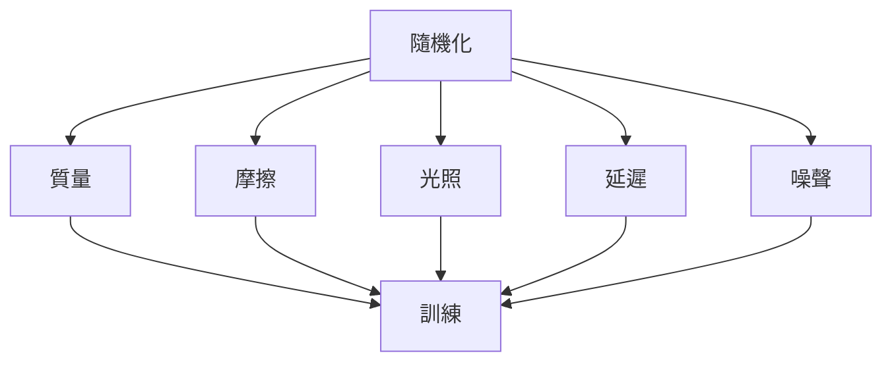
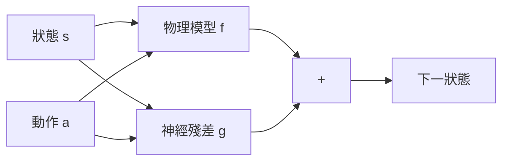
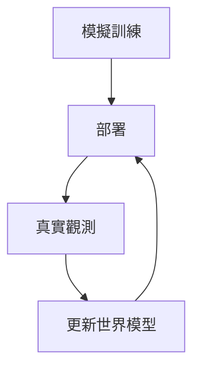

# 15.2 VLA（Vision-Language-Action）模型、控制策略與世界模型驅動的 Sim-to-Real 遷移：系統辨識（System Identification）、域隨機化（Domain Randomization）與殘差學習

## VLA：把「看、懂、做」合一

**VLA（Vision-Language-Action）** 模型直接從視覺與語言輸入產生動作：

$$
\pi: (\text{image}, \text{instruction}) \to \text{action}
$$

它把多模態理解（13.1）與控制（14.2）結合，是具身 Agent 的核心模型。

### 與傳統方法的差異

| 面向 | 傳統管線 | VLA |
|---|---|---|
| 感知 | 手工特徵/模組 | 端到端學習 |
| 語言 | 另外解析 | 原生融合 |
| 泛化 | 差 | 較好（預訓練） |
| 可解釋 | 高 | 低 |
| 資料需求 | 中 | 大 |

VLA 的優勢是**從大規模預訓練中獲得泛化**，能理解「把紅色積木放到藍色盒子」這類開放指令。

## 動作空間

### 1. 關節空間（Joint Space）

動作 = 各關節角度/速度/力矩：

$$
\mathbf{a} = (\dot q_1, \dots, \dot q_n) \quad \text{或} \quad \boldsymbol{\tau}
$$

### 2. 任務空間（Task Space）

動作 = 末端執行器的位姿變化：

$$
\mathbf{a} = (\Delta x, \Delta y, \Delta z, \Delta\text{roll}, \Delta\text{pitch}, \Delta\text{yaw})
$$

### 3. 離散動作（Discrete）

如「前進」「左轉」「抓取」——適合高層決策。

VLA 常輸出任務空間的增量，再由底層控制器（IK/阻抗控制）轉為關節指令。

## 控制策略

### 1. 模仿學習（Imitation Learning）

從專家示範學策略：

$$
\pi^* = \arg\min_\pi \; \mathbb{E}_{(s,a)\sim \mathcal{D}} \big[ \|\pi(s) - a\|^2 \big]
$$

- **行為複製（Behavior Cloning）**：直接學 $`s \to a`$。
- **問題**：分布漂移（covariate shift）——測試時狀態分布與訓練不同，誤差累積。

### 2. 逆強化學習（IRL）

從示範推斷獎勵函數，再強化學習。

### 3. 強化學習（RL）

透過試錯最大化獎勵：

$$
\pi^* = \arg\max_\pi \; \mathbb{E}\Big[\sum_t \gamma^t r_t\Big]
$$

- **優點**：可超越示範。
- **缺點**：樣本效率低、真實世界試錯危險。

### 4. 混合

模仿學習初始化 + RL 微調。

## Sim-to-Real 遷移

在模擬中訓練（便宜、安全、可平行），部署到現實。但**模擬與現實有落差**（15.1），直接遷移會失敗。

$$
\pi_{\text{sim}} \not\Rightarrow \pi_{\text{real}} \quad \text{（直接遷移常失敗）}
$$

三大技術跨越落差：

### 一、系統辨識（System Identification）

**估計模擬器的物理參數**，使其更接近現實。

- 質量、慣性、摩擦係數、馬達延遲。
- 用真實資料擬合參數。

$$
\theta^* = \arg\min_\theta \sum_t \| \text{sim}_\theta(s_t, a_t) - s_{t+1}^{\text{real}} \|^2
$$

**限制**：真實世界參數可能隨時間/情境變化，且有些效應無法建模。

### 二、域隨機化（Domain Randomization）

**不追求精確建模，而是讓訓練分布涵蓋現實的可能範圍**。隨機化物理參數、視覺、延遲：

$$
\theta \sim p(\theta), \quad \text{訓練 } \pi \text{ 在 } \theta \text{ 的多樣性上}
$$

策略學會對參數變化**穩健（robust）**。

**優點**：不需精確系統辨識，直接學穩健策略。
**缺點**：隨機化範圍太窄→不魯棒；太寬→策略過於保守、性能下降。

$$
\text{range too narrow} \to \text{not robust}, \quad \text{range too wide} \to \text{too conservative}
$$

### 三、殘差學習（Residual Learning）

用**解析模型（物理）作主幹**，神經網路學**殘差**（模擬與現實的差）：

$$
\text{real dynamics} = \underbrace{f_{\text{physics}}(s,a)}_{\text{已知}} + \underbrace{g_\theta(s,a)}_{\text{神經殘差}}
$$

**優點**：物理提供結構與泛化，神經補足未建模效應。
**缺點**：需可靠的物理主幹。

## 三者比較

| 方法 | 核心 | 優點 | 缺點 |
|---|---|---|---|
| 系統辨識 | 校準參數 | 模擬更真 | 參數時變、難全建模 |
| 域隨機化 | 學穩健 | 不需精確模型 | 範圍難調、可能保守 |
| 殘差學習 | 物理+神經 | 結構+泛化 | 需好主幹 |

實務常**組合**：系統辨識校準主幹 + 域隨機化增穩健 + 殘差學習補漏。

## 世界模型在 Sim-to-Real 的角色

世界模型（14.3）可作為：
- **模擬器**：訓練策略。
- **預測器**：行動前推演（14.4）。
- **表徵學習**：從真實資料學動態。

用真實資料**持續更新**世界模型，縮小落差：

$$
\text{world model} \xleftarrow{\text{online update}} \text{real observations}
$$

這是**終身學習**的雛形。

## 評估 Sim-to-Real

| 指標 | 說明 |
|---|---|
| 遷移成功率 | 現實中完成任務比例 |
| 性能差距 | 模擬 vs. 現實的表現差 |
| 魯棒性 | 參數擾動下表現 |
| 樣本效率 | 需要多少真實資料 |

## 與後續章節的關聯

- **14.3 世界模型**：Sim-to-Real 的核心工具。
- **15.1 現實落差**：要跨越的鴻溝。
- **15.3 安全**：現實部署的安全。
- **16.4 形式化**：用不變量保證安全。

## 小結

1. VLA 直接從視覺+語言產生動作，靠預訓練獲得泛化。
2. 動作空間有關節、任務、離散三種，VLA 常輸出任務空間增量。
3. 控制策略：模仿學習（分布漂移）、IRL、RL、混合。
4. Sim-to-Real 三大技術：系統辨識（校準參數）、域隨機化（學穩健）、殘差學習（物理+神經）。
5. 三者常組合使用。
6. 世界模型可作模擬器、預測器、表徵，並持續更新縮小落差。
7. 評估看遷移成功率、性能差距、魯棒性、樣本效率。
