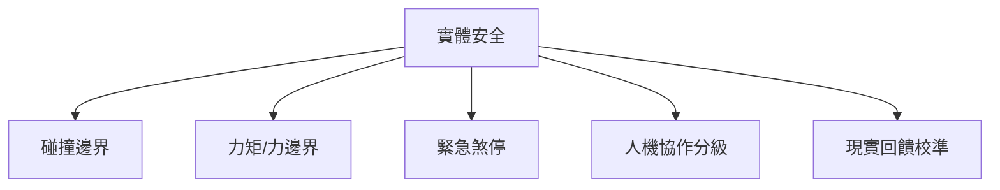
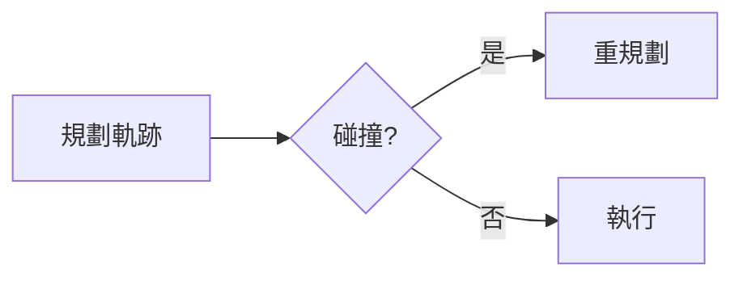
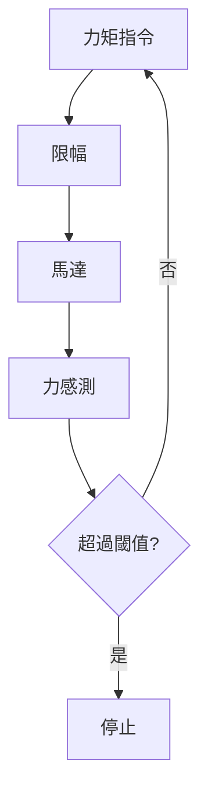
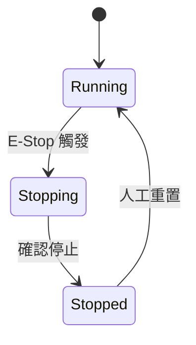
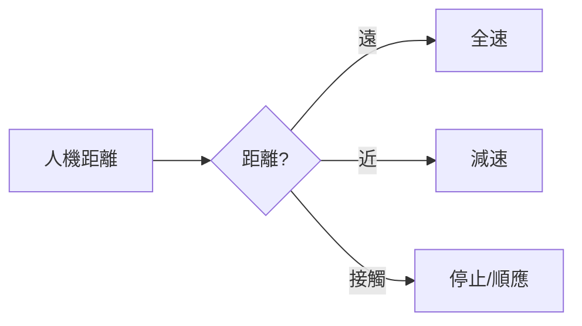
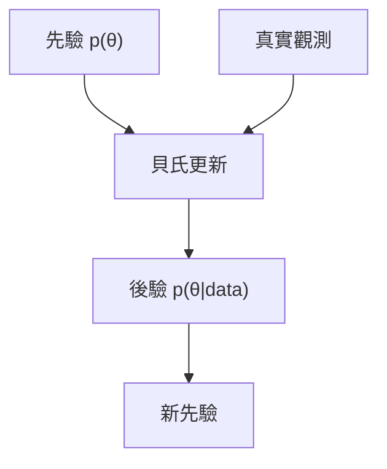
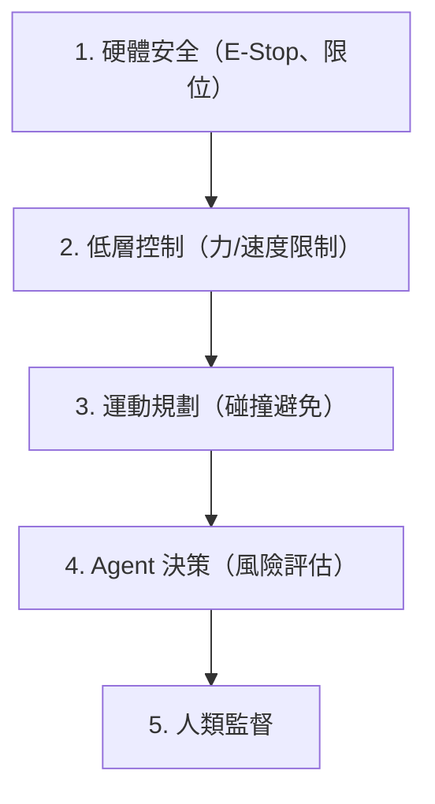

# 15.3 實體安全與現實閉環：碰撞與力矩邊界、緊急煞停（Emergency Stop）、人機協作分級，以及實體回饋反過來校準物理與模擬模型

## 物理世界的錯誤無法「重試」

數位世界裡，刪錯了可以從備份還原。物理世界裡，撞壞了、傷人了，**無法 undo**。這是具身 Agent 最根本的風險差異，也是本節的核心：**安全必須是硬約束，而非事後補救**。



## 碰撞與力矩邊界

### 1. 碰撞檢測與避免

在動作執行前，檢查是否會碰撞：

$$
\text{collision}(\text{trajectory}) = \bigvee_{t} \text{overlap}(\text{robot}(t), \text{obstacles})
$$

- **幾何方法**：距離查詢（GJK、FCL）。
- **速度障礙（Velocity Obstacles）**：動態避障。
- **安全距離**：保持最小間距。



### 2. 力矩與力邊界

即使不碰撞，過大的力矩也會損壞物體或傷人：

$$
\|\boldsymbol{\tau}\| \le \tau_{\max}, \qquad \|\mathbf{F}\| \le F_{\max}
$$

- **力/力矩限制**：硬體與軟體雙重限制。
- **阻抗控制**：順應外力，降低衝擊。
- **力感測回饋**：偵測異常力，立即停止。



### 3. 速度與加速度限制

$$
\|\dot q\| \le \dot q_{\max}, \qquad \|\ddot q\| \le \ddot q_{\max}
$$

限制速度與加速度，讓人來得及反應，也降低動量。

## 緊急煞停（Emergency Stop）

### 定義

**E-Stop** 是最高優先級的安全機制：無論 Agent 想做什麼，立即停止所有運動。



### 觸發來源

- **硬體按鈕**：實體按鈕，最高可靠度。
- **軟體監控**：力超限、碰撞、逾時。
- **人類觀察**：操作員隨時可停。
- **安全區域**：人進入工作區。

### 設計原則

1. **獨立於主控**：E-Stop 不依賴 Agent 的軟體堆疊。
2. **故障安全（fail-safe）**：斷電即停，而非斷電即衝。
3. **不可被軟體覆寫**：Agent 不能「忽略」E-Stop。
4. **需人工重置**：不能自動恢復。

```python
class SafetyMonitor:
    def check(self, state):
        if state.force > FORCE_LIMIT:
            self.trigger_estop("force_limit")
        if state.collision:
            self.trigger_estop("collision")
        if self.human_in_workspace():
            self.trigger_estop("human_detected")

    def trigger_estop(self, reason):
        hardware.brake()          # 直接呼叫硬體
        log.critical(f"ESTOP: {reason}")
        raise EmergencyStop(reason)
```

## 人機協作分級

人與機器人如何共享空間？ISO 10218 / ISO/TS 15066 定義協作模式：

| 模式 | 說明 | 安全機制 |
|---|---|---|
| 安全監控停止 | 人進入即停 | 區域感測 |
| 手動引導 | 人引導機器人 | 力限制 |
| 速度與距離監控 | 依距離調速 | 動態限速 |
| 功率與力限制 | 限制接觸力 | 力感測 |



### 速度與距離監控

$$
v_{\max}(d) = \begin{cases}
v_{\text{full}} & d > d_{\text{safe}} \\
v_{\text{reduced}} & d_{\text{min}} < d \le d_{\text{safe}} \\
0 & d \le d_{\text{min}}
\end{cases}
$$

距離越近，速度越低，直到停止。

### 功率與力限制

確保接觸時的力量在人體可承受範圍：

$$
F_{\text{contact}} \le F_{\text{human-tolerance}}(\text{body part})
$$

不同身體部位耐受度不同（手 > 臉）。

## 現實閉環：用實體回饋校準模型

這是最精彩的部分：**現實世界會「回饋」給模型**，讓物理與模擬越來越準。


### 校準什麼

1. **物理參數**：質量、摩擦、慣性（系統辨識，15.2）。
2. **感測器模型**：噪聲、偏差。
3. **世界模型**：動態預測（14.3）。
4. **控制策略**：殘差修正（15.2）。

### 閉環的數學

用貝氏更新持續修正參數：

$$
p(\theta \mid \text{data}) \propto p(\text{data} \mid \theta) \, p(\theta)
$$

每觀察一筆真實資料，就更新對物理參數的信念。



### 異常即訊號

當現實與模型不符（預測 vs. 實際差異大），這是**有價值的訊號**：

- 可能是參數變了（磨損、溫度）。
- 可能是未建模效應。
- 可能是感測器故障。

$$
\text{surprise} = D_{\mathrm{KL}}\big( p_{\text{real}} \,\|\, p_{\text{model}} \big)
$$

高 surprise → 觸發重新校準或安全停止。

## 安全架構的層次



多層防禦（defense in depth）：任何一層失效，其他層仍能保護。

## 安全與能力的權衡

$$
\text{safety} \uparrow \Rightarrow \text{speed/capability} \downarrow
$$

過度保守 → 沒效率；過度激進 → 危險。需依場景調整：
- 工業環境（人少）：可較快。
- 家庭/醫療（人多）：保守。
- 高風險（手術）：極保守 + 人類主導。

## 驗證與認證

實體系統需通過安全認證：
- **風險評估**（ISO 12100）。
- **安全完整性等級**（SIL / PL）。
- **測試**：模擬 + 實體 + 壓力測試。

形式化方法（第 16 章）可提供更強的保證：證明某些危險狀態**不可達**。

## 與後續章節的關聯

- **6.3 HITL**：人類監督的延伸。
- **14.4 推演**：行動前評估風險。
- **15.1/15.2 現實落差**：校準的對象。
- **16.4 形式化護盾**：可證明的安全約束。

## 小結

1. 物理錯誤不可 undo，安全必須是硬約束。
2. 碰撞與力矩邊界靠檢測、限幅、阻抗控制、力回饋。
3. E-Stop 是最高優先級安全機制：獨立、fail-safe、不可覆寫、需人工重置。
4. 人機協作分級：安全監控停止、手動引導、速度距離監控、功率力限制。
5. 現實閉環用實體觀測校準物理/模擬/世界模型，貝氏更新持續修正。
6. 預測與現實不符（surprise）是有價值的訊號。
7. 多層防禦 + 安全與能力權衡 + 認證，構成完整實體安全。
