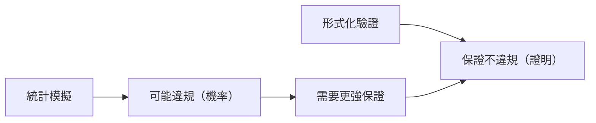
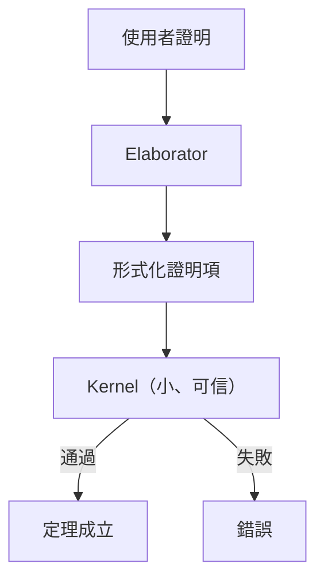
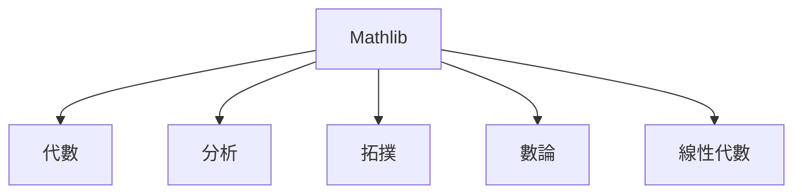
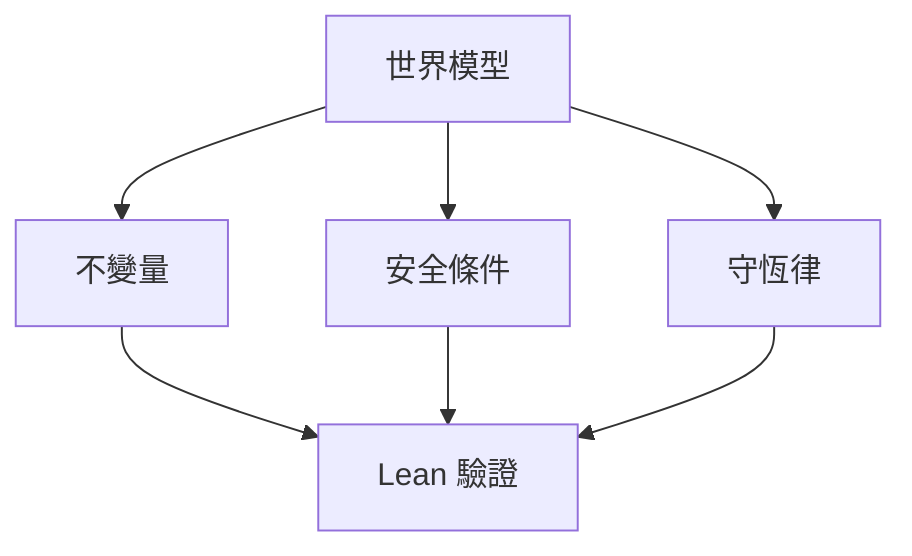
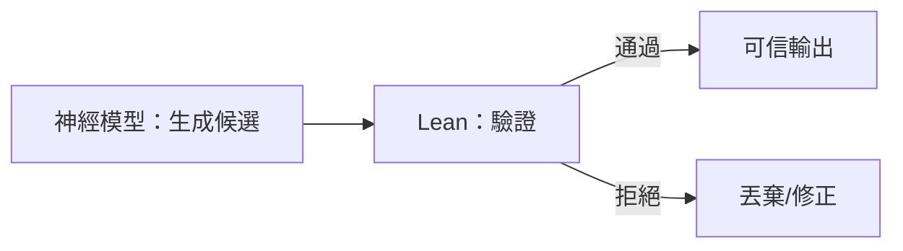

# 16.1 為什麼世界模型與模擬需要形式化數學：統計模擬無法保證不違規，Lean 4 編譯器核與 Mathlib 作為不變量、守恆律與安全條件的零幻覺驗證器

## 統計模擬的根本弱點

第 14、15 章的世界模型再強，本質仍是**統計模型**：它學的是「大概率會怎樣」，而非「一定符合物理」。這帶來根本問題：

- 它能說「通常能量守恆」，但不能保證「**一定**守恆」。
- 它在訓練分布內很準，分布外就可能違反物理。
- 它的錯誤是**機率性的**，無法排除。

$$
\text{statistical model}: P(\text{valid}) \approx 1 \quad \not\Rightarrow \quad P(\text{valid}) = 1
$$

對於安全關鍵系統（自駕、醫療、機器人），「99.9% 安全」不等於「安全」。我們需要**保證**。



## 什麼是「形式化」

**形式化（Formalization）** 把數學命題與證明寫成機器可檢查的形式語言，由**證明助手**驗證每一步邏輯。

- 不是「測試」（抽樣檢查）。
- 不是「數值模擬」（近似）。
- 而是「**證明**」（對所有情況成立的邏輯推導）。

$$
\text{theorem} : \forall x, P(x) \quad \text{+} \quad \text{proof} \;\Rightarrow\; \text{kernel verifies}
$$

## Lean 4：可信任的邏輯核

**Lean 4** 是互動式定理證明器與程式語言。其核心是**小型的編譯器核（kernel）**，只信任極少數的公理與推導規則：



### 為什麼 kernel 小很重要

信任基礎（Trusted Computing Base, TCB）越小，越容易確保正確：

$$
\text{trust} = \text{kernel} + \text{axioms} + \text{compiler}
$$

只要 kernel 正確，任何通過檢查的證明就**必然**正確——不管證明是怎麼來的（人手寫、AI 生成都一樣）。

### De Bruijn 準則

「證明檢查器必須極簡，讓少數人能完全理解。」Lean 的 kernel 正是如此。

## Mathlib：數學知識庫

**Mathlib** 是 Lean 的龐大數學庫，涵蓋代數、分析、拓撲、數論等：

- 數萬個定義與定理。
- 統一的數學結構階層（typeclass）。
- 社群持續擴充。

$$
\text{Mathlib} = \{\text{definitions}\} \cup \{\text{theorems}\} \cup \{\text{proofs}\}
$$

它讓 Agent 不必從零開始：可直接引用已有的定理。



## 形式化什麼：世界模型的三類約束

### 1. 不變量（Invariants）

系統演化中保持不變的性質：

$$
\forall t, \; I(\mathbf{x}_t) = I(\mathbf{x}_0)
$$

例如：
- 能量守恆。
- 動量守恆。
- 質量守恆。

形式化：證明演化函數保持 $`I`$。

```lean
theorem energy_conserved (s : State) (a : Action) :
    energy (step s a) = energy s := by
  ...
```

### 2. 安全條件（Safety Conditions）

「壞事永遠不會發生」：

$$
\forall t, \; \neg \text{bad}(\mathbf{x}_t)
$$

例如：
- 機器人永不進入人的區域。
- 溫度永不超过閾值。
- 兩個物件永不重疊。

形式化：證明從初始狀態（滿足前置條件）出發，所有可達狀態都安全。

```lean
theorem no_collision (s₀ : State) (h : safe s₀) :
    ∀ t, safe (run s₀ t) := by
  ...
```

### 3. 守恆律與物理定律

PDE、力學方程的正確性：

$$
\frac{d\mathbf{x}}{dt} = f(\mathbf{x}) \;\Rightarrow\; \text{discretization preserves } I
$$

形式化：證明離散格式保持連續系統的性質（如辛積分保持能量）。



## 「零幻覺」驗證器

這是本章的核心主張：**Lean 的 kernel 是零幻覺的驗證器**。

- 若證明通過 kernel，定理**一定**成立（在公理下）。
- 若證明有錯，kernel **一定**拒絕。
- 沒有「大概對」「看起來對」——只有「對」或「錯」。

$$
\text{kernel}(proof) = \begin{cases}
\text{accept} & \text{proof valid} \\
\text{reject} & \text{otherwise}
\end{cases}
$$

這與神經網路形成互補：

| 面向 | 神經世界模型 | Lean 驗證 |
|---|---|---|
| 來源 | 資料統計 | 邏輯推導 |
| 保證 | 機率 | 確定 |
| 泛化 | 分布內 | 全稱 |
| 成本 | 低 | 高 |
| 錯誤 | 可能幻覺 | 零幻覺 |



**神經負責「猜」，Lean 負責「驗」**——這是神經—符號（neuro-symbolic）的核心架構（16.4）。

## 為什麼這對世界模型是「最後一塊拼圖」

世界模型需要三件事：
1. **預測能力**（神經網路擅長）。
2. **物理一致性**（需要約束）。
3. **保證**（需要證明）。

神經網路提供 1，物理先驗（14.3）部分提供 2，但**只有形式化能提供 3**。

$$
\text{trustworthy world model} = \underbrace{\text{neural prediction}}_{1} + \underbrace{\text{physics priors}}_{2} + \underbrace{\text{formal verification}}_{3}
$$

## 形式化的挑戰

| 挑戰 | 說明 |
|---|---|
| 成本 | 形式化極耗人力/算力 |
| 覆蓋 | 只能形式化「已建模」的部分 |
| 規格 | 「安全」怎麼形式化？ |
| 落差 | 形式模型 vs. 真實系統 |
| 可擴展 | 大系統的證明爆炸 |

這些是 16.2、16.3 要面對的。

## 與後續章節的關聯

- **14.x 世界模型**：形式化的對象。
- **16.2 定理證明 Agent**：如何自動化形式化。
- **16.3 數學里程碑**：大規模形式化的工程經驗。
- **16.4 神經符號閉環**：如何整合。

## 小結

1. 統計模擬只能給機率保證，安全關鍵系統需要確定保證。
2. 形式化用機器可檢查的證明，而非測試或模擬。
3. Lean 4 的 kernel 小而可信，通過即保證正確（De Bruijn 準則）。
4. Mathlib 提供龐大數學知識庫，讓 Agent 不必從零開始。
5. 形式化世界模型的三類約束：不變量、安全條件、守恆律。
6. kernel 是零幻覺驗證器，與神經網路互補：神經猜、Lean 驗。
7. 這是可信世界模型的最後一塊拼圖。
