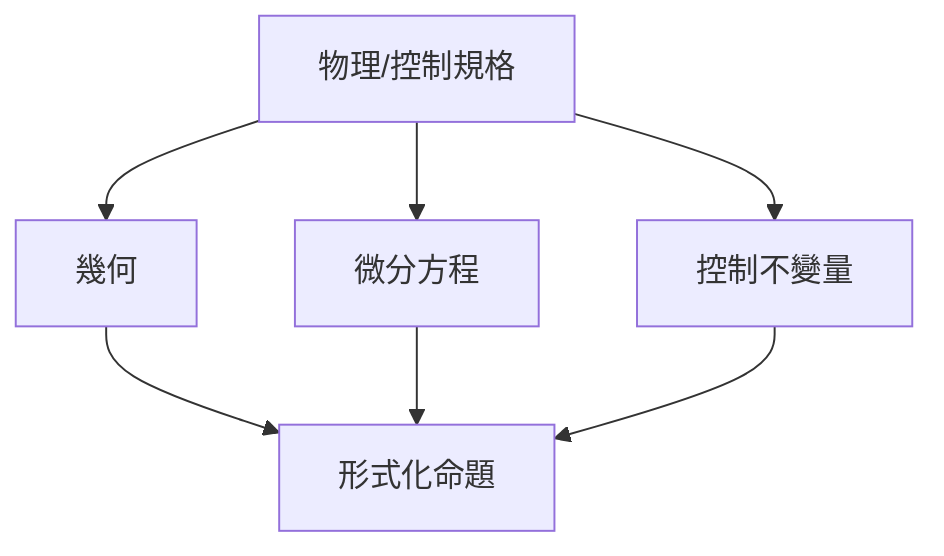
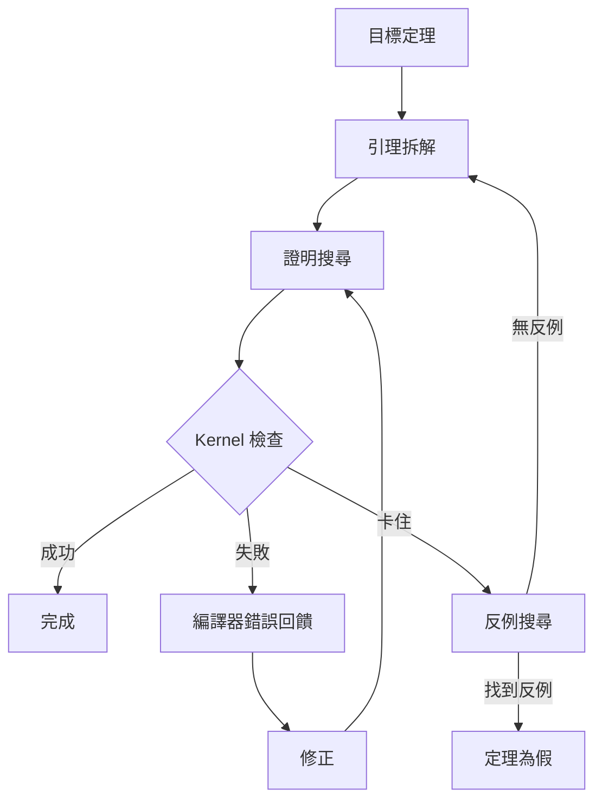
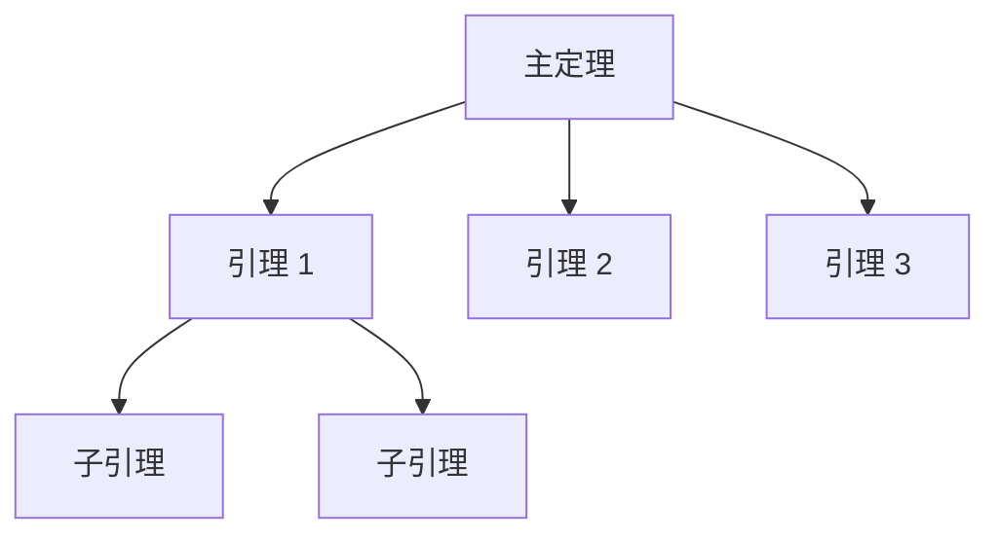
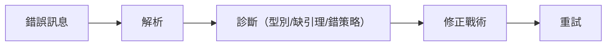
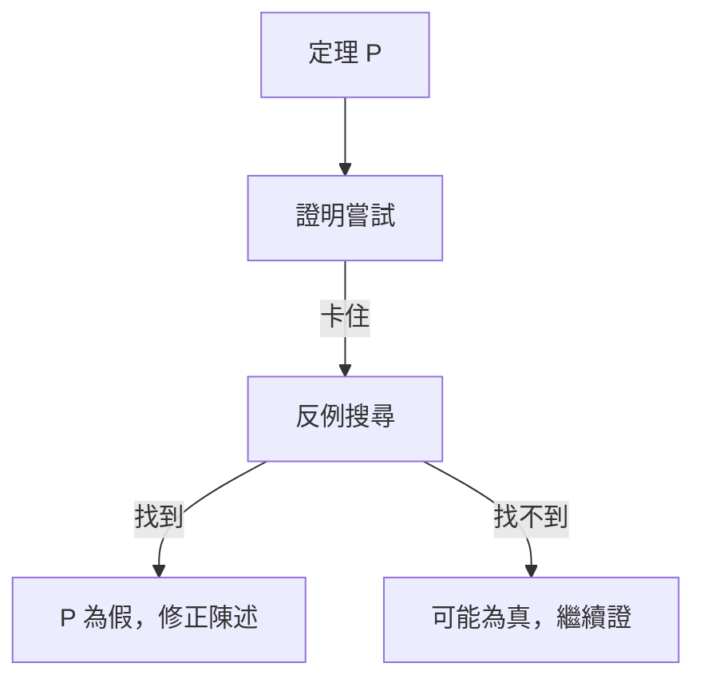
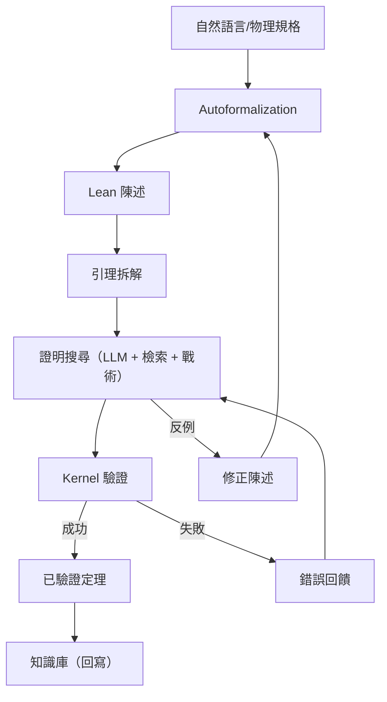

# 16.2 面向物理與空間推論的定理證明 Agent 架構：幾何、微分方程與控制不變量的自動形式化（Autoformalization）、引理拆解、反例搜尋與編譯器回饋迴圈

## 問題：形式化太難

16.1 說形式化能給保證，但手寫 Lean 證明極耗人力。一個中等定理可能要數百行、數天。要讓 Agent 大規模使用形式化，必須**自動化**。


## Autoformalization：從自然語言到形式命題

**Autoformalization** 把自然語言（或物理/控制規格）翻譯成形式化命題。

$$
\text{autoformalize}: \text{NL spec} \to \text{Lean statement}
$$

### 例如

自然語言：
> 「單擺的機械能在無摩擦下守恆。」

形式化：
```lean
def pendulumEnergy (θ ω : ℝ) : ℝ :=
  0.5 * m * l^2 * ω^2 + m * g * l * (1 - Real.cos θ)

theorem pendulum_energy_conserved
    (θ ω : ℝ → ℝ) (h : satisfiesPendulumODE θ ω) :
    ∀ t, pendulumEnergy (θ t) (ω t) = pendulumEnergy (θ 0) (ω 0) := by
  ...
```

### 難點

- **語意歧義**：自然語言模糊，形式化需精確。
- **隱含假設**：物理規格常省略前提（無摩擦、小角度）。
- **型別選擇**：$`\mathbb{R}`$ vs. $`\mathbb{C}`$、離散 vs. 連續。
- **Mathlib 對應**：找到正確的既有定義。

$$
\text{autoformalization error} = \text{misinterpretation} + \text{missing assumptions} + \text{wrong types}
$$

## 物理與空間的形式化

### 1. 幾何

- 點、線、面、距離。
- 座標變換（李群 $`SO(3)`$、$`SE(3)`$）。
- 碰撞條件（距離 < 半徑和）。

```lean
-- 碰撞：兩球距離小於半徑和即碰撞
def collides (c₁ c₂ : Sphere) : Prop :=
  dist c₁.center c₂.center < c₁.radius + c₂.radius

theorem safe_implies_no_collision
    (s : State) (h : safe s) (i j : Fin n) :
    ¬ collides (s.balls i) (s.balls j) := by
  ...
```

### 2. 微分方程

- ODE 解的存在唯一性。
- 不變量在演化下保持。
- 數值格式的性質。

形式化 ODE 需分析學（Mathlib 有）。

### 3. 控制不變量

控制系統的安全集是「控制不變集（control invariant set）」：

$$
\forall x \in \mathcal{S}, \; \exists u, \; f(x,u) \in \mathcal{S}
$$

形式化：證明存在控制律使系統永不離開安全集。

```lean
theorem control_invariant
    (S : Set State) (hS : safetySet S) :
    ∀ x ∈ S, ∃ u, step x u ∈ S := by
  ...
```



## 定理證明 Agent 的架構



### 核心迴圈

1. **拆解**：把大定理拆成小引理。
2. **搜尋**：嘗試證明每個引理。
3. **驗證**：交 kernel 檢查。
4. **回饋**：用錯誤訊息修正。
5. **反例**：若證不出，找反例確認定理真假。

## 引理拆解

大定理直接證幾乎不可能。拆成子引理：

$$
\text{theorem} \; T \;\Leftarrow\; L_1 \wedge L_2 \wedge \dots \wedge L_k
$$



**策略**：
- **自頂向下**：先寫主定理的證明骨架（`sorry` 佔位），再填。
- **自底向上**：先證小引理，再組合。
- **混合**：依難度。

Lean 的 `sorry`（未完成佔位）允許先搭骨架：

```lean
theorem main_theorem : P := by
  have h1 : Q := by sorry
  have h2 : R := by sorry
  exact combine h1 h2
```

## 編譯器錯誤回饋

當證明失敗，Lean 回傳**具體錯誤**，這是 Agent 的學習訊號：

```text
error: type mismatch
  expected: ℝ
  actual: ℕ
```

Agent 根據錯誤修正：



**關鍵**：形式化系統的錯誤是**精確的**（不像自然語言），這讓 Agent 能可靠地迭代。

## 證明戰術（Tactics）

Lean 用「戰術」建構證明：

```lean
theorem example (a b : ℝ) (h : a = b) : a + 1 = b + 1 := by
  rw [h]        -- 重寫
  rfl           -- 反身性
```

常用戰術：
- `simp`：化簡。
- `rw`：重寫。
- `induction`：歸納。
- `cases`：分情況。
- `linarith`：線性算術。
- `ring`：環運算。
- `omega`：整數算術。

Agent 需學會**選對戰術**。這可透過：
- 檢索相似證明的戰術。
- 嘗試 + 錯誤回饋。
- 訓練專門的模型。

## 反例搜尋

若證不出，可能是定理**本身為假**。用反例搜尋：

- **隨機測試**：生成隨機輸入，找違反。
- **SMT 求解**：對可判定片段找反例。
- **數值模擬**：物理系統跑模擬找反例。

$$
\text{find } x \text{ s.t. } \neg P(x) \;\Rightarrow\; \text{theorem false}
$$



反例搜尋是**除錯陳述**的關鍵：很多「證不出」其實是「陳述錯了」。

## 檢索增強證明

用 RAG（5.1）檢索相關定理與證明：


Mathlib 有數萬定理，檢索能大幅加速。

## 整個架構的整合



## 評估

| 指標 | 說明 |
|---|---|
| 證明成功率 | 多少定理被證出 |
| 自動化率 | 多少不需人工 |
| 陳述正確性 | 形式化是否忠於原意 |
| 成本 | token/時間 |

**陳述正確性最難**：證明對了，但形式化的命題不是你要的，白費功夫（16.3 的「陳述比對」）。

## 與後續章節的關聯

- **16.1 形式化基礎**：本節的理論前提。
- **16.3 數學里程碑**：大規模實戰經驗。
- **16.4 神經符號閉環**：與世界模型整合。
- **5.1 RAG**：檢索增強證明。
- **9.1 拆解**：引理拆解是任務拆解的特例。

## 小結

1. Autoformalization 把自然語言/物理規格翻成形式命題，難在語意、隱含假設、型別。
2. 物理與空間形式化涵蓋幾何、ODE、控制不變量。
3. 定理證明 Agent 迴圈：拆解 → 搜尋 → kernel 驗證 → 錯誤回饋 → 反例。
4. 引理拆解讓大定理可證（自頂向下/自底向上/混合）。
5. 編譯器錯誤是精確的學習訊號。
6. 反例搜尋能發現陳述錯誤。
7. 檢索 Mathlib 加速證明；陳述正確性是最難的評估點。
