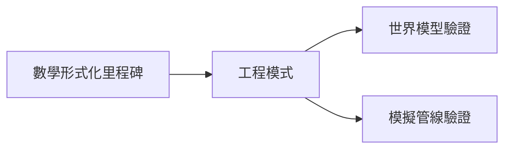
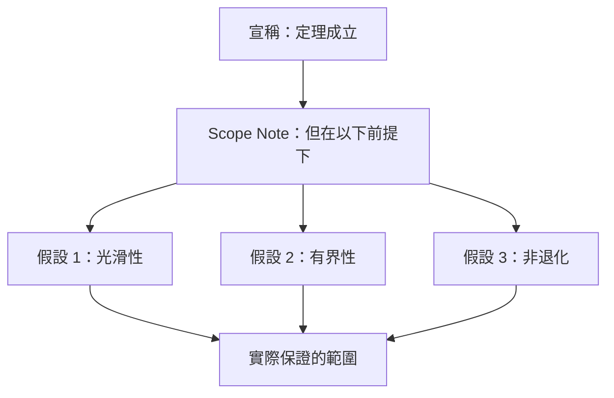
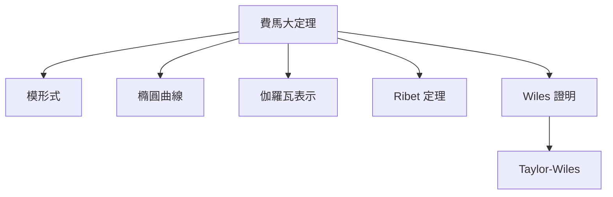
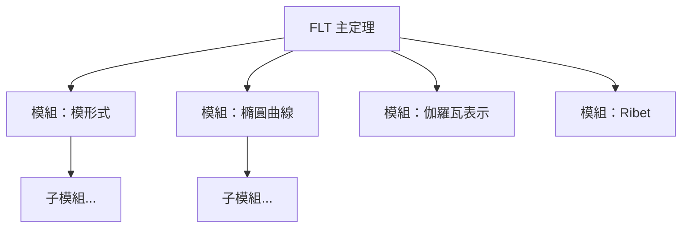
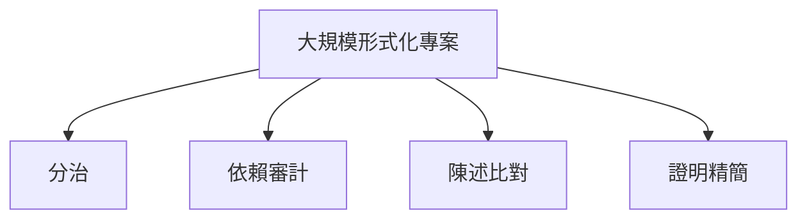
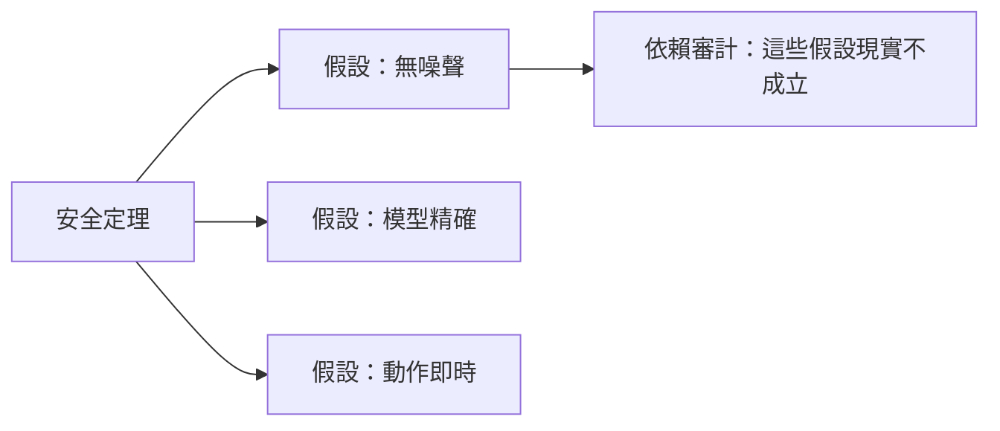
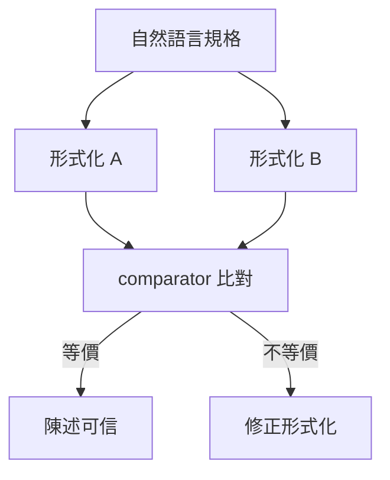
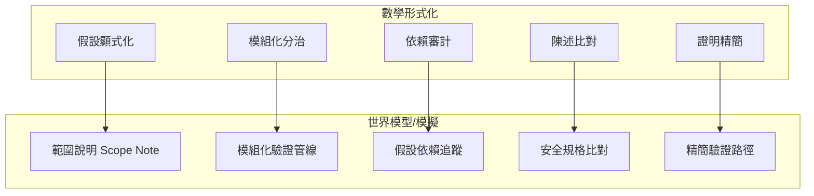

# 16.3 重大數學里程碑對大規模世界與模擬系統的工程鏡像：OpenAI 700+ 篇手稿與 Scope Note 落差（顯式化假設邊界）、Claude 協作推進 FLT（千萬行級形式化）與 Riemann Hypothesis 證明（分治、依賴審計、`comparator` / `con-leche` 比對與證明精簡）對複雜模擬與驗證管線的啟示

## 為什麼要看數學前沿

AI 在數學形式化的進展，是「可驗證智慧體」的縮影。這些里程碑揭示的工程模式——**假設顯式化、模組化分治、陳述比對、依賴審計、證明精簡**——可直接映射到世界模型與模擬系統的驗證管線。



## 一、OpenAI 700+ 篇手稿與 Scope Note 的落差

### 背景

在形式化數學的實踐中，一個常見現象：**論文/手稿宣稱的結果，與其實際「形式化能保證的範圍」之間存在落差**。一篇手稿可能寫了 700+ 頁的證明，但其背後的「範圍說明（Scope Note）」往往揭示：

- **前提假設**未在前言顯式化。
- **邊界條件**（如無窮、極限、正則性）被默默使用。
- **「已證明」的範圍**小於「宣稱」的範圍。

$$
\text{claimed result} \supsetneq \text{actually verified result}
$$



### 工程鏡像：顯式化假設邊界

這對世界模型/模擬的直接啟示：**把隱含的環境前提顯式化**。

| 數學 | 世界模型/模擬 |
|---|---|
| 光滑性假設 | 動力學連續可微 |
| 有界性假設 | 狀態/動作有界 |
| 非退化假設 | 系統非奇異、可觀測 |
| 定義域限制 | 模擬有效的操作範圍 |

$$
\text{simulation is valid only on } \mathcal{D}_{\text{valid}} = \bigcap_i \text{assumption}_i
$$

**實務做法**：
1. 為每個模型/模擬器寫「範圍說明」：在什麼條件下有效。
2. 執行時檢查前提是否滿足。
3. 前提不滿足時拒絕或降級。

```python
def simulate_with_scope(model, state, action):
    if not model.assumptions_hold(state):
        raise OutOfScope("precondition violated")
    return model.step(state, action)
```

這比「假設一切正常然後出錯」安全得多。

## 二、Claude 協作推進 FLT：千萬行級形式化

### 背景

**費馬大定理（Fermat's Last Theorem, FLT）** 的形式化是數學形式化的里程碑。它涉及極深的數學（橢圓曲線、模形式、伽羅瓦表示），形式化規模達**千萬行級**。

FLT：對 $`n > 2`$，方程

$$
x^n + y^n = z^n
$$

沒有正整數解。



### 為什麼是「千萬行級」

證明依賴大量前置數學：
- 模形式的理論。
- 橢圓曲線的算術。
- Galois 表示的變形。
- 大量代數幾何與數論。

形式化需要把這一切建成 Lean 定義與定理，規模龐大。

### 工程鏡像：模組化分治

千萬行不可能一次寫完。靠**模組化分治**：



**對世界模型的啟示**：
- 把大系統拆成可獨立驗證的模組。
- 每個模組有明確介面（輸入/輸出/前提/保證）。
- 模組間用形式化的「契約」連接。

$$
\text{system} = \bigoplus_i \text{module}_i, \quad \text{interface}_i = (\text{pre}, \text{post})
$$

這與第 9 章 DAG 拆解、第 10 章多 Agent 分工同構：**把不可管理的大問題，拆成可管理的小問題**。

## 三、Riemann Hypothesis 證明與驗證管線

### 背景

**黎曼猜想（Riemann Hypothesis, RH）** 是希爾伯特問題之一：黎曼 ζ 函數的非平凡零點都在臨界線 $`\Re(s) = 1/2`$ 上。

$$
\zeta(s) = 0, \; s \neq -2, -4, \dots \;\Rightarrow\; \Re(s) = \frac{1}{2}
$$

形式化 RH（或部分進展）需要極高的嚴謹性。這裡的重點不是數學本身，而是**大規模形式化專案的工程方法**。

### 關鍵工程模式



#### 1. 分治（Divide and Conquer）

把證明拆成引理 DAG（9.1），平行攻關。

#### 2. 依賴審計（Dependency Audit）

追蹤每個定理依賴哪些公理與前置定理：

$$
\text{deps}(T) = \{A_1, \dots, A_k\} \cup \bigcup_i \text{deps}(A_i)
$$

**目的**：
- 找出「隱藏的假設」（如某引理用了未證的猜想）。
- 確保沒有循環依賴。
- 確認只依賴「可接受」的公理（如 `propext`、`Classical.choice`）。

```lean
#print axioms my_theorem
-- 列出所有依賴的公理
```

**對模擬系統的啟示**：追蹤每個「保證」依賴哪些假設。若某安全證明依賴「感測器完美」，那它其實不保證真實安全。



#### 3. 陳述比對（Statement Comparison）

**最隱蔽的風險**：證明通過了，但形式化的陳述**不是**你想證的。

- 自然語言：「所有連續函數…」
- 形式化：`∀ f, Continuous f → ...`（漏了定義域？）
- 或更糟：`∀ f, ...`（根本沒要求連續）

陳述比對用工具檢查形式陳述是否忠於原意：

- **`comparator`**：比較兩個形式陳述的等價性/蘊含關係。
- **`con-leche`**（概念示意）：比對形式化與非形式化版本的語意一致性。

$$
\text{trust} = \text{proof correct} \;\wedge\; \text{statement faithful}
$$

**對世界模型的啟示**：**「證明安全」之前，先確認「安全的定義對嗎」**。形式化「機器人不碰撞」很容易，但若定義漏了「高速移動的物體」，證明再漂亮也沒用。



#### 4. 證明精簡（Proof Minimization）

大專案的證明可能冗長、含冗餘。精簡：

- 移除未使用的引理。
- 縮短證明。
- 統一風格。

**目的**：可維護、可審計、可重用。

$$
\text{minimize} \; |\text{proof}| \quad \text{s.t.} \quad \text{kernel accepts}
$$

## 四、這些模式如何映射到世界模型



| 數學模式 | 世界模型應用 |
|---|---|
| 假設顯式化 | 模型有效範圍、前提檢查 |
| 模組化分治 | 分層驗證、模組契約 |
| 依賴審計 | 安全保證的假設清單 |
| 陳述比對 | 安全規格與形式化一致 |
| 證明精簡 | 可維護的驗證管線 |

## 五、規模化的現實

| 專案 | 規模 | 啟示 |
|---|---|---|
| FLT 形式化 | 千萬行級 | 分治是唯一可行 |
| RH 進展 | 極深依賴 | 依賴審計必需 |
| 700+ 手稿 | 範圍落差 | 假設必須顯式 |

這些都指向一個結論：**大規模形式化的瓶頸不是 kernel，而是「規格、假設、依賴」的管理**。

$$
\text{large-scale verification} = \text{kernel} + \text{spec management} + \text{dependency management}
$$

## 與後續章節的關聯

- **16.1 形式化**：本節的理論基礎。
- **16.2 證明 Agent**：執行這些模式的 Agent。
- **16.4 神經符號閉環**：整合世界模型。
- **9.1 DAG**：模組化分治的同構。
- **11.2 評估**：陳述比對是評估的一種。

## 小結

1. 數學形式化里程碑揭示可驗證智慧體的工程模式。
2. OpenAI 700+ 手稿與 Scope Note 落差 → 顯式化假設邊界。
3. FLT 千萬行形式化 → 模組化分治是唯一可行。
4. RH 驗證管線 → 依賴審計、陳述比對、證明精簡。
5. `comparator` / `con-leche` 確保形式陳述忠於原意。
6. 這些模式直接映射到世界模型：範圍說明、模組驗證、假設追蹤、規格比對。
7. 大規模驗證的瓶頸是規格與依賴管理，不是 kernel。
