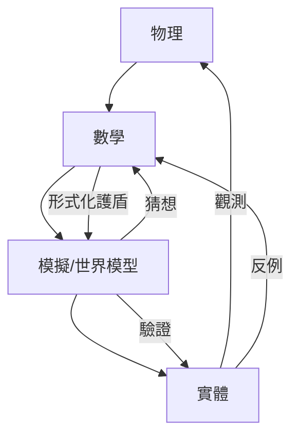
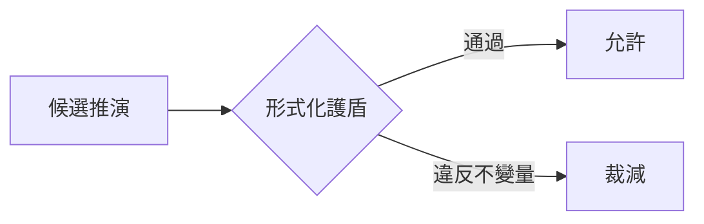
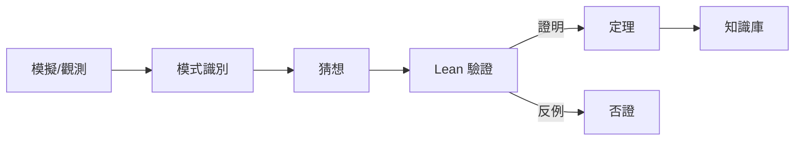
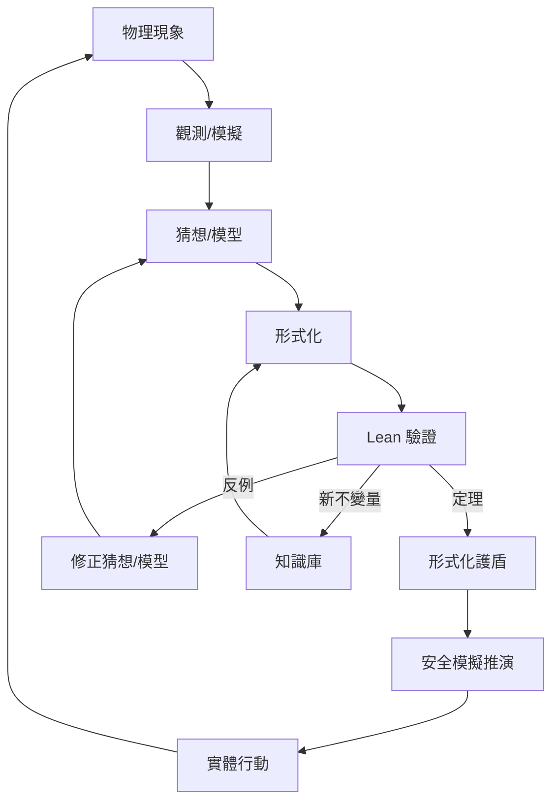
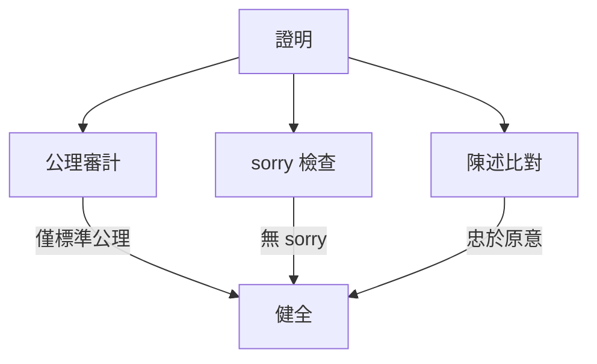
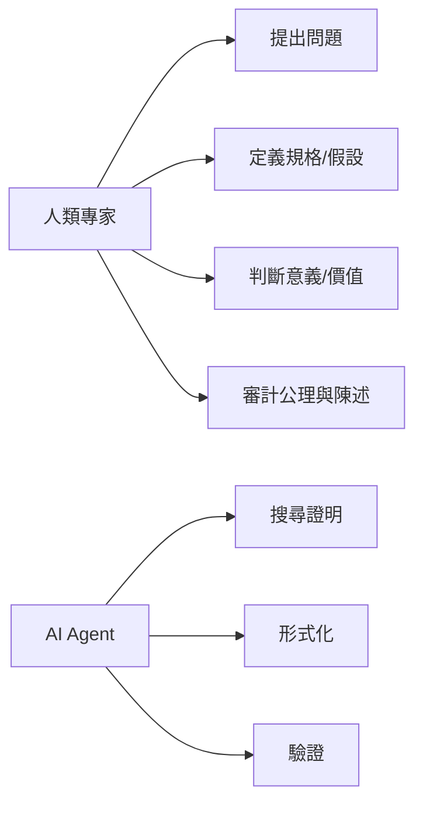
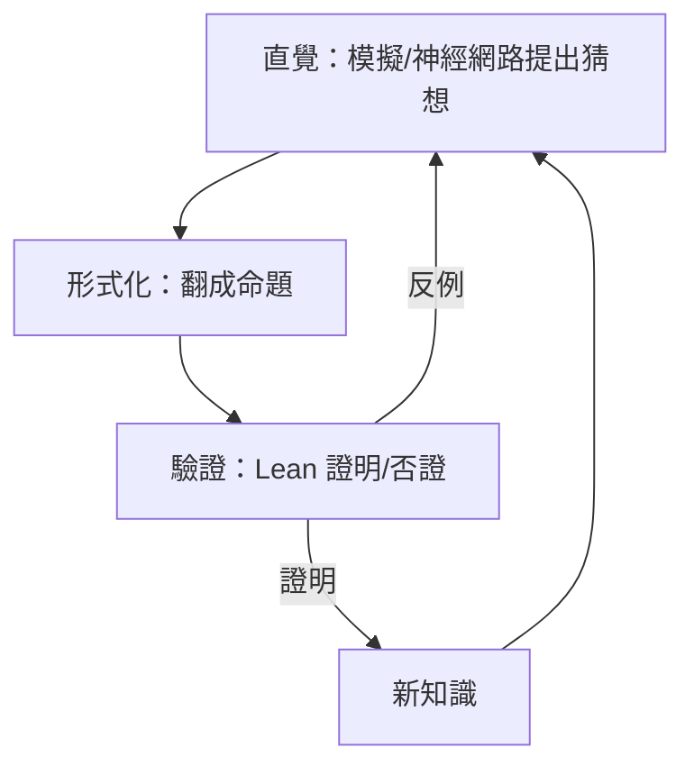
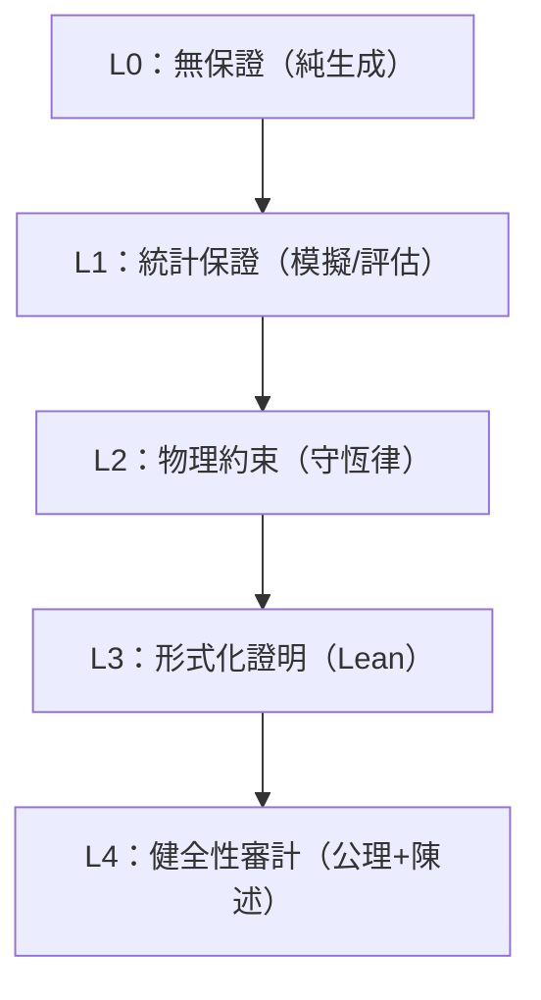

# 16.4 物理—數學—模擬—實體的四方共生閉環：Lean 證明護盾約束模擬推演、模擬與實體觀測啟發新猜想與反例、形式化核驗證新不變量，以及公理健全性（Soundness）與人機分工

## 四方共生

本書第五部走過：物理（14）、數學（14.2）、模擬/世界模型（14.3）、實體（15）、形式化（16.1–16.3）。最終，它們不是線性堆疊，而是**四者共生的閉環**：



四個角色兩兩互動，形成**雙向賦能**：

- **物理 → 數學**：現象啟發現律。
- **數學 → 模擬**：形式化約束推演。
- **模擬 → 實體**：訓練策略、預演行動。
- **實體 → 物理/數學**：觀測修正模型、發現新猜想。

## 正向賦能：數學 → 世界模型（形式化護盾）

### Verified Shielding（可驗證護盾）

在 Agent 行動前推演（14.4）時，用 Lean 證明的**不變量**裁減違反物理/安全的推演分支：



$$
\mathcal{A}_{\text{safe}} = \{ a : \text{Lean proves } \text{invariant}(\text{sim}(s,a)) \}
$$

- 護盾是**已證明的定理**，不是啟發式。
- 它即時過濾掉「物理上不可能」或「不安全」的推演。
- 只留下可被證明的安全動作。

```lean
-- 護盾：任何通過的動作都保持安全不變量
theorem shield_sound
    (s : State) (a : Action) (h : shield s a = true) :
    safe (step s a) := by
  ...
```

**價值**：把「希望它安全」變成「證明它安全」，且可即時執行。

## 反向賦能：世界模型 → 數學發現

### 從模擬生成猜想

模擬與實體觀測能**啟發**新的數學猜想：



例如：
- 模擬中觀察到某個量的守恆 → 猜想不變量 → Lean 證明。
- 空間模擬發現幾何規律 → 猜想 → 證明。
- 實體實驗發現反例 → 修正猜想。

$$
\text{simulation} \to \text{conjecture} \to \text{proof} \to \text{knowledge}
$$

這把「資料驅動的直覺」與「形式化的嚴格」結合：**神經負責提猜想，Lean 負責驗真假**。

### 反例的價值

模擬或實體觀測到反例，能**否證**錯誤猜想：

$$
\exists x, \neg P(x) \;\Rightarrow\; \neg(\forall x, P(x))
$$

這比證明更有時更寶貴：它告訴你「這條路不通」。

## 完整閉環



這是一個**自我改進的閉環**：

1. 觀測物理 → 形成猜想。
2. 形式化 → Lean 驗證。
3. 證明的定理 → 護盾約束模擬。
4. 模擬 → 安全行動。
5. 行動 → 新觀測 → 新猜想。
6. 否證 → 修正。

## 公理健全性（Soundness）

### 什麼是健全性

形式化系統的「健全性」：**能證明的都是真的**。

$$
\text{soundness}: \vdash \varphi \;\Rightarrow\; \models \varphi
$$

若系統不健全，證明了假命題，一切保證崩潰。

### 風險來源

1. **不安全公理**：加入 `axiom bad : False`，則可證任何事。
2. **`sorry`**：未完成的證明佔位，若未清除，等於假設。
3. **編譯器 bug**：極少數但存在。
4. **形式化錯誤**：陳述寫錯（16.3）。

```lean
-- 危險：引入矛盾公理
axiom bad : False
-- 從 False 可證任何命題
theorem anything : 1 = 2 := False.elim bad
```

### 治理

| 風險 | 對策 |
|---|---|
| 不安全公理 | 只允許標準公理（`propext`、`choice`、`funext`） |
| `sorry` | CI 檢查，禁止 `sorry` 進生產 |
| 編譯器 | 用可信版本、獨立檢查 |
| 陳述錯誤 | comparator 比對（16.3） |



**核心原則**：形式化的保證，**上限由公理與陳述決定**。kernel 再正確，若公理有問題，結論也不可信。

$$
\text{trust} = \text{kernel} \times \text{axioms} \times \text{statement faithfulness}
$$

任一項為零，整體為零。

## 人類專家的新定位

形式化不會取代人類，而是**重新定義人類的角色**：



### 人類負責「不可自動化」的部分

| 角色 | 為什麼需要人 |
|---|---|
| 提出好問題 | 需要品味與洞察 |
| 定義「安全」 | 是價值判斷，非邏輯 |
| 確認陳述忠於原意 | 需理解真實意圖 |
| 審計公理健全性 | 需判斷假設合理性 |
| 解讀結果意義 | 需領域知識 |

### AI 負責「可自動化」的部分

| 角色 | 為什麼適合 AI |
|---|---|
| 證明搜尋 | 大量嘗試、模式匹配 |
| 形式化翻譯 | 語言→邏輯 |
| 引理拆解 | 搜尋空間探索 |
| 依賴審計 | 機械化追蹤 |
| 反例搜尋 | 大量測試 |

**人機分工的本質**：
- 人類定義「什麼是對的」。
- AI 證明「它確實是對的」。

$$
\text{verified intelligence} = \underbrace{\text{human values}}_{\text{定義目標}} + \underbrace{\text{AI search}}_{\text{達成證明}} + \underbrace{\text{kernel}}_{\text{保證正確}}
$$

## 「直覺模擬—形式化驗證」閉環

最深刻的洞見：**直覺與嚴格不是對立，而是循環的兩端**。



- 神經世界模型擅長**生成假設**（直覺）。
- Lean 擅長**驗證假設**（嚴格）。
- 兩者循環，產生可信的新知識。

這就是「神經—符號世界模型」的雙向演化：**神經提供廣度與直覺，符號提供深度與保證**。

## 信任的層次



越往上，保證越強，成本越高。實務依風險選擇層次：
- 低風險：L1。
- 中風險：L2。
- 高風險（醫療/自駕）：L3–L4。

## 全書的回顧

從第 1 章的「token 機率分布」，到第 16 章的「可證明世界模型」，這是一條**信任遞增**的路：

$$
\text{token} \to \text{prompt} \to \text{tool} \to \text{loop} \to \text{memory} \to \text{multi-agent} \to \text{world model} \to \text{proof}
$$

每一層都在解決前一層的「不可靠」：
- LLM 不可靠 → 工具驗證。
- 工具迴圈不可靠 → 終止條件。
- 記憶不可靠 → 治理。
- 多 Agent 不可靠 → 通訊協定。
- 世界模型不可靠 → 物理約束。
- 物理約束不可靠（統計）→ 形式化證明。

## 與全書的關聯

- **第 7 章 Agent 迴圈**：本節的閉環是其最高形態。
- **第 14 章世界模型**：被護盾約束的對象。
- **第 15 章實體**：閉環的落地端。
- **16.1–16.3**：形式化的理論、架構、經驗。

## 小結

1. 物理—數學—模擬—實體構成四方共生閉環，雙向賦能。
2. 正向：形式化護盾（可證明的不變量）裁減非法推演。
3. 反向：模擬/實體觀測啟發猜想與反例，Lean 驗證成定理。
4. 健全性由公理、`sorry`、編譯器、陳述共同決定，任一失效則保證歸零。
5. 人類定義「什麼是對的」，AI 證明「它確實對」。
6. 直覺與嚴格是循環兩端：神經提猜想，Lean 驗真假。
7. 全書是信任遞增之路，終點是可驗證、可證明的智慧體。
